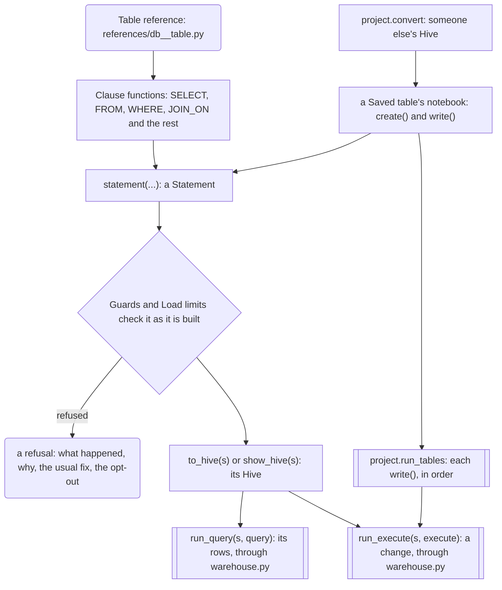
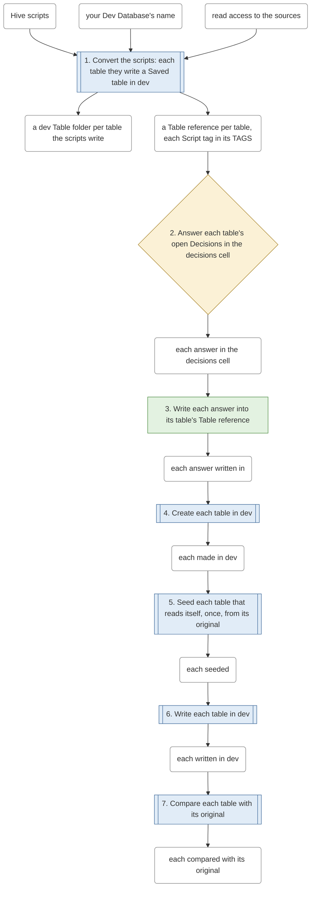
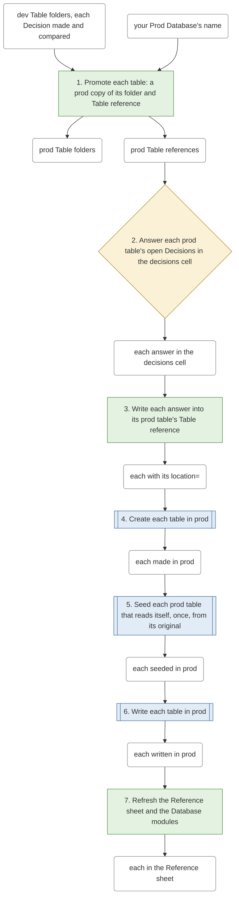
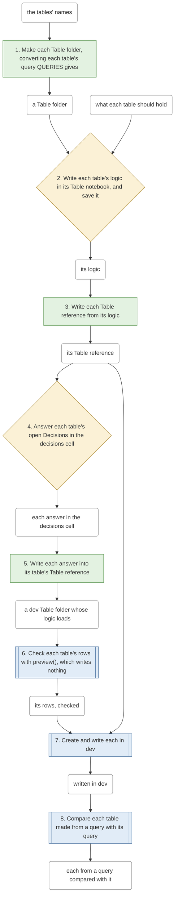
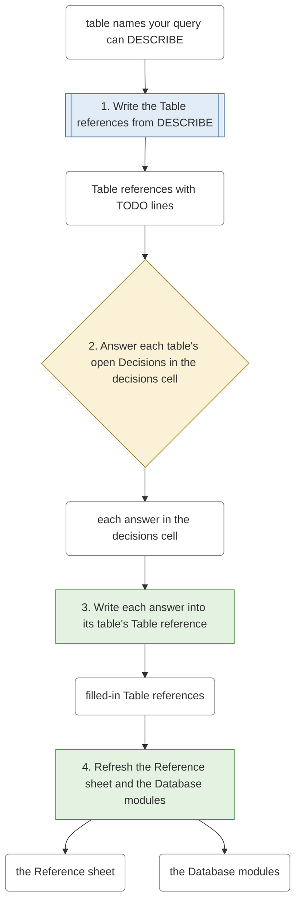
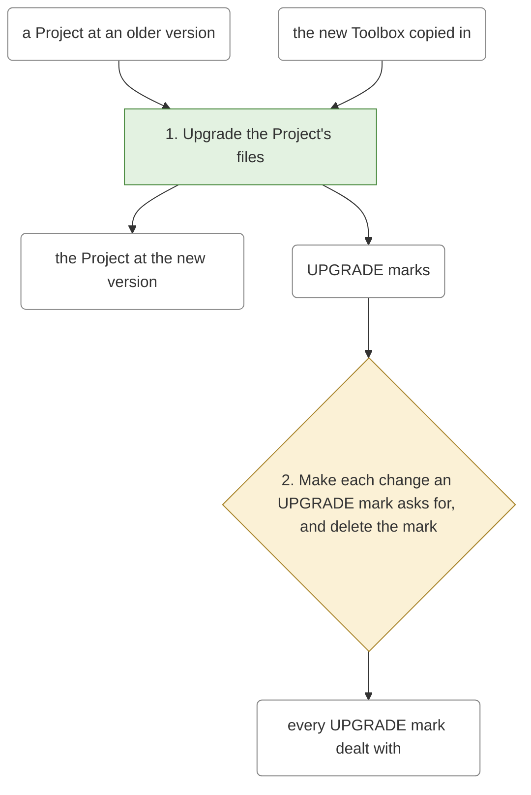
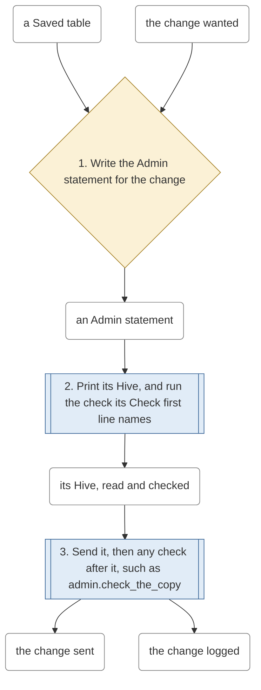
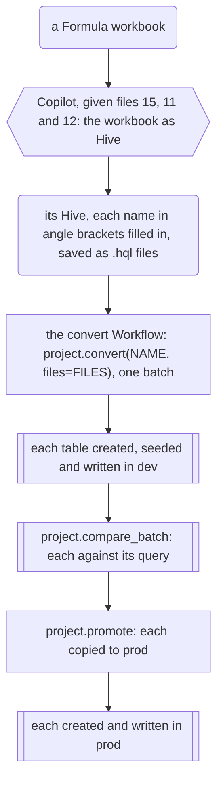

<!-- sqlglot Composer 8.6, exported 2026-11-10 07:18 - generated from dev, do not edit -->
# sqlglot Composer

This is version 8.6, exported 2026-11-10 07:18.

Write Hive SQL as Python. You put clause functions (`SELECT`, `FROM`, `WHERE`, ...) together in
SQL order, and the Toolbox writes the Hive string. **It refuses a Statement that would silently
give a wrong number, or read or return too much, and says what to change.**

### How to read this page

- Steps 1 to 9 are a tutorial in nine steps, one story through one Project: you start it, add
  your tables' Table references, build Statements on them, share Building blocks, save tables
  of your own, follow their Lineage, keep the Project in order, and convert someone else's Hive
  into your own code. Do them in order: each closes with what to check before the next.
- Each step is a short summary of the Getting started how-to of the same name, which walks
  through it in full on `sqlglot_composer/how_to.html`, a page in the download to open in your
  browser.
- Every example here runs on the Example database, so you can follow the page before you
  connect your own warehouse.
- The Starter Example project shows a Project much like the one the story leaves, filled in.
- The sections after step 9 are reference: the Workflows, Scheduled runs, the how-tos, the
  Example gallery, the Example projects, the Templates, Copilot, updating, the license and the
  cheat sheet.
- What changed in each version, and how to update from it, is in `CHANGES.md`.

### Terms

Each word below is the Toolbox's own; the steps define the rest where they first use them.

- **Toolbox**: the one folder, `sqlglot_composer`, whose Python functions write Hive. You copy
  it into each Project.
- **Warehouse**: where your tables are and your Hive runs at work. The Toolbox reaches it only
  through two functions of yours, `query` and `execute`, in `warehouse.py`.
- **Example database**: nine made-up tables that ship inside the Toolbox and stand in for your
  warehouse in every example.
- **Statement**: one query, built from clause functions, that the Toolbox checks and writes as
  one Hive string.
- **Project**: your folder at work holding the Toolbox and your own files in one fixed layout.
- **Project action**: a call of the `project` module, such as `project.start()`, that makes or
  changes a Project's files, never the warehouse, and is logged in the Admin log.
- **Workflow**: the steps of one job of a Project, from what you start with to its end goal: a
  notebook in `admin/workflows/`, read top to bottom. Fill in its names cell, run "Run up to
  your Decisions", answer in the decisions cell under it, then run "Run the rest".
  `project.check()` names its next step, while `project.do_next()` runs each step that only
  writes files, such as making a Table folder, and stops at the first that calls the warehouse
  or needs your decision. The Workflows section below draws each one.
- **Decision**: one thing about one table that only you decide, such as its Key: you answer
  it in a Workflow's decisions cell, and a step writes your answer in.
- **Dev Database** and **Prod Database**: the database where you create and write your own
  tables first, and the one others read your finished tables from.
- **Database settings**: what differs between the Dev and Prod Databases, one set for each,
  `DEV` and `PROD` in `admin/databases.py`: each Database's name and the folder its tables'
  files go under.

## 1. Start a Project

Goal: a Project folder laid out by the Toolbox, its warehouse.py connected.

The Toolbox needs Python 3.11 or newer, pandas, numpy and sqlglot, and is tested on Python 3.13,
which `requirements.txt`'s pins are for, as they are for 3.12. It is one folder,
`sqlglot_composer`. The Toolbox works with any sqlglot from 30.19.0 up to (not including) 31.

1. **Get the download.** Goal: the Toolbox on your computer. Action: download this branch as a
   zip and extract it. Done when the extracted folder holds `sqlglot_composer` and
   `requirements.txt`; then step 2.
2. **Install what the Toolbox needs.** Goal: its libraries, at the versions it is tested on.
   Action: change `requirements.txt` by the rules below, then run
   `pip install -r requirements.txt` in the download's top folder, or, from a notebook,
   `%pip install -r` followed by the path to that file. Done when pip finishes with no error;
   then step 3.
   - If you are on Python 3.11, change numpy's line in `requirements.txt` to `numpy==2.4.6`,
     which pandas 3.0.6 runs on there, before you run pip: numpy 2.5.4 can't install on 3.11.
   - If your notebook already has a package, such as pandas, delete its line, so pip keeps
     the one you have.
   - If your notebook's sqlglot is in the range above, delete sqlglot's line too. If it is
     not, keep the line, so pip installs the one the Toolbox is tested on.
     `import sqlglot; print(sqlglot.__version__)` in a notebook shows which you have.
3. **Make the Project's folder.** Goal: a folder holding the Toolbox. Action: make an empty
   folder for your Project, wherever you keep your work, such as `team_project` in your
   documents, and copy the whole `sqlglot_composer` folder into it. Any folder name will do,
   and the download's folder can stay where it is. Keep your own files beside the
   Toolbox, never inside it. Done when your folder holds `sqlglot_composer` alone; then step 4.
4. **Lay the folder out.** Goal: every folder and file a Project starts with. Action: open a
   notebook in the Project's folder, such as start.ipynb, and run `project.start()`, as below.
   Done when it prints "Started a Project in the folder you're working in"; then step 5.

```python
>>> from sqlglot_composer import project
>>> project.start()
Started a Project in the folder you're working in: admin/, references/, building_blocks/,
tables/, scheduled_runs/ and warehouse.py.
Next: at the top of each notebook, fill in connect(...) with your connection.
```

5. **Connect your warehouse.** Goal: the Toolbox's Hive reaching your tables. Action: each
   notebook runs on its own, so each gives `warehouse.py` your connection at its top, with
   `connect(...)`: each notebook the Project actions write that reaches the warehouse has the
   line `# connect(your_connection)` in its first code cells, for you to fill in, as below.
   This page connects to the Example database, `connect(example_database)`. Done when each
   notebook you run connects, or connects to the Example database while you follow this page;
   then go on to section 2, "Add your tables' references".

```python
import my_api  # your team's library
from warehouse import connect  # the setup cell imports it already

# Your connection: its query(sql) gives back a DataFrame, its execute(sql) runs a change.
connect(my_api.connect())
```

If your team keeps its connection in a file outside the Project, such as a file
team_connection.py, then write these lines in place of that line: they put that file's folder
on Python's path, then import it.

```python
sys.path.append("C:/work/connections")  # the folder team_connection.py is in
from team_connection import conn
connect(conn)
```

Until a notebook connects, `query` and `execute` refuse: "No connection: call connect(...)
first".

Two rules hold for every call on this page:

- Import every name from `sqlglot_composer`, at its top level, never from a file inside it.
- Each Project action, such as `project.start()`, returns its report, which a notebook shows
  under the cell. From a plain Python script, run `print(project.start())` to see it.

### Your query and execute

- The Toolbox never connects to anything itself: it writes Hive as text, and hands that text
  to one of two functions in `warehouse.py`, which pass it to the connection the notebook
  gave `connect(...)`.
- `query` runs Hive that gives back rows, such as a SELECT, and gives them back as a pandas
  DataFrame.
- `execute` runs Hive that changes something, such as a write, and gives back nothing.
- You pick which one sends a Statement, by calling `run_query(s, query)` or
  `run_execute(s, execute)`.

### Every file of a Project

You make three things by hand: the Project's folder, the copied `sqlglot_composer` folder and
the notebook you run `project.start()` from. A Project action makes every other file, so make
each with its call of the `project` module, not by hand in your file explorer: each is logged
in the Admin log, and the registry lists what it made, so `project.check()` can tell what is
missing or made by hand. Each line below names a path, what makes it, and what you fill in.

- **Made by you:**
  - your Project's folder, such as my_project: made by you, in your file explorer; you fill
    in nothing.
  - `sqlglot_composer/`: copied in by you from the download; you fill in nothing: never edit a
    file inside it.
  - `sqlglot_composer/version.txt`, the Toolbox's version and its list of files: from the
    download; you fill in nothing: the import checks the folder against it.
  - `start.ipynb`, or any name you like, the notebook you run `project.start()` from: made by
    you, in Jupyter; you fill in nothing: keep it for trying things out, or delete it.
- **At the Project's top:**
  - `warehouse.py`: made by `project.start()`; you fill in nothing: each notebook's line
    `connect(...)` takes your connection. Only if your connection names its two calls other
    than `query(sql)` and `execute(sql)` do you edit it: change the calls warehouse.py's
    `query` and `execute` make, and the names its `connect` checks for, to yours.
- **In admin/:**
  - `admin/`, a notebook for each job on the whole Project, such as check_project.ipynb,
    run_tables.ipynb, remove.ipynb and scheduled_runs.ipynb, whose cells you run by hand for
    your Scheduled runs: made by `project.start()`; you fill in the names some ask for in their
    names cell, such as the tables to remove.
  - admin/lineage/, the Project's lineage: every Saved table, what reads it and which
    Scheduled runs write it, an HTML page and its Markdown twin. Made by
    `project.export_project_lineage()`, run by hand from `admin/scheduled_runs.ipynb`; you fill
    in nothing.
  - `admin/workflows/`, a folder per Workflow, such as new_table/ and convert/, each holding
    its notebook: made by `project.start()`; you fill in what the Workflow works on, in its
    notebook's names cell, such as the tables, then save it. Then run its cells top to bottom,
    as The Workflows section says; `project.check()` names the next step.
  - `admin/databases.py`, the Database settings, `DEV` and `PROD`, a dict each, such as
    `DEV = {"database": "mart_dev", "location_root": "/data/team/dev"}`: made by
    `project.start()`; you fill in each one's `"database"`, the Database's name, and
    `"location_root"`, the folder its tables' files go under. A Saved table with no folder of
    its own is placed in `<location_root>/<database>.db/<table>`, DEV's for your dev tables and
    PROD's for their prod copies, so its folder is no Decision. Any other setting is yours,
    such as `"run_as"`: give it in both, each its own value, and
    `database_settings("mart_dev")` gives DEV's to your code. A setting in one and not the
    other is refused, naming it.
  - `admin/sent.csv`, a row for each change a notebook of the Project sends to the warehouse:
    made by `project.start()`, then each `run_execute` and `project.run_tables`; you fill in
    nothing.
  - `admin/admin_log.md`, the Admin log: made by `project.start()`, then each Project action
    adds an entry; you fill in nothing.
  - `admin/project_version.txt`, the Toolbox version that last wrote the Project: made by
    `project.start()`, then `project.upgrade()`; you fill in nothing.
  - `admin/workflows/convert/<name>/`, a Conversion folder per batch of someone else's Hive you
    convert: its `batch.md`, where each script is and what each statement became, a script
    read from a file read where it is, never copied, and Hive pasted as text kept in its
    scripts/. Made by
    `project.convert(...)`, from `admin/workflows/convert/convert.ipynb`, as
    [Convert someone else's Hive](../sqlglot_composer/how_to.html#convert_someone_elses_hive)
    shows; it makes each table the Hive writes a Saved table in your Dev Database. You fill in
    each table's Decisions, in the notebook's decisions cell.
  - an Upgrade's checklist in admin/, named for the version it upgraded to, such as
    upgrade_7.3.md: what it did and a box for each change it left you. Made by
    `project.upgrade()`; you make the changes it lists, each marked `# UPGRADE <version>:` at
    its line.
  - `admin/registry.csv`, the registry: made by `project.start()`, then each Project action
    that makes or archives a Table folder, a Table reference, a Building block, a Scheduled
    run or a Conversion folder adds a row; you fill in nothing.
  - `admin/templates/`, the Templates: made by `project.start()`; you fill in nothing, unless
    you want your team's own shape.
  - admin/removed/, what you archive: made by `project.remove_table(...)`,
    `project.remove_reference(...)`, `project.remove_block(...)`,
    `project.remove_scheduled_run(...)` and `project.remove_conversion(...)`, and by `project.upgrade()` and
    `project.convert(..., overwrite=True)`, which keep each file as it was before they change
    it; you fill in nothing.
- **In references/:**
  - `references/<db>__<table>.py`, a Table reference per table: made by
    `project.add_references([...], query=query)` for a table in the warehouse, or by
    `project.new_table(...)` for a Saved table of your own; you accept or change what it
    proposed, fill in any TODO line left, and add your own Aliases.
  - `references/<db>.py`, a Database module per Database, such as `references/ops.py`: made by
    each Project action that adds or archives a Table reference; you fill in nothing: never
    edit it.
  - `references/reference_sheet.csv`, the Reference sheet: made by
    `project.refresh_reference_sheet()`; you fill in nothing.
- **In building_blocks/:**
  - `building_blocks/<name>.py`, a Building block: made by `project.new_block("<name>")`; you
    fill in its `<...>` and TODO lines.
  - building_blocks/run_values.py, your Run values: made by `project.new_run_value(...)`,
    which writes one function in it at each call; you write any other kind by hand.
  - `building_blocks/prod/<name>.py`, the prod copy of each Building block a promoted table
    imports: made by `project.promote(...)`; you fill in nothing: change the dev block and
    promote again.
- **In tables/:**
  - `tables/<db>__<table>/<db>__<table>.ipynb`, a Table notebook per Saved table: made by
    `project.new_table("<db>.<table>")`; you fill in its `<...>` lines.
  - `tables/<db>__<table>/lineage/`, the table's Lineage: made by its notebook's lineage cell;
    you fill in nothing.
  - `tables/<db>__<table>/<db>__<table>.hql`, the Hive the table's logic sends, to read at a
    glance and to commit: written by its notebook's Hive cell, `export_hive()`, again each time
    it runs. It is generated, so never edit it: edit the notebook's logic, save the notebook,
    and run its `export_hive()` cell again.
- **In scheduled_runs/:**
  - scheduled_runs/, a folder per Scheduled run: made by `project.start()`; you fill in
    nothing.
  - `scheduled_runs/<name>/<name>.ipynb`, a Scheduled run, a notebook an outside scheduler
    runs top to bottom: made by `project.new_scheduled_run("<name>")`; you fill in its `<...>`
    lines: its parameters, its connection and the Statements it runs.
  - `scheduled_runs/<name>/<name>.hql`, the run's built Hive, in order, to read and to commit:
    made by `project.export_run_hive("<name>")`, run by hand from `admin/scheduled_runs.ipynb`;
    you fill in nothing: it is generated, and the run never reads it, so edit the run's
    notebook and export again.
  - `scheduled_runs/<name>/lineage/`, the run's Lineage: made by
    `project.export_run_lineage("<name>")`, run by hand from `admin/scheduled_runs.ipynb`; you
    fill in nothing.
- **Anywhere else:**
  - a `.hql` file of Hive you write or are given, such as `daily.hql`: your input, not
    generated. Saved by you, in `admin/workflows/convert/` for the convert Workflow's `FILES`
    (or anywhere, named by its path), or in `admin/workflows/new_table/` for the new_table
    Workflow's `QUERIES`; you write all of it: it is yours, and nothing writes over it.
  - `lineage/`, beside the notebook you run it from, the Lineage of a Statement exported outside
    a Table notebook: made by `export_lineage(...)`; you fill in nothing.

How-to: [Start a Project](../sqlglot_composer/how_to.html#start_a_project), with what to do when
your API gives rows without their column names, and the lines a notebook deeper in the Project
starts with.

Before you go on, check:

- `project.start()` printed "Started a Project", and the folder holds admin/, references/,
  building_blocks/, tables/, scheduled_runs/ and warehouse.py beside `sqlglot_composer`.
- each notebook you run gives `connect(...)` the connection you mean to use.

## 2. Add your tables' references

Goal: a Table reference for each table your Statements read.

A Statement reads a table through its **Table reference**: a small file in `references/` holding
the table's columns and their types, its **Partitions** (the columns it is stored by, such as a
day or a region) and its **Key** (the columns that name one row), where it has them. Each
**Database**, the first part of a table's name (`ops` in `ops.jobs`), has a **Database module**,
such as `references/ops.py`, that gives each of its tables at a dot. The references Workflow,
`admin/workflows/references/references.ipynb`, takes you through it.

1. **Name the tables.** Goal: the Workflow knows which tables to read. Action: name the tables
   in the references Workflow's names cell, and save the notebook. Done when the names cell
   lists each table you read; then step 2.
2. **Write their files.** Goal: a Table reference per table. Action: run "Run up to your
   Decisions", whose first step, `project.add_references`, asks each table for its columns,
   through your query, and writes its file, and the Database module of its Database, as
   below. It also proposes each table's Key from its id columns, such as `run_id`, and checks
   it with `check_key` on the latest Partitions, printing each result. Done when it names each
   file it wrote; then step 3.

```python
>>> from sqlglot_composer import example_database
>>> from warehouse import connect, query, execute
>>> connect(example_database)
>>> project.add_references(["ops.jobs", "ops.job_runs", "ops.run_alerts"], query=query)
Wrote references/ops__jobs.py, references/ops__job_runs.py and references/ops__run_alerts.py: fill in their TODO lines.
ops.jobs: its Key proposed, (job_id), checked with check_key:
  ops.jobs: the key (job_id) holds.
ops.job_runs: its Key proposed, (run_id), checked with check_key:
  ops.job_runs: the key (run_id) holds where job_runs.dt IN ('2026-09-23', '2026-09-24').
ops.run_alerts: its Key proposed, (alert_id), checked with check_key:
  ops.run_alerts: the key (alert_id) holds where run_alerts.dt IN ('2026-09-23', '2026-09-24').
To accept every proposed Key, write in the decisions cell: "all_tables": {"key": "proposed"}
Wrote references/ops.py: from references import ops gives ops.job_runs, ops.jobs and ops.run_alerts.
Restart the kernel of a notebook that imported references, to see a table added since.
```

   "Run up to your Decisions" then stops at the Decisions, and under the lines above prints a
   whole `DECISIONS` to paste into the decisions cell, which holds the `"all_tables"` line its
   report names:

```python
DECISIONS = {
    "all_tables": {  # answers for every table of this notebook; a table's own answer, under its name, overrides it
        "key": "proposed",  # accepts each table's proposed Key, marked # proposed in its Table reference, as if typed
    },
}
```

   A Key add_references proposes, from the table's rows, stays open, written
   `key=None,  # TODO: proposed ["run_id"], checked`, until you accept it in the decisions
   cell: a few Partitions are evidence, not a promise. "fill in their TODO lines" means that
   `key=` line, accepted in the next step, and, for a table it proposed no Key for, its first
   line too, what one row is, which no Key could propose. Every other line it proposed is
   marked `# proposed`, and blocks nothing.
3. **Accept each Key.** Goal: each table's Key, the one Decision it waits on. Action: paste
   the whole `DECISIONS` it printed over the `DECISIONS = {}` line of the decisions cell,
   under "Run up to your Decisions", change it by the rules below, save the notebook, and
   run "Run the rest", which writes each answer in. Done when no `key=None,  # TODO` line is
   left; then step 4.
   - If you agree with every proposed Key, keep it as printed:
     `DECISIONS = {"all_tables": {"key": "proposed"}}` writes each as if you typed it.
   - If a Key is another, give it under the table's name, which wins over "all_tables":
     `{"ops.job_runs": {"key": ["run_id", "dt"]}}`; `"key": None` says no columns name one row.
   - If it proposed none, as for a table with no id column, its line says why: give its Key
     the same way.
4. **Read what it proposed.** Goal: each file saying what you mean. Action: read each line
   marked `# proposed`: the first line, what one row is ("One row per run_id."), proposed from
   its Key, and `does_not_add_up=`, the columns the Toolbox refuses to add up, proposed from
   names such as `avg_*` and `*_ratio`. Keep each, taking off its `# proposed` comment, or
   change it. Below it, you may add **Aliases**, your own names for its columns and
   conditions. Done when you have read each; then step 5.
5. **Import the Database.** Goal: every table of the Database from one import. Action: run
   `from references import ops`; each column is at a dot after its table, as below. Done when
   `ops.job_runs.status` shows `job_runs.status`; then step 6.

```python
>>> from references import ops
>>> ops.job_runs.status  # -> Column
job_runs.status
```

6. **Check each file.** Goal: each file true to its table. Action: run
   `check_table_reference(ops.job_runs, query=query)`, which checks the file against its table,
   and, for a Key of your own, `check_key`, which checks it as step 2 checked each proposed
   one. If the table is partitioned, then give
   `check_key` one Partition to check with `where=`, such as `check_key(ops.job_runs,
   query=query, where=equals(ops.job_runs.dt, "2026-09-24"))`; `query("SHOW PARTITIONS
   ops.job_runs")` lists the Partitions it holds. `admin/check_references.ipynb` runs both
   checks on every table, each partitioned one on its latest Partition. Done when each check's
   `ok` is true; then go on to section 3, "Build and run a first statement".

How-to: [Add your tables' references](../sqlglot_composer/how_to.html#add_your_tables_references).

Before you go on, check:

- `references/` holds a file for each table you read, each Key answered, and a Database
  module for each Database.
- `from references import ops` gives each table at a dot, and each column at a dot after it.

## 3. Build and run a first statement

Goal: one Statement built, its Hive read, and its rows back in pandas.

A Statement is built along a chain of types, each made by a call on the one before:

- `ops.jobs`, a Table reference, gives a `Table`: a table, its columns, its Partitions and its
  Key.
- `ops.jobs.job_id` gives a `Column`: one of its columns.
- a test, such as `equals(...)`, gives a `Condition`: a test of each row, for WHERE or ON.
- `SELECT(...)`, `FROM(...)`, `WHERE(...)` and the others give a `Clause`: one part of a query.
- `statement(...)` gives a `Statement`: its Clauses, checked together as one query.
- `to_hive(...)` gives a `str`: the Hive, the query's text, ready to paste.
- `run_query(..., query)` gives a `DataFrame`: the rows your query gives back, in pandas.

The example finds the runs that failed on 2026-09-23 and 2026-09-24. ops.job_runs is
partitioned by dt, so a Statement on it must filter dt.

1. **Build the Statement.** Goal: the failed runs as one query. Action: give `statement(...)`
   its Clause functions in SQL order, `SELECT`, `FROM`, then `WHERE` with a test of status and
   of dt. Done when `statement(...)` gives back a Statement; then step 2.
2. **Read its Hive.** Goal: the query's text. Action: run `print(to_hive(failed))`. Done when
   it prints the SELECT below; then step 3.
3. **Run it.** Goal: its rows. Action: run `run_query(failed, query)`. Done when it gives back
   the two runs below; then step 4.

```python
>>> from sqlglot_composer import *
>>> job_runs = ops.job_runs  # -> Table
>>> failed = statement(  # -> Statement
...     SELECT(job_runs.run_id, job_runs.job_id, job_runs.dt),
...     FROM(job_runs),
...     WHERE(equals(job_runs.status, "FAILED"),
...           between(job_runs.dt, "2026-09-23", "2026-09-24")),
... )
>>> print(to_hive(failed))
SELECT
  job_runs.run_id,
  job_runs.job_id,
  job_runs.dt
FROM ops.job_runs AS job_runs
WHERE
  job_runs.status = 'FAILED' AND job_runs.dt BETWEEN '2026-09-23' AND '2026-09-24'
>>> run_query(failed, query)  # -> DataFrame
   run_id  job_id          dt
0      97       3  2026-09-23
1     102       2  2026-09-24
```

`show_hive(failed)` prints the same Hive with a `;` at the end, ready to paste into Hue,
Beeline or DBeaver.

4. **Run a Worked example.** Goal: any function's example in your own notebook. Action: find
   it, `help(to_hive)` shows the one for `to_hive`, then run the lines below first and paste
   the example after them. Done when the example shows the rows its docstring shows; then go
   on to section 4, "Count, join and stay safe".

```python
from sqlglot_composer import *
jobs, job_runs = example_database.jobs, example_database.job_runs
```

What the Worked examples hold:

- Every function and class in the cheat sheet has a Worked example in its docstring.
- The examples use every Toolbox name and the Example database's `jobs` and `job_runs`: its own
  Table references of `ops.jobs` and `ops.job_runs`, the same tables as your Project's
  `ops.jobs` and `ops.job_runs`, which ship inside the Toolbox so an example runs with no
  Project.
- The examples take today as 2026-09-25, the day after the Example database's last day.
- If a pasted example uses `last_n_days(...)`, which counts back from your own today, write
  `between(...)` with the days the example's Hive shows in its place, such as
  `between(job_runs.dt, "2026-09-23", "2026-09-24")`, to get the rows it shows.

How-to: [Build and run a first statement](../sqlglot_composer/how_to.html#build_and_run_a_first_statement),
with every Condition `WHERE` takes, `AS`, `all_columns` and `first_look`.

Before you go on, check:

- `print(to_hive(failed))` prints a WHERE that filters dt.
- `run_query(failed, query)` gives back runs 97 and 102.

## 4. Count, join and stay safe

Goal: numbers per group, other tables joined in, and each refusal read.

1. **Count per group.** Goal: each job's runs and failed runs. Action: give `GROUP_BY` the
   column to group by, which makes one row per group, and let `count_rows` and `sum_of` work
   out its numbers, as below. Done when it gives back one row per job; then step 2.

```python
>>> per_job = statement(  # -> Statement
...     SELECT(job_runs.job_id,
...            AS(count_rows(), "runs"),
...            AS(count_rows(where=equals(job_runs.status, "FAILED")), "failed_runs")),
...     FROM(job_runs),
...     WHERE(between(job_runs.dt, "2026-09-23", "2026-09-24")),
...     GROUP_BY(job_runs.job_id),
... )
>>> run_query(per_job, query)  # -> DataFrame
   job_id  runs  failed_runs
0       1     4            0
1       2     3            1
2       3     2            1
```

2. **Join another table.** Goal: its columns beside yours. Action: add `JOIN` or `LEFT_JOIN`,
   which brings in another table, matched on its Key. Done when the Statement builds; then
   step 3.
3. **Read each refusal.** Goal: a Statement that gives the right number. Action: as you build a
   Statement, the Toolbox checks it three ways, below; follow the message of any check that
   stops it. Done when the Statement builds, each Warning read; then go on to section 5,
   "Share Building blocks".

The three checks:

- A **Guard** refuses a Statement that would silently give a wrong number, such as a join that
  counts a row twice.
- A **Warning** lets one through but says why a number may come out wrong.
- A **Load limit** refuses one that would cost the cluster or your notebook too much, such as a
  read that filters none of a table's partition columns.

Each message says what happened, why it matters, the usual fix and the opt-out, a keyword for
when you truly mean it:

- If the usual fix gives what you want, make it.
- If you truly mean what it refused, pass its opt-out.

How-to: [Count, join and stay safe](../sqlglot_composer/how_to.html#count_join_and_stay_safe),
with `HAVING`, the top N, Derived tables, the rows with no match, and when each opt-out is
right.

Before you go on, check:

- `run_query(per_job, query)` gives one row per job, with runs and failed_runs.
- For each refusal you met, you can name its check, Guard or Load limit, and its usual fix.

## 5. Share Building blocks

Goal: a piece several Statements need, written once.

A **Derived table** is a Statement given a name with `derived`, which another Statement reads
like a table. Wrapped in a function, kept in a file of its own in `building_blocks/`, it is a
**Building block**, which every notebook of the Project imports.

1. **Make its file.** Goal: the Building block's file. Action: run `project.new_block`, which
   makes its file from the Project's `building_block` Template, as below. Done when it names the
   file it wrote; then step 2.

```python
>>> project.new_block("runs_per_job")
Wrote building_blocks/runs_per_job.py, from admin/templates/building_block.py:
fill in its <...> and TODO lines.
```

2. **Fill it in.** Goal: the piece's logic. Action: fill in its `<...>` and TODO lines. The
   Starter Example project's `building_blocks/runs_per_job.py` is this file filled in: each
   job's runs, failed runs and minutes, for the rows a Condition it is given picks. Done when
   no `<...>` or TODO line is left; then go on to section 6, "Save a table".

How-to: [Share Building blocks](../sqlglot_composer/how_to.html#share_building_blocks).

Before you go on, check:

- `building_blocks/runs_per_job.py` holds no `<...>` or TODO line.

## 6. Save a table

Goal: a table of yours written in dev, read by everyone after.

A **Saved table** is a table of yours that a Statement writes, so a number worked out once is
read by everyone after. Each has a **Table folder** in tables/, holding its **Table notebook**,
whose cells create, preview and write it. The new_table Workflow,
`admin/workflows/new_table/new_table.ipynb`, takes you from its name to the table written in
dev.

1. **Add what it reads.** Goal: a Table reference for each table the new table reads, from its
   query or from logic you write. Action: add them with the references Workflow,
   `admin/workflows/references/references.ipynb`, before you run the new_table Workflow. Done
   when each has its file in `references/`; then step 2.
2. **Name the table.** Goal: the Workflow knows what to make. Action: name the table in the
   new_table Workflow's names cell, by the rules below, and save the notebook. Done when the
   names cell holds it; then step 3.
   - If you have its query already, give it in the names cell's
     `QUERIES = {"alerts_per_severity": "alerts_per_severity.hql"}`, the table named in your Dev
     Database: its logic is written for you from the query, then compared with it.
   - If you have no query, you write its logic in step 4.
3. **Make its Table folder.** Goal: the table's notebook and a stand-in Table reference.
   Action: run its first step, `project.new_table`, which makes its Table folder, holding a
   Table notebook made from the `saved_table` Template, and a Table reference that stands in
   until a later step writes it, as below. Done when it names the folder it made; then step 4.

```python
>>> project.new_table("mart.alerts_per_severity")
Made tables/mart__alerts_per_severity/: mart__alerts_per_severity.ipynb and lineage/, from
admin/templates/saved_table.py.
Wrote references/mart__alerts_per_severity.py: project.reference_from_logic writes it.
```

4. **Write its logic.** Goal: what the table holds. Action: in the notebook's logic, set
   `READS`, the rows its write reads, and define `create()`, `rows()`, `preview()` and
   `write()`, each giving a Statement and running nothing. Save the notebook. Done when
   `preview()` gives the rows you expect; then step 5.
5. **Write its Table reference.** Goal: the stand-in replaced. Action: run the step
   `project.reference_from_logic`, which writes it from the logic you wrote: its columns and
   types from `preview()`, its partition columns from the logic's `PARTITIONED_BY`, its Key,
   and its location, placed under DEV's `"location_root"`. Done when its file in
   `references/` lists those columns; then step 6.
6. **Write it.** Goal: its rows in the warehouse. Action: run
   `project.run_tables(execute=execute)`, which writes every Saved table, each after the tables
   it reads, sending the Session setting below first. With no execute, it prints each write's
   Hive in order and sends nothing. Done when it has sent each write; then step 7.
7. **Write its Hive file.** Goal: the table's Hive to read at a glance. Action: run its
   notebook's Hive cell, `export_hive()`, which writes it into `<db>__<table>.hql` beside the
   notebook: `create()`, then `write()`, in the order they are sent. Done when the file is
   there; then go on to section 7, "Follow lineage".

How a write works:

- `write()` gives an `INSERT_OVERWRITE`, which replaces whatever the Partitions its rows fill
  held, or the whole table when it has none, so sending it twice leaves the same rows, not
  twice as many.
- A write that fills its Partitions from its rows needs the **Session setting**
  "dynamic_partitions", which `show_hive` prints ahead of it.
- The Python stays the table's definition, so the `.hql` file is generated, to read and to
  commit, never edited.

To change a table's Hive file:

1. **Edit the logic.** Action: edit the logic cell of the Table notebook, such as
   `tables/mart__alerts_per_severity/mart__alerts_per_severity.ipynb`. Done when it holds your
   change; then step 2.
2. **Save the notebook.** Action: save it, since `export_hive()` reads it as last saved. Done
   when it is saved; then step 3.
3. **Write the file again.** Action: run its `export_hive()` cell, which writes
   `mart__alerts_per_severity.hql` again. Done when the file shows your change.

Which `.hql` file is which:

- If `export_hive()` wrote it, it is in the Table folder, generated: read it and commit it.
- If you wrote it yourself or were given it, such as `alerts_per_severity.hql` above, it is
  yours: save it in `admin/workflows/new_table/` for the new_table Workflow's `QUERIES`, or in
  `admin/workflows/convert/` for the convert Workflow's `FILES`, never in a Table folder.

How-to: [Save a table](../sqlglot_composer/how_to.html#save_a_table), with the Starter Example
project's `mart.alerts_per_severity` notebook filled in beside its Table reference.

Before you go on, check:

- `tables/mart__alerts_per_severity/` holds its notebook, `lineage/` and, once its Hive cell has
  run, its `.hql` file.
- Its Table reference lists the columns `preview()` gives.

## 7. Follow lineage

Goal: each output column followed back to the table columns it reads.

1. **Export the Lineage.** Goal: the Lineage of a Statement: an HTML page and a Markdown twin
   that follow each output column back to the table columns it reads, and list every condition
   that decides which rows count. Action: run `export_lineage(...)`; from a Table notebook, run
   its lineage cell, which writes them into its Table folder's `lineage/`, named by the time
   and the table, so each export joins the table's history. Done when the new pages are in
   `lineage/`; then step 2.
2. **Follow it past what it reads.** Goal: Lineage that goes back to where the rows start.
   Action: by the rules below. Done when the HTML page traces each output column to a table
   column; then go on to section 8, "Keep the Project in order".
   - If the table reads another Saved table, pass that table's write too, from
     `project.load("mart.daily_job_runs").write()`, so its Lineage goes on back to the tables
     they start from.
   - If a change is made in pandas, declare it with `python_step`, a **Python step**, so the
     Lineage doesn't stop at it.

How-to: [Follow lineage](../sqlglot_composer/how_to.html#follow_lineage).

Before you go on, check:

- The table's `lineage/` holds the HTML page and its Markdown twin from your last export.

## 8. Keep the Project in order

Goal: every file the registry lists is there, and every file there is registered.

1. **Check the Project.** Goal: what is missing or made by hand. Action: run `project.check()`,
   which compares the registry with the Project's files, and changes nothing. Done when its
   first line is the one below; then step 2.
   - If it names a file made by hand, run the `project.register(...)` call it gives, which
     adopts it.
   - It also names any file deleted by hand.
   - It also lists each line still marked `# proposed`, which blocks nothing, as below, where
     section 2's proposals are left as add_references wrote them: keep each by taking off its
     comment, or change it, and it goes from the list.

```python
>>> project.check()
Every Table folder, Table reference, Building block and Scheduled run is registered, and each one registered is there.
Proposed by the Toolbox, which blocks nothing: each line marked # proposed is used as it is. Accept a proposed Key in its Workflow's decisions cell, with "key": "proposed" under its table's name or under "all_tables"; accept any other line by taking off its # proposed comment, or change it.
  references/ops__job_runs.py, line 1: """ops.job_runs - One row per run_id."""  # proposed from its Key
  references/ops__job_runs.py, line 16: does_not_add_up=["avg_retry_secs"],  # proposed from its columns' names
  references/ops__jobs.py, line 1: """ops.jobs - One row per job_id."""  # proposed from its Key
  references/ops__jobs.py, line 13: does_not_add_up=[],  # proposed: no name says average, ratio, percent or rate
  references/ops__run_alerts.py, line 1: """ops.run_alerts - One row per alert_id."""  # proposed from its Key
  references/ops__run_alerts.py, line 14: does_not_add_up=[],  # proposed: no name says average, ratio, percent or rate
```

2. **Refresh the Reference sheet.** Goal: every column of every table in one CSV file, the
   Reference sheet. Action: run `project.refresh_reference_sheet()`. Done when
   references/reference_sheet.csv lists them; then step 3.
3. **Check the Table references.** Goal: each Table reference true to its table. Action: run
   `admin/check_references.ipynb`, which checks each against its table. Done when it finds
   nothing wrong; then step 4.
4. **Archive what you no longer need.** Action: run `project.remove_table(...)`,
   `project.remove_reference(...)` or `project.remove_block(...)`, which archive it in
   admin/removed/, deleting nothing. Done when `project.check()` prints its first line again;
   then go on to section 9, "Convert someone else's Hive".

How a Project stays in order:

- Your files sit in three **Levels**, each importing only from the Toolbox and the Levels below
  it: the Table references and `warehouse.py`, then the Building blocks, then each Table
  notebook's logic.
- `project.check()` also names the next step of each Workflow you have started, and
  `project.do_next()` runs the steps it can for you, up to the first it can't.

How-to: [Keep the Project in order](../sqlglot_composer/how_to.html#keep_the_project_in_order).

Before you go on, check:

- `project.check()` prints that every Table folder, Table reference, Building block and
  Scheduled run is registered.

## 9. Convert someone else's Hive

Goal: Hive someone else wrote, one query or a folder of scripts, as your own code, each table
it writes a Saved table in dev, then in prod.

The convert Workflow, `admin/workflows/convert/convert.ipynb`, makes a **Conversion** of a
**batch**, one or more scripts converted together. The scripts' order doesn't matter: a FROM
with several INSERTs and an INSERT that reads its own table each come out as Saved tables, and
a temporary table another statement reads, a **staging table**, is folded into the tables that
read it. A **Script tag**, a `<PARM="NAME"/>` the program that ran the scripts filled in before
Hive read it, such as `WHERE dt <= <PARM="PERIOD_END"/>`, is converted as a value standing
there, and left for you to answer, once for each table it ends up in, since it may stand for a different
value in each.

1. **Save the scripts.** Goal: the Workflow can read them. Action: save them beside it, in
   `admin/workflows/convert/`. Each is read where it is, never copied, and `batch.md` names
   where. Done when each script is there; then step 2.
   - If `FILES` is left `[]`, the Workflow reads every `.hql` file beside the notebook, in
     name order, and its report names each.
   - If a script is somewhere else, name it in `FILES` by its path, such as
     `FILES = ["C:/work/daily.hql"]`, and leave it where it is.
2. **Name the batch.** Goal: the Workflow knows what to convert, and what each table it makes
   is called. Action: name the batch in its names cell, `NAME`, and its scripts in `FILES`, or
   leave `FILES = []`; fill in DEV's `"database"` and `"location_root"` in
   `admin/databases.py`, so each table is placed in a folder of its own under that root; and
   save the notebook. Each table the batch makes in dev is named by the rules below; you may
   give one a name of your own in the names cell's `RENAME`. Done when both are filled in
   and saved: the names cell's `NAME` (and `FILES`, unless left `[]`), and DEV's
   `"database"` and `"location_root"` in `admin/databases.py`; then step 3.
   - If a script writes a table, such as `INSERT OVERWRITE TABLE mart.team_fails`, its copy in
     dev is named for that table, then the original's database: `mart_dev.team_fails_mart`,
     so two databases' tables of one name stay apart in your Dev Database. If you want
     the copy to keep the original's name, give it in `RENAME`, the name alone, without a
     database: `RENAME = {"mart.team_fails": "team_fails"}` makes `mart_dev.team_fails`.
   - If the batch is one file holding a query alone, one that writes no table, its table is
     named for the batch, whatever the file is called: `NAME = "failed_runs"` with
     `FILES = ["from_your_team.hql"]` makes `mart_dev.failed_runs`.
   - If the batch is several files, each holding a query alone is named for its file:
     `sales.hql` makes `mart_dev.sales`.
   - If the scripts are simple and unrelated, set `EACH_SCRIPT_ITS_OWN_BATCH = True`: each
     file is a batch of its own, named for its file, `daily` for `daily.hql`, and `NAME` is
     unused. The run cells run each batch in turn, and one decisions cell answers them all.
     Two scripts where one reads a table the other writes are refused, named: convert them as
     one batch.
3. **Run up to your Decisions.** Goal: a Saved table for each table the scripts write. Action:
   run the cell "Run up to your Decisions". Its first step, below, makes each table the
   scripts write a Saved table in your Dev Database, with its Table folder, its Table
   reference and a checklist; it stops at the Decisions, printing a whole `DECISIONS = {...}`
   to paste, each answer not given yet shown as `"<FILL IN>"`. Done when it names each table
   it made; then step 4.

```python
project.convert("ops_reports", files=["daily.hql", "weekly.hql"], query=query)
```

4. **Answer each Decision.** Goal: what only you can decide. Action: paste the `DECISIONS`
   it printed into the decisions cell, directly under it, fill in each `"<FILL IN>"`, such as
   each Script tag's value, and save the notebook. Done when each table's Decisions are
   answered; then step 5. Each answer, by the rules below:
   - If a tag stands alone, bare, answer it with the value's own quotes,
     `{"tags": {"PERIOD_END": "'2026-10-31'"}}`; if it stands inside quotes,
     `'<PARM="STATUS"/>'`, with none, `{"tags": {"STATUS": "failed"}}`.
   - If a tag stands for a day that changes each run, answer it with a **Run value**, the
     value a function of yours gives each time the table is written. For the latest day a
     table holds, write at the top of the decisions cell
     `project.new_run_value("period_end", latest_partition="ops.job_runs.dt")`, then, under
     it, this import line, which the call also prints:
     `from building_blocks.run_values import period_end`; and run the cell once: it writes the function into building_blocks/run_values.py and registers the
     file. Run again as it is, it changes nothing. Then give the function's name, with no
     brackets: `{"tags": {"PERIOD_END": period_end}}`. The Hive sent holds the day itself, a
     date as `'2026-10-31'`; `show_hive`, in the Table notebook's "Try it" cell, shows it
     first.
   - If a Run value is of any other kind, write its function in
     building_blocks/run_values.py by hand, then register the file once:
     `project.check()` names it as made by hand, with the call to run in the
     `project.register(...)` cell of `admin/check_project.ipynb`.
   - If several tables share an answer, give it once under `"all_tables"`, and a table's own
     answer overwrites it: `{"all_tables": {"key": "proposed", "tags": {"PERIOD_END":
     period_end}}}` accepts each table's proposed Key, as if typed, and gives each table
     holding PERIOD_END that function. A guessed type is each table's own.
   - If a table's Key was proposed by convert, worked out of its query, such as its GROUP
     BY, it is written in its Table reference marked `# proposed`, and kept even if you
     leave it unanswered: `"key": "proposed"` only takes off the mark, and a `"key"` of your
     own replaces it. This differs from the references Workflow, whose Key, proposed from the
     table's rows, stays open until you accept it. A table with no Key proposed, such as one
     that reads itself, waits on its `"key"`: give its columns, or `None`.
   - If a location is a Decision, DEV's `"location_root"` is not filled in yet: fill it in,
     or answer `"location"` for that table.
   - If a table reads itself, its seed copies every Partition of its original unless you
     limit it, by partition column: `{"seed": {"dt": {"from": "2026-01-01"}}}` copies those
     from 2026-01-01 on; a list, `{"region": ["US", "CA"]}`, those values alone. A single
     value, `{"dt": "2026-01-01"}`, means **that value or later**.
   - If an answer was wrong, answer it again and run "Run the rest" again: it writes the
     answers in, writes each table, and compares each. Each table is made and seeded already,
     so those steps stay done.
5. **Run the rest.** Goal: each table written in dev and compared. Action: run the cell "Run
   the rest", under the decisions cell: it writes your answers in, creates each table in dev,
   seeds each whose write reads its own table (copy its **original**'s rows in once, the
   original being the table the script writes, so its first write doesn't start from
   nothing, each Partition or those its `"seed"` answer names), writes each, and compares each
   with the table it copies, `project.compare_batch`. A partitioned table is compared on the
   latest Partition both tables hold. If you want another Partition compared too, once your
   dev table holds it, then list it in `PARTITIONS` in the names cell, such as
   `PARTITIONS = [{"dt": "2026-09-23"}]`, and run "Run the rest" again, a finished batch too:
   its `conversion/compare.md` keeps each Partition's result. Done when every result of each
   table has passed; then step 6.
6. **Promote them.** Goal: the tables in your Prod Database. Action: fill in PROD's
   `"database"` and `"location_root"` in `admin/databases.py`, then run the promote
   Workflow's cells top to bottom with `TABLES = []` left empty, which promotes every
   finished table not promoted yet, or changed in dev since, naming each and why. The
   names cell's `[]` is read by the run cells, `project.run_workflow`, which work out those
   tables; `project.promote`, the call in step 1's own cell under Step by step, takes the
   tables by name, and refuses `project.promote([])`, naming the run cells. It carries each
   to your Prod Database, keeping its name unless `rename=` gives it another. Done when each
   is written in prod. What it carries, by the rules below:
   - If a prod copy was promoted before, it keeps that location; if not, it is placed under
     PROD's `"location_root"`; if that is not filled in, its location is a Decision, in the
     DECISIONS it prints.
   - If the table imports a Building block, a Run value among them, promote copies the block
     into building_blocks/prod/ and the prod table imports that copy: dev's blocks change
     freely, and prod's only when promoted again. `project.check()` names a prod copy edited
     by hand.

Dev stays the source: to change a promoted table, change it in dev and promote it again.

How-to: [Convert someone else's Hive](../sqlglot_composer/how_to.html#convert_someone_elses_hive).

Before you go on, check:

- Each table of the batch passed `project.compare_batch` before you promoted it.
- Each change you make to a promoted table is made in dev.

## The Workflows

Each job a Project goes through has a Workflow: a notebook in `admin/workflows/`, whose steps
take you from what you start with to the end goal. What only you can decide of a table, a
Decision such as its Key, you answer in its decisions cell,
`DECISIONS = {"mart_dev.weekly": {"key": ["job_id"]}}`, and a step writes each answer in for
you.

**Run a Workflow notebook's cells one at a time, never all at once (Run All), since a step after
a decision would write before you make it.**

The convert, promote, new_table and references notebooks read top to bottom, in four cells:

1. **Name what it works on.** Action: fill in the names cell, the first, and save the
   notebook. Done when it is saved; then step 2.
2. **Run up to your Decisions.** Action: run the cell under it, "Run up to your Decisions",
   `project.run_workflow(...)`: it runs every step, the calls to the warehouse too, up to the
   first only you can do, and prints the `DECISIONS` to paste, each answer not given yet
   shown as `"<FILL IN>"`. With nothing waiting on you, as when convert proposes every Key
   and places every location, it runs to the end, writing and comparing each table: give it
   `dry_run=True` first to see what it would send. Done when it says where it stopped; then
   step 3.
3. **Make the decisions.** Action: paste what it printed into the decisions cell, directly
   under it, fill in each `"<FILL IN>"`, and save the notebook. Done when it is saved; then
   step 4.
4. **Run the rest.** Action: run the cell under the decisions cell, "Run the rest", which goes
   on from where it stopped. Done when it says every step is done. It is the same call as
   step 2's, `project.run_workflow(...)`, run once before you answer and once after, and each
   run stops at the first step only you can do. So "Run the rest" can stop again, by the
   rules below:
   - If an answer was wrong, or a Decision is left open, it names it: mend it in the
     decisions cell, save, and run "Run the rest" again. You never go back up the notebook.
   - If a step is refused, or a compare fails, it names why: mend what it names, then run
     "Run the rest" again.

How the rest of a notebook runs, by the rules below:

- If you want to run one step on purpose, or run it again, run its own cell, under
  "Step by step", below the four cells; a decision step's `project.check()` cell, under it,
  prints what to paste.
- If the Workflow is upgrade or change_a_saved_table, run each step's cell in turn, making
  each decision where its step says, such as the step's own cell for change_a_saved_table's
  change; the notebook's last cell, `project.run_workflow(...)`, runs every step left.
- If you want to see what it would send first, give `run_workflow` `dry_run=True`: it sends
  nothing through your execute and says the Hive each step would send.

`project.check()` names each Workflow's next step, and `project.do_next()` runs only the steps
that write files. Each chart below is drawn from the steps its notebook runs, beside the same
steps as a list. In each chart:

- a plain box is a step that changes only files, or only prints;
- a box with double edges is a call to the warehouse, yours to run;
- a diamond is a decision, yours to make;
- a box with round corners is something a step needs or makes.

### How the Toolbox runs

The path every Statement takes, from a Table reference to the warehouse:

<!-- chart: program_flow -->


1. A Table reference describes a table you read or write.

       references/db__table.py

2. Clause functions build a Statement, in the order SQL writes them.

       statement(SELECT(...), FROM(...), WHERE(...))

3. Guards and Load limits check it as it is built; a refusal says what happened, why, the usual
   fix and the opt-out.
4. to_hive or show_hive gives its Hive.

       show_hive(s)

5. run_query sends a read through your query, run_execute a change through your execute, both in
   warehouse.py.

       run_query(s, query)
       run_execute(s, execute)

6. A Saved table's notebook builds its create() and write() the same way; project.convert writes
   one from someone else's Hive, and project.run_tables runs each write() in order.

       project.run_tables(execute=execute)

<!-- /chart -->

### convert

<!-- chart: convert -->


1. Convert the scripts: each table they write a Saved table in dev (it is a call to the
   warehouse, yours to run).

       project.convert(NAME, HIVE, files=FILES, query=query, database=DATABASE,
                       rename=RENAME, staging=STAGING)

2. Answer each table's open Decisions in the decisions cell (it is a decision, yours to make).
3. Write each answer into its table's Table reference (it changes only files, so
   project.do_next() runs it for you).

       project.write_decisions(DECISIONS, tables=project.batch_tables(NAME))

4. Create each table in dev (it is a call to the warehouse, yours to run).

       for table in project.batch_tables(NAME):
           run_execute(project.load(table).create(), execute)

5. Seed each table that reads itself, once, from its original (it is a call to the warehouse,
   yours to run).

       to_seed = project.batch_tables(NAME, seeded=True)
       if not to_seed:
           print("Seeded nothing: no table of the batch reads itself.")
       else:
           run_execute(hive_settings("dynamic_partitions"), execute)
           for table in to_seed:
               run_execute(project.load(table).seed(), execute)

6. Write each table in dev (it is a call to the warehouse, yours to run).

       project.run_tables(tables=project.batch_tables(NAME), execute=execute)

7. Compare each table with its original (it is a call to the warehouse, yours to run).

       project.compare_batch(NAME, query=query, partitions=PARTITIONS)

<!-- /chart -->

### promote

<!-- chart: promote -->


1. Promote each table: a prod copy of its folder and Table reference (it changes only files, so
   project.do_next() runs it for you).

       project.promote(TABLES)

2. Answer each prod table's open Decisions in the decisions cell (it is a decision, yours to
   make).
3. Write each answer into its prod table's Table reference (it changes only files, so
   project.do_next() runs it for you).

       project.write_decisions(DECISIONS, tables=project.promoted_tables(TABLES))

4. Create each table in prod (it is a call to the warehouse, yours to run).

       for table in project.promoted_tables(TABLES):
           run_execute(project.load(table).create(), execute)

5. Seed each prod table that reads itself, once, from its original (it is a call to the
   warehouse, yours to run).

       to_seed = project.promoted_tables(TABLES, seeded=True)
       if not to_seed:
           print("Seeded nothing: no prod copy reads itself.")
       else:
           run_execute(hive_settings("dynamic_partitions"), execute)
           for table in to_seed:
               run_execute(project.load(table).seed(), execute)

6. Write each table in prod (it is a call to the warehouse, yours to run).

       project.run_tables(tables=project.promoted_tables(TABLES), execute=execute)

7. Refresh the Reference sheet and the Database modules (it changes only files, so
   project.do_next() runs it for you).

       project.refresh_reference_sheet(project.promoted_tables(TABLES))

<!-- /chart -->

### new_table

<!-- chart: new_table -->


1. Make each Table folder, converting each table's query QUERIES gives (it changes only files,
   so project.do_next() runs it for you).

       project.new_table(TABLES, queries=QUERIES)

2. Write each table's logic in its Table notebook, and save it (it is a decision, yours to
   make).

       for table in TABLES:
           project.load(table).preview()  # says what stops it, if anything does

3. Write each Table reference from its logic (it changes only files, so project.do_next() runs
   it for you).

       project.reference_from_logic(TABLES)

4. Answer each table's open Decisions in the decisions cell (it is a decision, yours to make).
5. Write each answer into its table's Table reference (it changes only files, so
   project.do_next() runs it for you).

       project.write_decisions(DECISIONS, tables=TABLES)

6. Check each table's rows with preview(), which writes nothing (it is a call to the warehouse,
   yours to run).

       for table in TABLES:
           print(run_query(project.load(table).preview(), query))

7. Create and write each in dev (it is a call to the warehouse, yours to run).

       for table in TABLES:
           run_execute(project.load(table).create(), execute)
       project.run_tables(tables=TABLES, execute=execute)

8. Compare each table made from a query with its query (it is a call to the warehouse, yours to
   run).

       for name in QUERIES:
           print(project.compare_batch(name, query=query))

<!-- /chart -->

### references

<!-- chart: references -->


1. Write the Table references from DESCRIBE (it is a call to the warehouse, yours to run).

       project.add_references(TABLES, query=query)

2. Answer each table's open Decisions in the decisions cell (it is a decision, yours to make).
3. Write each answer into its table's Table reference (it changes only files, so
   project.do_next() runs it for you).

       project.write_decisions(DECISIONS, tables=TABLES)

4. Refresh the Reference sheet and the Database modules (it changes only files, so
   project.do_next() runs it for you).

       project.refresh_reference_sheet(TABLES)

<!-- /chart -->

### upgrade

<!-- chart: upgrade -->


1. Upgrade the Project's files (it changes only files, or only prints: run its cell).

       project.upgrade()

2. Make each change an UPGRADE mark asks for, and delete the mark (it is a decision, yours to
   make).
<!-- /chart -->

### change_a_saved_table

<!-- chart: change_a_saved_table -->


1. Write the Admin statement for the change (it is a decision, yours to make).

       from sqlglot_composer import between, equals  # where= takes a Condition
       table = project.table_reference(TABLE)
       # such as where=equals(table.dt, "2026-09-24"), or a range of days,
       # where=between(table.dt, "2026-09-01", "2026-09-30"), dt its partition column
       change = admin.drop_partitions(table, where=...)  # or another: help(admin)

2. Print its Hive, and run the check its Check first line names (it is a call to the warehouse,
   yours to run).

       show_hive(change)
       print(query("SHOW PARTITIONS " + TABLE))

3. Send it, then any check after it, such as admin.check_the_copy (it is a call to the
   warehouse, yours to run).

       run_execute(change, execute)

<!-- /chart -->

## Scheduled runs

A **Scheduled run** is a notebook in `scheduled_runs/<name>/` that an outside scheduler, such
as papermill or your team's, runs top to bottom: one notebook that writes the tables it needs,
in order, and reads back what you asked for, without running the whole Project. Building and
running are separate cells: the Build cell prints the Hive and sends nothing, and the Run cell
sends it. It has no dev or prod of its own: it writes the tables it names, in whichever
Database they are.

Its cells, top to bottom:

1. `# parameters`, tagged `parameters`, papermill's tag: each **Parameter**, a value the
   scheduler passes in, as a name, its type hint and its default, such as
   `RUN_DATE: datetime.date | None = None`, and `START_FROM: str = ""`, which every run keeps.
2. Setup: the Project on Python's path, the Toolbox, and your connection in its
   `connect(...)` line.
3. `# scheduled`: `def statements():`, which gives the Statements the run is for, each by its
   name. A SELECT's rows come back by that name.
4. Build: `built = project.build_run(statements, run_values={}, leave_out=[])`.
5. Run: `results = built.run(query, execute)`.

To make one:

1. **Make the notebook.** Goal: the run's notebook, registered. Action: in
   `admin/scheduled_runs.ipynb`, name it in `NEW_RUNS = ["weekly"]` and run that cell, which
   calls `project.new_scheduled_run(NEW_RUNS)`: it makes `scheduled_runs/weekly/weekly.ipynb`
   from the `scheduled_run` Template. Done when the notebook is there; then step 2.
2. **Find what to call.** Goal: the Table notebooks' functions the run uses. Action: in the
   same notebook, name the tables in `TABLES = ["mart.team_days"]` and run the cell of
   `project.describe_logic(TABLES)`: it
   lists each function of that table's logic cell, with what it takes and the first sentence
   of its docstring, and runs nothing. Paste what it prints into a Copilot chat, after Copilot
   file 18, to have Copilot fill in the run. Done when you know each function the run calls; then step 3.
3. **Name the parameters.** Goal: each value the scheduler passes in. Action: write each in the
   `# parameters` cell, with its type hint, by the rules below. Done when each has a hint;
   then step 4.
   - A scheduler passes text, so the Build cell reads each value by its hint first, before
     anything is built: `datetime.date` from `2026-11-01`, `int`, `float`, `bool` from `true`
     or `false`, and `str`, each alone, in `list[...]`, its items split at commas, or with
     `| None`, such as `list[datetime.date]` for `2026-11-01,2026-11-08`.
   - A value that can't be read, a parameter with no hint, a hint outside those, and a value
     left empty whose hint has no `| None` are refused, naming the parameter, its hint and the
     value. `""` is a value of a `str`.
   - A cell of your own beside it, such as one that sets a user ID, is yours: it isn't read.
4. **Connect.** Goal: the account this run runs as. Action: fill in the setup cell's
   `connect(...)` line, as in every notebook. Done when the setup cell runs; then step 5.
5. **Name the Statements.** Goal: what the run is for. Action: write each in the dict
   `statements()` gives, by the rules below. Done when each is named; then step 6.
   - If it is a Table notebook's logic, load it, giving the function what its signature
     takes, such as two parameters:
     `project.load("mart.team_days").week_totals(FIRST_DAY, LAST_DAY)`. A `datetime.date`
     parameter given where the signature says `str` is written `str(FIRST_DAY)`.
   - If it is a Statement of your own, compose it there, with `statement(...)`. A Guard it
     trips only warns there, as below.
   - If a value is worked out each time the run is built, such as the latest Partition a
     table holds, write a function for it in the cell, import `run_value` from
     `sqlglot_composer`, and pass `run_value(function)`, a Run value of the run's own.
   - A parameter reaches only what `statements()` passes it to. Each value goes in one of
     three ways: as an argument to a logic function you call, as above; through a Run value
     of the run's own, `run_value(function)`, whose function reads the parameters; or, for a
     Run value inside a logic function you don't call yourself, such as one a `write()` uses,
     by `run_values=` in the Build cell, as step 6 says.
6. **Build.** Goal: the Hive, in order, to read before anything is sent. Action: run the cells
   down to the Build cell, by the rules below. Done when it prints each Statement's Hive in
   order; then step 7.
   - It prints each parameter as used first, so the scheduler's saved output shows what the
     run was given, then each Statement under a heading, such as
     `-- 3 of 7: mart.team_days (read by week_totals)`, and its Hive. It sends nothing.
   - It adds the write of each table of the Project that the Statements read, all the way up,
     each as its Table notebook's `write()` writes it, on the days its own logic gives it,
     before what reads it; a table outside the Project is only read. So a run asking for one
     SELECT may write the tables it reads first: that is what keeps them up to date. If a
     table it would write is written elsewhere, such as by another run, name it in
     `leave_out=["mart.job_day_facts"]`, which leaves out its write, and the write of each
     table the build added only because mart.job_day_facts reads it.
   - `run_values={"period_end": RUN_DATE}` gives RUN_DATE, for this run, to every Run value
     whose function is named `period_end`, in place of calling it, wherever it is used: in
     a write the build adds, too, whose `write()` takes no arguments to give it a day. This
     is how a parameter reaches a write you don't call yourself. The build names each it gave.
   - It builds the Hive fresh each time, so each Run value is worked out as it builds: one
     that reads the warehouse needs `connect(...)` first.
   - A loop among the tables, each waiting on another, is refused, naming its tables.
7. **Run.** Goal: the Statements sent and the SELECTs' rows back. Action: run the Run cell, or
   have the scheduler run the notebook. Done when it ends with no error: `results["week_totals"]`
   is that SELECT's rows, for the cells of your own after it.
   - Each write, Admin statement and Unchecked statement goes through `run_execute` and your
     execute, and each SELECT through `run_query` and your query, in the build's order.
   - The first that fails stops the rest and raises its error, so the scheduler sees the
     notebook fail, once it has printed the tables written before it and the line to run again
     from, such as `START_FROM = "mart.team_days"`, or, for a SELECT that failed, its name.
     Pass that `START_FROM` to the next run, and the build passes over each Statement before
     it. A plain run again, `START_FROM` left `""`, is safe too when each write is an
     `INSERT_OVERWRITE`, printed by the build as `INSERT OVERWRITE TABLE`, which replaces the
     Partitions it fills, or the whole table when it has none. A write made with
     `INSERT_INTO`, printed as `INSERT INTO TABLE`, adds its rows each time it is sent, so a
     run holding one runs again only with the `START_FROM` it printed.
   - Nothing is written as a run runs: no lineage and no record. The scheduler's saved output
     is the run's record.
8. **Schedule it.** Goal: the scheduler runs the notebook. Action: have your scheduler run the
   notebook top to bottom, from its own folder, each parameter passed as text: with papermill,
   from scheduled_runs/weekly/, a command such as
   `papermill weekly.ipynb runs/weekly_2026-11-01.ipynb -p RUN_DATE 2026-11-01`, which saves
   a copy of the notebook with each cell's output. Done when the scheduler runs it with the
   parameters it needs.

Guards only warn in the run's own cell. While the build calls `statements()`, a Guard tripped
by a Statement the `# scheduled` cell composes itself warns, with its what, why, fix and
opt-out, and the build lists each one it let through, with its line, so a quick Statement
needs no opt-out. Why: a run's own cell is for quick Statements you mean as written, while a
Table notebook's logic is where a Statement others build on is checked in full. Those let
through are the Guards Hive runs past as written: adding up what
doesn't add up, a WHERE on a LEFT_JOIN's or a FULL_JOIN's table, a write whose Key is
unproven, and ORDER_BY in a Derived table. Load limits and every other refusal still refuse
there, and a Statement from a Table notebook's logic, through `project.load`, keeps every
Guard.

By hand, never on a schedule, since each would be work for nothing every time a run runs:
the cells of `admin/scheduled_runs.ipynb`, each run when you want it. Each list a cell names,
`NEW_RUNS`, `RUNS` or `TABLES`, left `[]` is passed over.

- `NEW_RUNS = ["weekly"]` makes each run named, as in step 1.
- `project.check()` reports a loop among your tables, naming the logic cell to mend, and each
  Table folder whose logic fails to load, with what stops it.
- `project.export_project_lineage()` writes `admin/lineage/<time>-project.html` and its
  Markdown twin: every Saved table, what reads it and which Scheduled runs write it, a table
  more than one run writes marked, and a loop drawn red. Two runs may write the same table:
  it is shown, never refused.
- `RUNS = ["weekly"]`: `project.export_run_hive(RUNS)` writes
  `scheduled_runs/weekly/weekly.hql`, the run's Hive as its Build cell builds it, with its
  parameters' defaults, to read and commit, and `project.export_run_lineage(RUNS)` its
  Lineage into the run's `lineage/`. Of the cells above its `# scheduled` cell, the
  `# parameters` cell runs whole, but of the others only their imports: never their
  `connect(...)`, since `admin/scheduled_runs.ipynb` connects for them, in its cell under
  the Project's path, nor a line of your own. So a constant or a function the `# scheduled` cell uses is defined in
  that cell or the parameters cell, or imported above it.
- `TABLES = ["mart.team_days"]`: `project.describe_logic(TABLES)`, as in step 2.

`project.remove_scheduled_run("weekly")` archives a run in admin/removed/, deleting nothing,
as `admin/remove.ipynb`'s `SCHEDULED_RUNS = []` does.

The intermediate Example project's `scheduled_runs/weekly_team/` is one filled in, with its
built Hive and Lineage.

How-to: [Schedule a run](../sqlglot_composer/how_to.html#schedule_a_run).

Before you go on, check:

- No code cell of the run holds a `<...>`, and each parameter has a type hint.
- Its Build cell prints each Statement's Hive in order, and sends nothing.

## The how-tos

Every how-to walks through one job from start to finish, in steps you paste into one notebook,
in order. Each holds:

- its goal;
- its steps, each run on the Example database with what it shows;
- how to check it worked;
- the mistakes people make first.

The how-tos come in two groups:

- Getting started: one story through one Project, a how-to for each of the README's steps: a
  Project, its Table references, Statements, Building blocks, Saved tables, their Lineage, the
  Project's upkeep and a Conversion of someone else's Hive.
- Intermediate: a menu, each starting from the Intermediate Example project: one job each,
  such as rewriting some partitions, rollups, Keys, quality checks and testing. Each says
  which Getting started how-tos it needs.

Getting started, how-tos 1 to 9:

1. [Start a Project](../sqlglot_composer/how_to.html#start_a_project)
2. [Add your tables' references](../sqlglot_composer/how_to.html#add_your_tables_references)
3. [Build and run a first statement](../sqlglot_composer/how_to.html#build_and_run_a_first_statement)
4. [Count, join and stay safe](../sqlglot_composer/how_to.html#count_join_and_stay_safe)
5. [Share Building blocks](../sqlglot_composer/how_to.html#share_building_blocks)
6. [Save a table](../sqlglot_composer/how_to.html#save_a_table)
7. [Follow lineage](../sqlglot_composer/how_to.html#follow_lineage)
8. [Keep the Project in order](../sqlglot_composer/how_to.html#keep_the_project_in_order)
9. [Convert someone else's Hive](../sqlglot_composer/how_to.html#convert_someone_elses_hive)

Intermediate, how-tos 10 to 31:

10. [Describe a table by hand](../sqlglot_composer/how_to.html#describe_a_table_by_hand)
11. [The latest row of each group, and the top N](../sqlglot_composer/how_to.html#latest_row_of_each_group)
12. [Generate Statements and Table references in a loop](../sqlglot_composer/how_to.html#generate_statements_and_references)
13. [Rewrite some partitions](../sqlglot_composer/how_to.html#rewrite_some_partitions)
14. [Look things up as of a day](../sqlglot_composer/how_to.html#look_things_up_as_of_a_day)
15. [Rollups and subtotals](../sqlglot_composer/how_to.html#rollups_and_subtotals)
16. [Check data quality with Statements](../sqlglot_composer/how_to.html#check_data_quality)
17. [Call other Hive functions](../sqlglot_composer/how_to.html#call_other_hive_functions)
18. [Look across rows, then finish in pandas](../sqlglot_composer/how_to.html#look_across_rows)
19. [Review and test a change](../sqlglot_composer/how_to.html#review_and_test_a_change)
20. [Choose how a Saved table is stored](../sqlglot_composer/how_to.html#choose_how_a_saved_table_is_stored)
21. [Keys, checked before each write](../sqlglot_composer/how_to.html#keys)
22. [Semi-, anti- and full joins](../sqlglot_composer/how_to.html#semi_anti_and_full_joins)
23. [Move a Saved table to its own folder](../sqlglot_composer/how_to.html#move_a_saved_table_to_its_own_folder)
24. [Reconcile two tables](../sqlglot_composer/how_to.html#reconcile_two_tables)
25. [Keep reads and joins fast](../sqlglot_composer/how_to.html#keep_reads_and_joins_fast)
26. [Declare a change made in Python](../sqlglot_composer/how_to.html#declare_a_change_made_in_python)
27. [Hand-written Hive with your Table references](../sqlglot_composer/how_to.html#hand_written_hive_with_your_table_references)
28. [Upgrade your Project to a new Toolbox version](../sqlglot_composer/how_to.html#upgrade_your_project_to_a_new_toolbox_version)
29. [Follow a Workflow](../sqlglot_composer/how_to.html#follow_a_workflow)
30. [Set your Database settings](../sqlglot_composer/how_to.html#set_your_database_settings)
31. [Schedule a run](../sqlglot_composer/how_to.html#schedule_a_run)

## The Example gallery

The [Example gallery](../sqlglot_composer/examples.html), `sqlglot_composer/examples.html`,
holds every Worked example on one page: its Python and, for each Statement it builds, the Hive
and any result. Open it in your browser.

- It needs nothing else: a box at the top keeps only the examples holding every word you type,
  and Ctrl+F searches it too.
- Besides each docstring's example, it holds the Worked examples that stand on their own: common
  jobs built in steps that each say why, such as building a Saved table or finding rows with no
  match, and Statements that give a wrong number shown beside their fix.
- Each result comes from the Example database or, where that can't run it, is computed in
  pandas.

## Example projects

An Example project is a Project made for the Example database's tables, laid out as yours is:
made by the `project` module's Project actions, then filled in by hand. `example_projects/`
holds two, and each one's `README.md` shows the file map of step 1 filled in, how each file was
made, and how to run it:

- `starter/`, on `ops.jobs`, `ops.job_runs` and `ops.run_alerts`: four Saved tables, each
  made from the `saved_table` Template. `mart.alerts_per_severity` is the Template filled in
  and nothing else; `mart.daily_job_runs` takes its rows from the Building block
  `runs_per_job`; `mart.alerts_per_job` joins each alert to its run; and `mart.team_day` adds
  up each team's day from `mart.daily_job_runs` alone among the Saved tables, with each job's
  team from `ops.jobs`, so it is written after it. It is much like the Project the Getting
  started how-tos leave, but not the same: it also holds `mart.alerts_per_job`, which no
  how-to makes, and it lacks what the how-tos add to show one thing each: the Table references
  of `ops.region_budgets` and `ops.team_notes`, from Count, join and stay safe,
  `mart.run_speed`, from Follow lineage, `ops.scheduler_runs`, from Keep the Project in order,
  and the four Saved tables of the ops_reports batch, from Convert someone else's Hive.
- `intermediate/`, where the Intermediate how-tos start, on `ops.job_events`, `ops.job_owners`,
  `ops.region_costs`, `ops.region_budgets` and `ops.team_notes`: seven Saved tables, among them
  an incremental load, an as-of lookup, a weekly rollup, quality checks from the
  `quality_checks` Template, a table partitioned by region and written a region at a time, one
  with no partitions and no Key, a finished Conversion, with the Hive it replaced, and a
  Scheduled run, `weekly_team`, which adds up a week of `mart.team_days`.

To open one:

1. **Copy the Toolbox in.** Action: copy the `sqlglot_composer` folder into the project's
   folder first, as a Project holds it. Done when the folder holds `sqlglot_composer`; then
   step 2.
2. **Open its notebooks.** Action: open them and run their cells. The Example database can be
   read but not written, so a Table notebook prints each write's Hive and runs only what reads
   the ops tables, and `admin/run_tables.ipynb`, with no execute, prints every write in order,
   writers first, and sends nothing (a dry run). Done when its cells have run.

To start a Project of your own, start it with `project.start()` rather than copying one: an
Example project is for reading, and copying it would bring its tables and its Admin log.

## Templates

A Template is the empty shape of one of your notebooks or files, to make a new one from.

- They ship inside the Toolbox, and `project.start()` copies them into your Project's
  `admin/templates`, where they are yours to edit, or to add your own beside.
- `project.new_table("mart.your_table")` makes a Table folder's notebook from the `saved_table`
  Template, and `template=` names another, filling in the table's database and name.
- Every other placeholder, a word in angle brackets such as `<SOURCE_TABLE>`, is yours to
  replace, brackets and all. Python stops at one left in, so a notebook can't run half filled
  in.
- Each Template's first lines list its placeholders, with an example of each.

The Table notebook Templates, each a notebook of the same six code cells around its own logic:

- `saved_table`: a Saved table worked out from a table it reads, with `create`, `rows`,
  `preview` and `write`, partitioned however its Table reference says, or not at all.
- `quality_checks`: the row count of each Partition of a table you read, saved, and checks for
  repeated keys and NULLs.

And three more: two for files beside the notebooks,

- `saved_table_reference`: the Table reference `new_table` writes for the table, in
  `references`, to fill in.
- `building_block`: a Derived table several notebooks read, which `new_block` writes into
  `building_blocks`, to fill in.

and one for a notebook of its own:

- `scheduled_run`: a Scheduled run's notebook, which `new_scheduled_run` makes in
  `scheduled_runs`, for an outside scheduler to run.

## Have Copilot write it

`copilot/`, in the download's top folder beside `sqlglot_composer`, holds the Copilot files:
plain text that teaches Microsoft Copilot the Toolbox, so you can ask it in plain words for a
Statement, a Table reference, a Table notebook's logic cell or a Conversion, or for a whole
job's steps: `copilot/13_workflows.txt` and `copilot/16_workflows_promote.txt` list convert's
and promote's, and file 14 the other Workflows', from the steps each notebook runs.
`copilot/18_scheduled_runs.txt` fills in a Scheduled run's cells from what
`project.describe_logic([...])` prints.

1. **Pick the file.** Action: read `copilot/00_start_here.txt`, which says which file fits what
   you want to do. Done when you have its name; then step 2.
2. **Give it to Copilot.** Action: open a new chat, and paste the one file for what you want to
   do as your first message. Done when it is sent; then step 3.
3. **Ask.** Action: ask in plain words, giving the import line and columns of each table to
   read. Done when Copilot answers; then step 4.
4. **Run its answer.** Action: run what Copilot gives you as you would your own code: the
   Toolbox still refuses what would give a wrong number. Done when it runs.

About the files:

- Each file fits the 8,000 characters Copilot takes at once, spaces and line breaks included;
  `copilot/count_characters.py` counts a copy you edit.
- `copilot/all_in_one/all_copilot_files.txt` holds every file in one document, for reading or
  searching them together, not for Copilot: it is many times the 8,000 characters, so in
  Copilot paste or attach the separate files.

The path from a workbook to prod:

<!-- chart: excel -->


1. Fill in a Formula workbook, laid out as copilot/formula_workbook.xlsx is.
2. Give Copilot files 15, 11 and 12 with the workbook: it writes the workbook as Hive, a query
   for each final Table.
3. Fill in each name it writes in angle brackets, save each query as a .hql file named for its
   final Table, and convert them as one batch in the convert Workflow, DEV filled in: each
   becomes a Saved table named for its file, or, when the batch is one file, for the batch.

       project.convert("budget", files=["sales.hql", "regions.hql"], query=query)

4. Answer each table's Decisions, then create, seed and write each in dev, as the Workflow's
   steps say.
5. Compare each with its query, the Hive Copilot wrote.

       project.compare_batch("budget", query=query)

6. Promote them, and create and write each in prod, through the promote Workflow.

       project.promote([...])

<!-- /chart -->

To hand over an Excel workbook's calculations, one chat holds three Copilot files and the workbook:

1. **Fill in a Formula workbook.** Action: copy `copilot/formula_workbook.xlsx` and follow its
   Steps sheet to move the data and formulas in. `copilot/examples/` shows three filled in:
   formulas with a value typed over, a summary Table with a Total Row, and Power Query, whose
   queries you add by hand as its Power Query sheet says. The last sheet of each, Hive, is the
   conversion Copilot should give. Done when your data and formulas are in it; then step 2.
2. **Ask Copilot.** Goal: Copilot sees all of the workbook. Copilot may not see a Power
   Query's M inside an attached workbook; the workbook written as text shows it.
   - If you can run Python: in a terminal in the download's top folder, run
     `python copilot/workbook_text.py "C:/my work/costs.xlsx"`, with your workbook's path in
     quotes. It needs nothing but Python, and writes costs.txt beside the workbook: each
     Table and formula, each Power Query's M, from the workbook or its Power Query sheet, and
     the order each piece reads the others in. If it names a loop instead, it writes nothing:
     break the link it names in Excel, save, and run it again. Attach the .txt below.
   - If you can't: attach the workbook itself below. If it has a Power Query, keep each
     query's M on its Power Query sheet too, as the Steps sheet's step 7 lays it out.

   Action: in a new chat, attach `copilot/15_excel_workbook_steps.txt`,
   `11_excel_formula_workbooks.txt` and `12_excel_power_query.txt` (or paste each as a message
   of its own), then attach the .txt or the workbook, and send "Convert this workbook". Done
   when Copilot answers with a map, a Hive query for each final, and what to do next; then
   step 3.
3. **Check the map.** Action: read the map Copilot answers with: which Tables are sources, the
   samples of your database's tables, and which are finals, the Tables your work ends with,
   each becoming a query. Done when every Table you expected is there; then step 4.
4. **Fill in the names.** Action: each query writes `<...>` for a name it can't know, such as
   `<database>.<sales_data>`. Fill each in with your database's own names: your Project's
   `references/` folder has them, `ops__job_runs.py` for `ops.job_runs`, or ask whoever owns
   the data. Done when no `<...>` is left; then step 5.
5. **Save the queries.** Goal: the convert Workflow can read them. Action: leave out each
   final no one needs kept as a table, such as a Total Row whose total no one needs. Save each
   other filled-in query as a .hql file of its own in `admin/workflows/convert/`, beside
   `convert.ipynb`, named for its final Table, such as `by_job.hql`; a Total Row's query,
   titled `by_job (Total Row)`, as `by_job_total.hql`. Done when each final you keep has its
   file; then step 6.
6. **Convert them.** Goal: a Saved table in dev for each final. Action: in the convert
   notebook's names cell, name the batch and its files, such as `NAME = "sales_summary"` and
   `FILES = ["sales.hql", "regions.hql"]`, with DEV filled in, in `admin/databases.py`, then
   run its steps. Each query becomes a Saved table named for its file; with one file, the
   table is named for the batch, so name the batch for its final Table. A query here writes no
   table of its own, so its compare step checks each Saved table's rows against the rows the
   query gives. Done when each table has passed its compare.

Copilot answers with Hive alone: the Conversion writes the Toolbox code from it, and checks
it.

Before you go on, check:

- Each final you keep has its query saved as a .hql file, with no `<...>` left in it.
- Each table the batch made has passed its compare in the convert notebook.

## Update

Goal: the new Toolbox copied in, and your Project carried to its version.

1. **Note your version.** Action: read `sqlglot_composer.VERSION`, such as
   `'sqlglot Composer 5.1, exported ...'`, or, if the import stops, the first line of
   `sqlglot_composer/version.txt`. Done when you have it written down; then step 2.
2. **Delete the old folder.** Action: delete the `sqlglot_composer` folder, and any
   `composer_core` folder beside it, left over from before 6.0. Done when neither is there;
   then step 3.
3. **Copy in the new one.** Action: from the new download, copy in the whole `sqlglot_composer`
   folder. Done when it is there; then step 4.
4. **Restart the kernel.** Action: restart it, since it still holds the old code. Done when it
   has restarted; then step 5.
5. **Bring your Project to the new version.** Action: by the rules below. Done when
   `project.check()` lists no UPGRADE mark left.
   - If your Project was made by Toolbox 7.1 or newer, upgrade it: run step 1's cell,
     `project.upgrade()`, of `admin/workflows/upgrade/upgrade.ipynb` (`project.start()` writes
     it, and an Upgrade adds it to a Project made before 8.0). If your Project has none, as one
     made before 8.0 hasn't, run `project.upgrade()` from `admin/check_project.ipynb`, which
     imports `project` already. Then work through the boxes in each checklist it writes in
     admin/, one for each version it upgraded through, named for the version, such as
     upgrade_8.4.md: the upgrade's report ends by naming each, in order.
   - If you skipped versions, copy in the newest and upgrade once: it runs each version's step
     in turn. From 8.3 on, the Toolbox's tests upgrade each version's Example projects straight
     to the newest.
   - If your Project was made before 7.1, bring it to 7.1 by hand first, then upgrade it as
     above: in `CHANGES.md`, at the top of the download, read the "To update" part of every
     version newer than yours, up to 7.1's. The newest comes first, so start at your version's
     next and read up the page. From 4.x to 6.0, that is 5.0's "To update from 4.x", then
     6.0's "To update from 5.x". Each says what to change in your notebooks and files. A
     Project 7.0 made looks like one 7.1 made to `project.upgrade()`, so do 7.1's "To update
     from 7.0" first.
   - If your Project was at 8.4, the 8.5 Upgrade carries it to 8.5: it writes each Workflow
     notebook again in 8.5's order, keeping each name and answer you gave, and turns DEV and
     PROD, two names in `admin/databases.py`, into Database settings,
     `{"database": "mart_dev", ...}`, marking `"location_root"` in each for you to fill in.
     Until you fill it in, each new table's location stays a Decision, as in 8.4.
   - If your Project was at 8.5, the 8.6 Upgrade carries it to 8.6: it writes `warehouse.py`
     with its `connect`, adds a `connect(...)` line to the setup cell of each of the
     Toolbox's notebooks that reaches the warehouse, and makes `scheduled_runs/`, the
     `scheduled_run` Template and `admin/scheduled_runs.ipynb`. A notebook of your own that
     imports from warehouse, and one of the Toolbox's whose import it can't connect, such as
     one inside a `try`, is marked at that import for you to connect by hand. If `conn` was
     still the Example database, each of the Toolbox's notebooks is connected to it,
     `connect(example_database)`, as `conn` was, and each line of yours that imports `conn`
     from warehouse, or reads `warehouse.conn`, is marked: the new `warehouse.py` has no
     `conn`, so use `example_database` in its place, or `query` and `execute`. If `conn` is
     your own, its lines stay in `warehouse.py`, marked for you to move into each notebook's
     `connect(...)` line: fill each in with your connection, since until a notebook connects,
     its `query` and `execute` refuse.
   - If a mark in `admin/databases.py` asks for your Dev and Prod Databases' settings, fill in
     each `"database"` and `"location_root"` in place of its `<...>`, such as
     `<DEV_DATABASE>`. Filling them in renames and moves nothing: each Saved table you made
     before, such as `mart.daily_job_runs`, keeps its name and its folder, and new tables,
     conversions and promotions use the settings you give.

What an Upgrade does:

- Updating is copying in the new folder; an **Upgrade** carries your Project's files to the new
  version, one version at a time.
- It makes each change that needs no judgement, keeping the file as it was in the folder
  admin/removed/, and marks each one it leaves for you with an `# UPGRADE <version>:` comment at
  the line.
- `project.check()` lists the marks left.
- It never touches the warehouse.

How-to:
[Upgrade your Project to a new Toolbox version](../sqlglot_composer/how_to.html#upgrade_your_project_to_a_new_toolbox_version).

When it is imported, the folder checks itself against its `version.txt`, the one file that
names its version and lists each of its files:

- If a file is missing or extra, if `version.txt` is missing or unreadable, or if this Python or
  the library it needs won't work with it, the import stops and says what happened, why it
  matters and the usual fix.
- If a file differs from the download, edited by hand or pasted from another download, the
  import only warns, naming it.

## License

- The Toolbox, its Example projects and its Templates are under the MIT No Attribution
  license, in `LICENSE`.
- Use them, change them, share them or sell them, at work or anywhere else, with no need to say
  where they came from, so you needn't copy `LICENSE` along with the folder.
- They come as they are, with no warranty.

## Cheat sheet

Everything the Toolbox offers, one line each, grouped by the file of `sqlglot_composer` it
lives in.

- Import every name from `sqlglot_composer` itself, never from a file inside it.
- Arithmetic isn't in it: a calculation uses Python's own `+ - * /` on columns, as in
  `job_runs.duration_mins / 60`.
- The star import brings the 118 names listed here before the admin module.
- Two modules' functions come last: the admin module's, which change your own Saved tables, and
  the project module's, which make and archive a Project's folders and files. The star import
  leaves both out, so import each by name, as `from sqlglot_composer import admin, project`,
  and call `admin.drop_table(t)` or `project.new_table("mart.daily_job_runs")`.

### `__init__.py`

Write Hive SQL as Python, one clause function per SQL clause.

- `TOOLBOX_VERSION` = `'8.6'` - the feature number, raised only when a big feature lands.
- `VERSION` = `'sqlglot Composer 8.6, exported 2026-11-10 07:18'` - the full text, which also says when this copy was exported.

### `tables.py`

Table references: Table, and the functions that read, write and check one.

- `Table` - A Table reference: a table's columns, its partition columns and its key.
- `Column` - One column of a table, or a calculation made from columns.
- `write_table_reference` - Write a table's Table reference as a file, such as ops__run_alerts.py.
- `first_look` - A first look at a table: all its columns, and 20 of its rows.
- `check_key` - Check that no two rows share a table's key, on the rows where= picks.
- `check_table_reference` - Compare a Table reference with its table as it is now, and list what differs.
- `Verdict` - What check_key(...), check_table_reference(...) or a comparison found, to print.
- `create_table` - The CREATE EXTERNAL TABLE Statement for a Saved table, in a folder of its own.
- `all_columns` - Every column of a Table reference, in its order, for SELECT instead of `*`.

### `clauses.py`

Clause functions: SELECT, FROM, JOIN, WHERE and the rest, assembled by statement(...).

- `SELECT` - The columns and named calculations a Statement returns; takes a list too.
- `SELECT_DISTINCT` - Like SELECT, but each different row comes back once.
- `AS` - Name a calculation, as AS(count_rows(), "runs"), or give a table a second name.
- `FROM` - The table a Statement reads; WHERE must filter a partitioned one's Partitions.
- `JOIN` - Add a second table's columns to the rows its ON= condition matches.
- `LEFT_JOIN` - Like JOIN, but rows with no match are kept, with NULL in the joined columns.
- `CROSS_JOIN` - Pair every row with every row of another table, with no ON=.
- `SEMI_JOIN` - Keep each row another table matches, once, adding none of that table's columns.
- `ANTI_JOIN` - Keep each row with no match in another table, such as the jobs that never ran.
- `FULL_JOIN` - Pair two tables' matching rows, and keep each table's rows with no match.
- `RIGHT_JOIN` - Refused: write LEFT_JOIN with the two tables swapped, which keeps the same rows.
- `WHERE` - Keep only the rows where every condition holds (they are joined with AND).
- `GROUP_BY` - Group rows that share these values, one output row per group.
- `HAVING` - Keep only the groups where every condition holds, tested after GROUP_BY.
- `ORDER_BY` - Sort the result; it needs a LIMIT, as sorting every row is slow, or use pandas.
- `LIMIT` - Return at most n rows.
- `INSERT_OVERWRITE` - Write rows into a Saved table, replacing the Partitions they fill, or all of it.
- `INSERT_INTO` - Add rows to a Saved table or its Partitions; sent twice, it adds twice.
- `statement` - Assemble clause functions, in SQL order, into a Statement.
- `Statement` - A query, made by statement(...): to_hive(s) gives its Hive string.
- `Clause` - One clause of a Statement, made by a clause function such as SELECT(...).
- `Named` - A column or calculation with the name it gets in the result, made by AS(...).
- `derived` - Name a Statement so another Statement can read it like a table.

### `stacking.py`

Stacks and subtotals: UNION_ALL and the rest, rollup, cube, grouping_sets and is_total.

- `UNION_ALL` - Stack the rows of Statements one after another, keeping every row.
- `UNION` - Stack the rows of Statements, each different row once.
- `INTERSECT` - Keep the rows every Statement returns, each different row once.
- `EXCEPT` - Keep the first Statement's rows that no other Statement returns, each once.
- `rollup` - Subtotals for GROUP_BY: dropping its columns from the right, to a grand total.
- `cube` - Subtotals for GROUP_BY over every mix of the columns, and a grand total.
- `grouping_sets` - Subtotals for GROUP_BY: the groups of each listed set of columns, in one result.
- `is_total` - A condition true on a subtotal row that totals over every value of the column.
- `Subtotals` - Subtotals for GROUP_BY, made by rollup(...), cube(...) or grouping_sets(...).

### `conditions.py`

Conditions: the tests that go in WHERE, HAVING and JOIN's ON=.

- `equals` - Rows where the column equals the value.
- `not_equals` - Rows where the column differs from the value; rows where it is NULL drop out.
- `is_null` - Rows where the column has no value (NULL).
- `is_not_null` - Rows where the column has a value (is not NULL).
- `at_least` - Rows where the column is greater than or equal to the value (>=).
- `at_most` - Rows where the column is less than or equal to the value (<=).
- `more_than` - Rows where the column is strictly greater than the value (>).
- `less_than` - Rows where the column is strictly less than the value (<).
- `between` - Rows where the column is from low to high, both ends included.
- `last_n_days` - Rows from the n days before today; today itself isn't included.
- `today` - Today's date in UTC, or utc_offset_hours from it.
- `is_in` - Rows where the column is one of the values in a list.
- `is_not_in` - Rows where the column is none of the values; rows where it is NULL drop out.
- `contains` - Rows where the column contains your text, a % or _ in it matched as % or _.
- `starts_with` - Rows where the column starts with your text, a % or _ in it matched as % or _.
- `any_of` - Rows where at least one of the conditions holds (OR); takes a list too.
- `all_of` - Rows where every one of the conditions holds (AND), for use inside any_of.
- `Condition` - A test on rows, for WHERE, HAVING or ON=: the condition functions give one back.

### `calculations.py`

Calculations: counts and sums, row-level functions, and dates grouped into weeks and months.

- `count_rows` - The number of rows, or of the rows where a condition holds.
- `count_distinct` - The number of different values in a column, leaving out NULL.
- `sum_of` - The total of a column, or of its rows where a condition holds.
- `average_of` - The average of a column that isn't a division, an average or a distinct count.
- `min_of` - The smallest value in a column.
- `max_of` - The largest value in a column.
- `if_else` - One value where a condition holds and another where it doesn't (CASE WHEN).
- `first_match` - The value of the first (condition, value) pair that holds for a row (CASE WHEN).
- `mapped` - A lookup: each row gets the dict's value for its column's value (CASE x WHEN).
- `fill_null` - The column, with a value put in where it is NULL (COALESCE).
- `week_start` - The Monday that starts each date's week, to group days into weeks.
- `month_start` - The first day of each date's month, to group days into months.
- `descending` - Sort by a column from largest to smallest, in ORDER_BY or a Window's ORDER_BY.
- `Ordering` - A column to sort by from largest to smallest, made by descending(...).
- `hive_function` - Call a Hive function the Toolbox doesn't wrap, with your text quoted for you.

### `windows.py`

Windows: a calculation over the rows around each row, such as a running total or a rank.

- `window` - The rows a calculation looks across for each row, passed to it as over=.
- `Window` - The rows a calculation looks across for each row, made by window(...) for over=.
- `row_number` - Number the rows of each group from 1, in ORDER_BY's order.
- `rank` - Rank each row in its group from 1; rows that tie share a rank.
- `dense_rank` - Rank each row in its group from 1; ties share a rank, and the next follows on.
- `ntile` - Which of N nearly equal parts of its group each row falls in, 1 to N, in order.
- `lag` - The column's value on the row before each row in its group, in ORDER_BY's order.
- `lead` - The column's value on the row after each row in its group, in ORDER_BY's order.
- `first_value` - The column's value on the first row of each row's group, in ORDER_BY's order.
- `last_value` - The column's value on the last row of each row's group, in ORDER_BY's order.

### `running.py`

Running: turn a Statement into Hive, send it, and set the load limit on rows.

- `to_hive` - The Hive string for a Statement, ready to send.
- `show_hive` - Print the Hive that runs, ready to paste into another program, and return it.
- `export_hive` - Write a Table notebook's Hive, or one Statement's, into a .hql file to read.
- `run_query` - Send a Statement's Hive through your query, and give back the rows it reads.
- `run_execute` - Send a Statement's Hive through your execute, which gives back nothing.
- `set_load_limits` - Switch on an automatic LIMIT for every Statement that reads; it starts off.

### `refusals.py`

Guards and Load limits stop a Statement; a Warning shows at the join it's about.

- `GuardRefused` - A Guard stopped a Statement that would silently give a wrong answer.
- `LoadRefused` - A Load limit stopped a Statement that would read or return too much.

### `lineage.py`

Lineage: draw where each column comes from, as an HTML page and as Markdown.

- `export_lineage` - Write where each column comes from, as an HTML page and a Markdown twin.

### `python_steps.py`

Python steps: a change you make to rows in Python, declared so Lineage can show it.

- `python_step` - Declare a change you make in Python and save yourself, for Lineage to show.
- `PythonStep` - A change made in Python, saved by you or, given rows=, by a Scheduled run.

### `unchecked.py`

Session settings, Hive written by hand, and the Admin log: Hive sent as you chose it.

- `hive_settings` - The SET lines of Session settings, by name, to send before your Statements.
- `seed_copy` - A converted table's Seed: its original's rows, copied in once, by Partition.
- `unchecked_hive` - Hive you write by hand, to send when no Toolbox function writes it yet.
- `unchecked_column` - Hive you write by hand for one column that no Toolbox function writes yet.
- `unchecked_condition` - Hive you write by hand for one condition that no Toolbox function writes yet.
- `unchecked_derived` - A Derived table whose SELECT is Hive you write by hand, its columns declared.
- `set_admin_log` - Set where the Admin log is written, such as "logs/admin_log.md".
- `SessionSettings` - The SET lines of one or more named sets, made by hive_settings(...).
- `UncheckedStatement` - Hive written by hand, made by unchecked_hive(...).

### `script_tags.py`

Script tags: a <PARM="NAME"/> in Hive someone else wrote, which the program that ran it

- `script_tag` - The value a Script tag stands for, written where the tag stood, as a Column.

### `run_values.py`

Run values: what a Python function gives each time a Statement is built, traced for its

- `hive_date` - A date as Hive writes one, in quotes, for Hive text you write by hand.
- `latest_partition` - The newest value of a partition column, from the warehouse's SHOW PARTITIONS.
- `run_value` - What a function gives, worked out each time the Statement is built, and traced.
- `tag_text` - The text a Script tag stands for, as its place in a string.

### `project.py`

The project module: a Project's folders and files, made and archived for you, and logged.

- `database_settings` - The Database settings of your Dev or Prod Database, by its name or a table's.
- `project.start` - Make a Project in the folder you're working in, once, from a notebook there.
- `project.new_table` - Make a Table folder for a Saved table: its notebook, lineage/ and reference.
- `project.remove_table` - Move a Table folder into admin/removed/, named by the time, deleting nothing.
- `project.new_block` - Make a Building block, building_blocks/<name>.py, from its Template.
- `project.remove_block` - Move a Building block into admin/removed/, named by the time, deleting nothing.
- `project.add_references` - Write a Table reference for each table into references/, skipping any it can't.
- `project.remove_reference` - Move a Table reference into admin/removed/, deleting nothing of yours.
- `project.register` - Adopt a Table folder, Table reference, Building block or Scheduled run you made.
- `project.check` - Report what the registry gets wrong, and the call that mends each.
- `project.refresh_reference_sheet` - Rebuild the Reference sheet: a row per column of every Table reference.
- `project.load` - A Table notebook's or Conversion's logic, its functions by name, from anywhere.
- `project.run_tables` - Write every table, each before the tables that read it.
- `project.upgrade` - Carry the Project's files on to this Toolbox's version, step by step.
- `project.scan_hive` - Say what a Conversion of some Hive would make, and change nothing.
- `project.convert` - Turn Hive someone else wrote into your own Saved tables, in your Dev Database.
- `project.remove_conversion` - Archive a batch's folder you no longer want, into admin/removed/.
- `project.do_next` - Run the next steps it can of each Workflow you have started.
- `project.batch_tables` - The Saved tables a batch made in your Dev Database, in the order they run.
- `project.compare_batch` - Compare each Saved table a batch made in dev with the table it copies.
- `project.promote` - Write a prod copy of dev Saved tables, each reading the others' prod copies.
- `project.promoted_tables` - The prod copies project.promote made of dev tables, by their names in prod.
- `project.table_reference` - A table's Table reference in your Project, by the table's name.
- `project.write_decisions` - Write each answer of a decisions cell into its table's Table reference.
- `project.run_workflow` - Run every step left of a Workflow, up to the first only you can do.
- `project.reference_from_logic` - Write a Saved table's Table reference from its logic.
- `project.new_run_value` - Write a Run value: a function giving a table's latest Partition.
- `project.new_scheduled_run` - Make a Scheduled run, a notebook an outside scheduler runs, from its Template.
- `project.remove_scheduled_run` - Move a Scheduled run's folder into admin/removed/, deleting nothing.
- `project.build_run` - Build a Scheduled run's Statements in order and print their Hive, sending none.
- `project.export_project_lineage` - Draw every Saved table, what reads it and which Scheduled runs write it.
- `project.export_run_lineage` - Draw one Scheduled run's lineage, built as its notebook's defaults give it.
- `project.export_run_hive` - Write one Scheduled run's built Hive, in order, into its folder, to read.
- `project.describe_logic` - List each table's logic functions, their hints and docstrings, for Copilot.

### `comparisons.py`

Checking a Statement against the original Hive it replaces, such as someone else's .hql.

- `compare_hive` - Compare a Statement's Hive with the original Hive it replaces.
- `compare_with_original` - Compare the rows a Statement gives with those of the original Hive it replaces.

### `upkeep.py`

Keeping reads and joins fast: repair_partitions, compute_statistics and explain.

- `repair_partitions` - The MSCK REPAIR TABLE Statement, which finds a Saved table's Partitions.
- `compute_statistics` - The ANALYZE TABLE Statement, which counts a Saved table's rows again.
- `explain` - The EXPLAIN Statement: Hive's plan for running a Statement, without running it.

### `example_database.py`

- `example_database` - The Example database: nine made-up tables, and a query and execute to try them.

### `admin.py`

The admin module: changes to your own Saved tables, written and checked for you.

- `admin.drop_table` - Drop one of your Saved tables: the DROP TABLE IF EXISTS Statement.
- `admin.drop_partitions` - Drop some of a Saved table's Partitions: an ALTER TABLE Statement.
- `admin.add_columns` - Add the new columns of a Saved table's Table reference to the table itself.
- `admin.set_properties` - Set a Saved table's properties as its Table reference gives them.
- `admin.move_to_own_folder` - Move a Saved table to a folder of its own: the move's first two Statements.
- `admin.check_the_copy` - Compare a moving table's rows with its copy's, then give the move's last steps.
