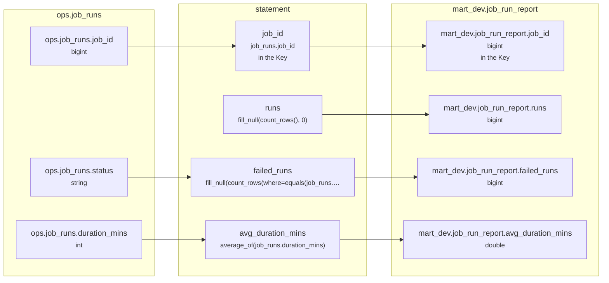

# Lineage: statement

Made by `export_lineage`. The chart is written in Mermaid, which JupyterLab draws. Arrows run from where a value comes from to where it goes. A solid arrow carries a value. A dotted arrow carries a column into a condition, or runs from a condition to the step whose rows it decides (labelled "filters").

## Graph



## statement

It writes the whole Saved table mart_dev.job_run_report.

### Calculated columns

Every column that is calculated rather than copied, in the order it is calculated.

#### `runs`

Calculated in **statement** as `fill_null(count_rows(), 0)`, which is `COALESCE(COUNT(*), 0)`.

```text
statement.runs = fill_null(count_rows(), 0)
└─ (no columns: it counts rows)
```

One value for each different `job_runs.job_id`.

#### `failed_runs`

Calculated in **statement** as `fill_null(count_rows(where=equals(job_runs.status, "FAILED")), 0)`, which is `COALESCE(COUNT(CASE WHEN job_runs.status = 'FAILED' THEN 1 END), 0)`.

```text
statement.failed_runs = fill_null(count_rows(where=equals(job_runs.status, "FAILED")), 0)
└─ ops.job_runs.status  (string)
```

One value for each different `job_runs.job_id`.

#### `avg_duration_mins`

Calculated in **statement** as `average_of(job_runs.duration_mins)`, which is `AVG(job_runs.duration_mins)`.

```text
statement.avg_duration_mins = average_of(job_runs.duration_mins)
└─ ops.job_runs.duration_mins  (int)
```

One value for each different `job_runs.job_id`.

### Copied columns

| Output | Comes from |
| --- | --- |
| `job_id` | ops.job_runs.job_id |

### Keys

The columns that tell each step's rows apart, as the Toolbox works them out. A column in one is marked "in the Key" in the chart.

- statement: Key (job_id), since GROUP_BY makes one row for each job_id.
- mart_dev.job_run_report's Key (job_id) holds: each row written has its own.

### Hive as submitted

```sql
INSERT OVERWRITE TABLE mart_dev.job_run_report
SELECT
  job_runs.job_id,
  COALESCE(COUNT(*), 0) AS runs,
  COALESCE(COUNT(CASE WHEN job_runs.status = 'FAILED' THEN 1 END), 0) AS failed_runs,
  AVG(job_runs.duration_mins) AS avg_duration_mins
FROM ops.job_runs AS job_runs
GROUP BY
  job_runs.job_id
```

---

Made by export_lineage on 2026-11-01 01:41, from your scripts at commit nogit, with sqlglot Composer 8.1, exported 2026-11-01 01:25.
