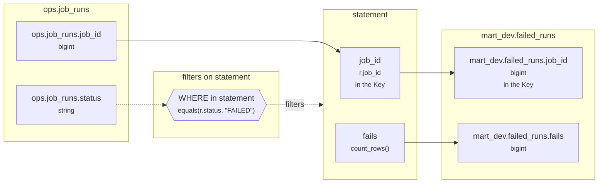

# Lineage: statement

Made by `export_lineage`. The chart is written in Mermaid, which JupyterLab draws. Arrows run from where a value comes from to where it goes. A solid arrow carries a value. A dotted arrow carries a column into a condition, or runs from a condition to the step whose rows it decides (labelled "filters").

## Graph



## statement

It writes the whole Saved table mart_dev.failed_runs.

### Calculated columns

Every column that is calculated rather than copied, in the order it is calculated.

#### `fails`

Calculated in **statement** as `count_rows()`, which is `COUNT(*)`.

```text
statement.fails = count_rows()
└─ (no columns: it counts rows)
```

Rows that count:
- WHERE in statement: `equals(r.status, "FAILED")`, which is `r.status = 'FAILED'` (reads ops.job_runs.status)

One value for each different `r.job_id`.

### Copied columns

| Output | Comes from |
| --- | --- |
| `job_id` | ops.job_runs.job_id |

### Keys

The columns that tell each step's rows apart, as the Toolbox works them out. A column in one is marked "in the Key" in the chart.

- statement: Key (job_id), since GROUP_BY makes one row for each job_id.
- mart_dev.failed_runs' Key (job_id) holds: each row written has its own.

### Hive as submitted

```sql
INSERT OVERWRITE TABLE mart_dev.failed_runs
SELECT
  r.job_id,
  COUNT(*) AS fails
FROM ops.job_runs AS r
WHERE
  r.status = 'FAILED'
GROUP BY
  r.job_id
```

---

Made by export_lineage on 2026-11-01 17:09, from your scripts at commit nogit, with sqlglot Composer 8.2, exported 2026-11-01 17:03.
