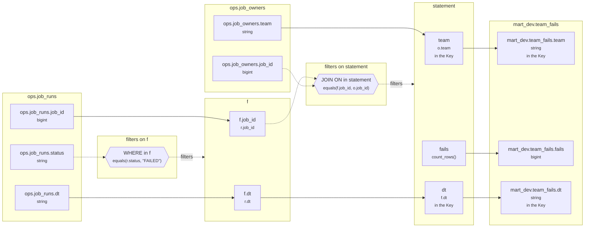

# Lineage: statement

Made by `export_lineage`. The chart is written in Mermaid, which JupyterLab draws. Arrows run from where a value comes from to where it goes. A solid arrow carries a value. A dotted arrow carries a column into a condition, or runs from a condition to the step whose rows it decides (labelled "filters").

## Graph



## statement

It writes the Saved table mart_dev.team_fails, replacing each partition its rows fill.

### Calculated columns

Every column that is calculated rather than copied, in the order it is calculated.

#### `fails`

Calculated in **statement** as `count_rows()`, which is `COUNT(*)`.

```text
statement.fails = count_rows()
└─ (no columns: it counts rows)
```

Rows that count:
- WHERE in f: `equals(r.status, "FAILED")`, which is `r.status = 'FAILED'` (reads ops.job_runs.status)
- JOIN ON in statement: `equals(f.job_id, o.job_id)`, which is `f.job_id = o.job_id` (reads ops.job_owners.job_id, ops.job_runs.job_id)

One value for each different `o.team` and `f.dt`.

### Copied columns

| Output | Comes from |
| --- | --- |
| `team` | ops.job_owners.team |
| `dt` | f.dt ← ops.job_runs.dt |

### Keys

The columns that tell each step's rows apart, as the Toolbox works them out. A column in one is marked "in the Key" in the chart.

- derived('f', ...): no Key the Toolbox can see, since r declares no Key.
- statement: Key (team, dt), since GROUP_BY makes one row for each team, dt.
- mart_dev.team_fails' Key (team, dt) holds: each row written has its own.

### Hive as submitted

```sql
WITH f AS (
  SELECT
    r.job_id,
    r.dt
  FROM ops.job_runs AS r
  WHERE
    r.status = 'FAILED'
)
INSERT OVERWRITE TABLE mart_dev.team_fails PARTITION(dt)
SELECT
  o.team,
  COUNT(*) AS fails,
  f.dt
FROM f
JOIN ops.job_owners AS o
  ON f.job_id = o.job_id
GROUP BY
  o.team,
  f.dt
```

---

Made by export_lineage on 2026-11-01 19:48, from your scripts at commit nogit, with sqlglot Composer 8.2, exported 2026-11-01 19:41.
