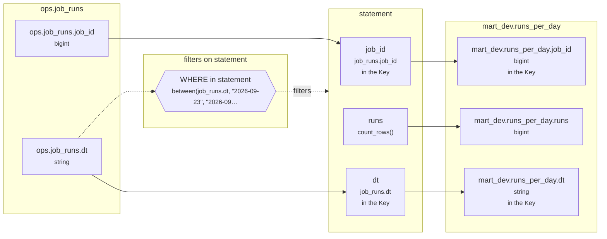

# Lineage: statement

Made by `export_lineage`. The chart is written in Mermaid, which JupyterLab draws. Arrows run from where a value comes from to where it goes. A solid arrow carries a value. A dotted arrow carries a column into a condition, or runs from a condition to the step whose rows it decides (labelled "filters").

## Graph



## statement

It writes the Saved table mart_dev.runs_per_day, replacing each partition its rows fill.

### Calculated columns

Every column that is calculated rather than copied, in the order it is calculated.

#### `runs`

Calculated in **statement** as `count_rows()`, which is `COUNT(*)`.

```text
statement.runs = count_rows()
└─ (no columns: it counts rows)
```

Rows that count:
- WHERE in statement: `between(job_runs.dt, "2026-09-23", "2026-09-24")`, which is `job_runs.dt BETWEEN '2026-09-23' AND '2026-09-24'` (reads ops.job_runs.dt)

One value for each different `job_runs.job_id` and `job_runs.dt`.

### Copied columns

| Output | Comes from |
| --- | --- |
| `job_id` | ops.job_runs.job_id |
| `dt` | ops.job_runs.dt |

### Keys

The columns that tell each step's rows apart, as the Toolbox works them out. A column in one is marked "in the Key" in the chart.

- statement: Key (job_id, dt), since GROUP_BY makes one row for each job_id, dt.
- mart_dev.runs_per_day's Key (job_id, dt) holds: each row written has its own.

### Hive as submitted

```sql
INSERT OVERWRITE TABLE mart_dev.runs_per_day PARTITION(dt)
SELECT
  job_runs.job_id,
  COUNT(*) AS runs,
  job_runs.dt
FROM ops.job_runs AS job_runs
WHERE
  job_runs.dt BETWEEN '2026-09-23' AND '2026-09-24'
GROUP BY
  job_runs.job_id,
  job_runs.dt
```

---

Made by export_lineage on 2026-11-01 10:03, from your scripts at commit nogit, with sqlglot Composer 8.1, exported 2026-11-01 09:58.
