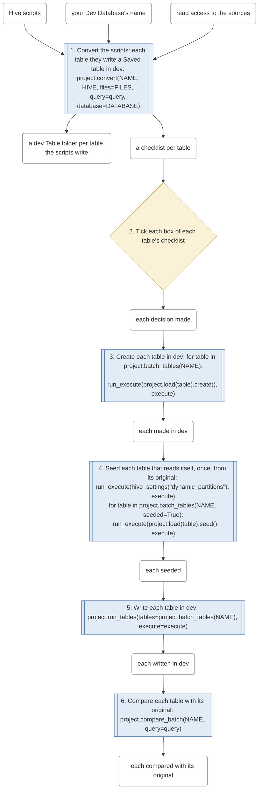
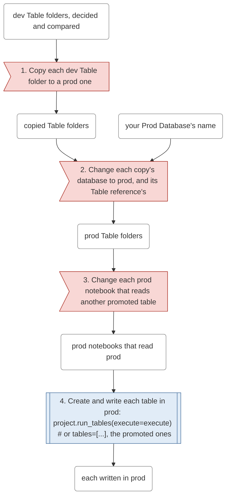
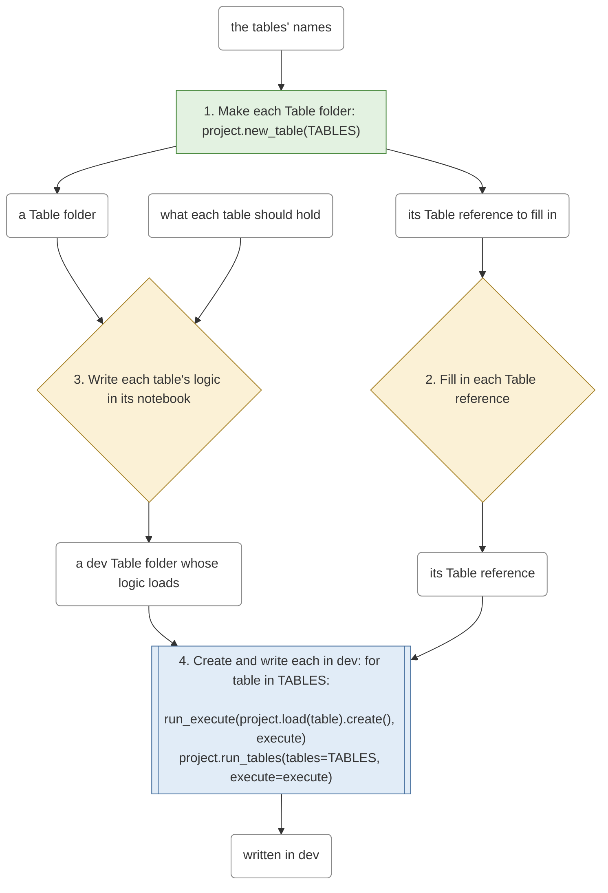
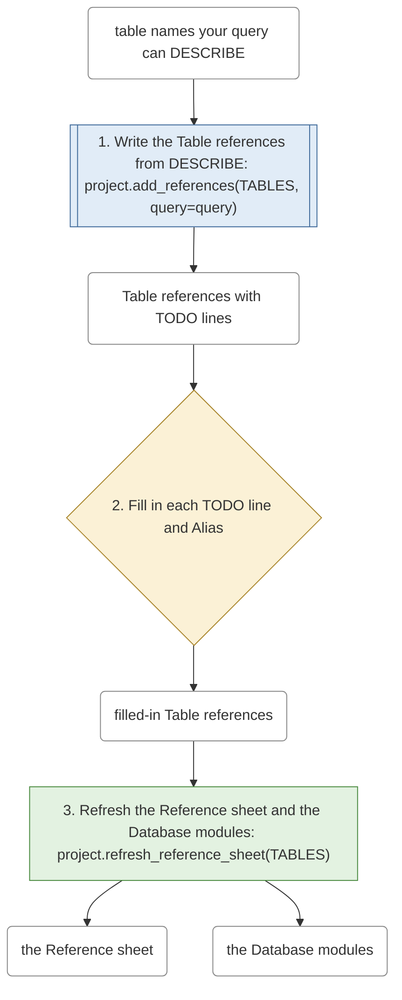
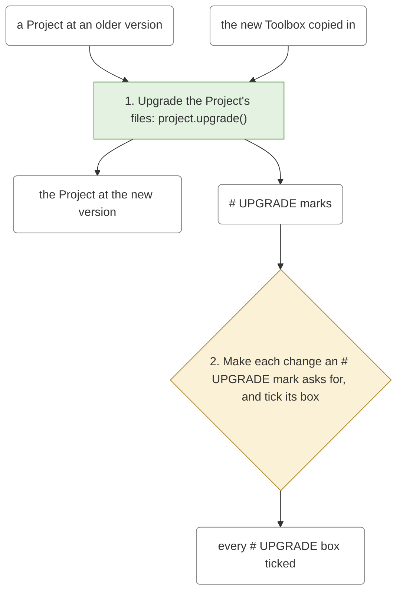
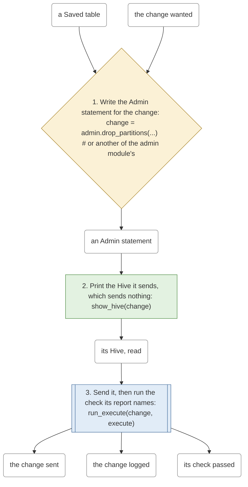

# Workflows

What a Project goes through to reach each end goal, drawn from `sqlglot_composer/workflows.py`
by `tools/workflow_graph.py`: don't edit this page, run the tool. Each box with round corners is
something a step needs or makes; each step is drawn by its kind:

- a **file step** (green), which touches only files, or only prints, never the
  Warehouse: a Project action, or show_hive;
- a **permission** (blue, double-edged), a call to the Warehouse the user makes on purpose;
- a **decision** (yellow, a diamond), which needs the user's judgement;
- **fiddling** (red, a flag), a step done by hand though the code knows the answer.

Toolbox 8.0 takes each Workflow's fiddling to nothing.

## convert

Steps: 0 file step, 5 permission, 1 decision, 0 fiddling.

Starts from: Hive scripts, your Dev Database's name, read access to the sources.

Ends with: a dev Table folder per table the scripts write, each written in dev, each compared with its original, each decision made.

## promote

Steps: 0 file step, 1 permission, 0 decision, 3 fiddling.

Starts from: dev Table folders, decided and compared, your Prod Database's name.

Ends with: prod Table folders, each written in prod.

## new_table

Steps: 1 file step, 1 permission, 2 decision, 0 fiddling.

Starts from: the tables' names, what each table should hold.

Ends with: a dev Table folder whose logic loads, written in dev, its Table reference.

## references

Steps: 1 file step, 1 permission, 1 decision, 0 fiddling.

Starts from: table names your query can DESCRIBE.

Ends with: filled-in Table references, the Reference sheet, the Database modules.

## upgrade

Steps: 1 file step, 0 permission, 1 decision, 0 fiddling.

Starts from: a Project at an older version, the new Toolbox copied in.

Ends with: the Project at the new version, every # UPGRADE box ticked.

## change_a_saved_table

Steps: 1 file step, 1 permission, 1 decision, 0 fiddling.

Starts from: a Saved table, the change wanted.

Ends with: the change sent, the change logged, its check passed.

