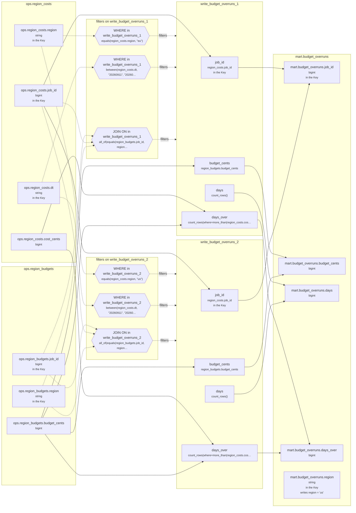

<!-- sqlglot Composer 7.2 - copy it, then edit your copy -->
# Lineage: write_budget_overruns_1, write_budget_overruns_2

Made by `export_lineage`. The chart is written in Mermaid, which JupyterLab draws. Arrows run from where a value comes from to where it goes. A solid arrow carries a value. A dotted arrow carries a column into a condition, or runs from a condition to the step whose rows it decides (labelled "filters").

## Graph



## write_budget_overruns_1

It writes the Saved table mart.budget_overruns, replacing each partition its rows fill.

### Calculated columns

Every column that is calculated rather than copied, in the order it is calculated.

#### `days`

Calculated in **write_budget_overruns_1** as `count_rows()`, which is `COUNT(*)`.

```text
write_budget_overruns_1.days = count_rows()
└─ (no columns: it counts rows)
```

Rows that count:
- WHERE in write_budget_overruns_1: `equals(region_costs.region, "eu")`, which is `region_costs.region = 'eu'` (reads ops.region_costs.region)
- WHERE in write_budget_overruns_1: `between(region_costs.dt, "20260911", "20260924")`, which is `region_costs.dt BETWEEN '20260911' AND '20260924'` (reads ops.region_costs.dt)
- JOIN ON in write_budget_overruns_1: `all_of(equals(region_budgets.job_id, region_costs.job_id), equals(region_budgets.region, "eu"))`, which is `region_budgets.job_id = region_costs.job_id AND region_budgets.region = 'eu'` (reads ops.region_budgets.job_id, ops.region_budgets.region, ops.region_costs.job_id)

One value for each different `region_costs.job_id` and `region_budgets.budget_cents`.

#### `days_over`

Calculated in **write_budget_overruns_1** as `count_rows(where=more_than(region_costs.cost_cents, region_budgets.budget_cents))`, which is `COUNT(CASE WHEN region_costs.cost_cents > region_budgets.budget_cents THEN 1 END)`.

```text
write_budget_overruns_1.days_over = count_rows(where=more_than(region_costs.cost_cents, region_budgets.budget_cents))
├─ ops.region_costs.cost_cents  (bigint)
└─ ops.region_budgets.budget_cents  (bigint)
```

Rows that count:
- WHERE in write_budget_overruns_1: `equals(region_costs.region, "eu")`, which is `region_costs.region = 'eu'` (reads ops.region_costs.region)
- WHERE in write_budget_overruns_1: `between(region_costs.dt, "20260911", "20260924")`, which is `region_costs.dt BETWEEN '20260911' AND '20260924'` (reads ops.region_costs.dt)
- JOIN ON in write_budget_overruns_1: `all_of(equals(region_budgets.job_id, region_costs.job_id), equals(region_budgets.region, "eu"))`, which is `region_budgets.job_id = region_costs.job_id AND region_budgets.region = 'eu'` (reads ops.region_budgets.job_id, ops.region_budgets.region, ops.region_costs.job_id)

One value for each different `region_costs.job_id` and `region_budgets.budget_cents`.

### Copied columns

| Output | Comes from |
| --- | --- |
| `job_id` | ops.region_costs.job_id |
| `budget_cents` | ops.region_budgets.budget_cents |

### Keys

The columns that tell each step's rows apart, as the Toolbox works them out. A column in one is marked "in the Key" in the chart.

- write_budget_overruns_1: Key (job_id), since GROUP_BY makes one row for each job_id.
- mart.budget_overruns' Key (job_id, region) holds: each row written has its own.

### Hive as submitted

```sql
INSERT OVERWRITE TABLE mart.budget_overruns PARTITION(region = 'eu')
SELECT
  region_costs.job_id,
  region_budgets.budget_cents,
  COUNT(*) AS days,
  COUNT(CASE WHEN region_costs.cost_cents > region_budgets.budget_cents THEN 1 END) AS days_over
FROM ops.region_costs AS region_costs
JOIN ops.region_budgets AS region_budgets
  ON region_budgets.job_id = region_costs.job_id AND region_budgets.region = 'eu'
WHERE
  region_costs.region = 'eu' AND region_costs.dt BETWEEN '20260911' AND '20260924'
GROUP BY
  region_costs.job_id,
  region_budgets.budget_cents
```

## write_budget_overruns_2

It writes the Saved table mart.budget_overruns, replacing each partition its rows fill.

### Calculated columns

Every column that is calculated rather than copied, in the order it is calculated.

#### `days`

Calculated in **write_budget_overruns_2** as `count_rows()`, which is `COUNT(*)`.

```text
write_budget_overruns_2.days = count_rows()
└─ (no columns: it counts rows)
```

Rows that count:
- WHERE in write_budget_overruns_2: `equals(region_costs.region, "us")`, which is `region_costs.region = 'us'` (reads ops.region_costs.region)
- WHERE in write_budget_overruns_2: `between(region_costs.dt, "20260911", "20260924")`, which is `region_costs.dt BETWEEN '20260911' AND '20260924'` (reads ops.region_costs.dt)
- JOIN ON in write_budget_overruns_2: `all_of(equals(region_budgets.job_id, region_costs.job_id), equals(region_budgets.region, "us"))`, which is `region_budgets.job_id = region_costs.job_id AND region_budgets.region = 'us'` (reads ops.region_budgets.job_id, ops.region_budgets.region, ops.region_costs.job_id)

One value for each different `region_costs.job_id` and `region_budgets.budget_cents`.

#### `days_over`

Calculated in **write_budget_overruns_2** as `count_rows(where=more_than(region_costs.cost_cents, region_budgets.budget_cents))`, which is `COUNT(CASE WHEN region_costs.cost_cents > region_budgets.budget_cents THEN 1 END)`.

```text
write_budget_overruns_2.days_over = count_rows(where=more_than(region_costs.cost_cents, region_budgets.budget_cents))
├─ ops.region_costs.cost_cents  (bigint)
└─ ops.region_budgets.budget_cents  (bigint)
```

Rows that count:
- WHERE in write_budget_overruns_2: `equals(region_costs.region, "us")`, which is `region_costs.region = 'us'` (reads ops.region_costs.region)
- WHERE in write_budget_overruns_2: `between(region_costs.dt, "20260911", "20260924")`, which is `region_costs.dt BETWEEN '20260911' AND '20260924'` (reads ops.region_costs.dt)
- JOIN ON in write_budget_overruns_2: `all_of(equals(region_budgets.job_id, region_costs.job_id), equals(region_budgets.region, "us"))`, which is `region_budgets.job_id = region_costs.job_id AND region_budgets.region = 'us'` (reads ops.region_budgets.job_id, ops.region_budgets.region, ops.region_costs.job_id)

One value for each different `region_costs.job_id` and `region_budgets.budget_cents`.

### Copied columns

| Output | Comes from |
| --- | --- |
| `job_id` | ops.region_costs.job_id |
| `budget_cents` | ops.region_budgets.budget_cents |

### Keys

The columns that tell each step's rows apart, as the Toolbox works them out. A column in one is marked "in the Key" in the chart.

- write_budget_overruns_2: Key (job_id), since GROUP_BY makes one row for each job_id.
- mart.budget_overruns' Key (job_id, region) holds: each row written has its own.

### Hive as submitted

```sql
INSERT OVERWRITE TABLE mart.budget_overruns PARTITION(region = 'us')
SELECT
  region_costs.job_id,
  region_budgets.budget_cents,
  COUNT(*) AS days,
  COUNT(CASE WHEN region_costs.cost_cents > region_budgets.budget_cents THEN 1 END) AS days_over
FROM ops.region_costs AS region_costs
JOIN ops.region_budgets AS region_budgets
  ON region_budgets.job_id = region_costs.job_id AND region_budgets.region = 'us'
WHERE
  region_costs.region = 'us' AND region_costs.dt BETWEEN '20260911' AND '20260924'
GROUP BY
  region_costs.job_id,
  region_budgets.budget_cents
```

---

Made by export_lineage on 2026-09-25 06:00, from your scripts at commit nogit, with sqlglot Composer 7.2.
