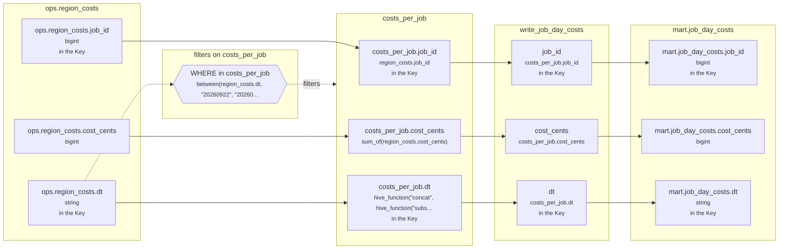

# Lineage: write_job_day_costs

Made by `export_lineage`. The chart is written in Mermaid, which JupyterLab draws. Arrows run from where a value comes from to where it goes. A solid arrow carries a value. A dotted arrow carries a column into a condition, or runs from a condition to the step whose rows it decides (labelled "filters").

## Graph



## write_job_day_costs

It writes the Saved table mart.job_day_costs, replacing each partition its rows fill.

### Calculated columns

Every column that is calculated rather than copied, in the order it is calculated.

#### `costs_per_job.cost_cents`

Calculated in **costs_per_job** as `sum_of(region_costs.cost_cents)`, which is `SUM(region_costs.cost_cents)`.

```text
costs_per_job.cost_cents = sum_of(region_costs.cost_cents)
└─ ops.region_costs.cost_cents  (bigint)
```

Rows that count:
- WHERE in costs_per_job: `between(region_costs.dt, "20260922", "20260924")`, which is `region_costs.dt BETWEEN '20260922' AND '20260924'` (reads ops.region_costs.dt)

One value for each different `region_costs.job_id` and `hive_function("concat", hive_function("substr", region_costs.dt, 1, 4), "-", hive_function("substr", region_costs.dt, 5, 2), "-", hive_function("substr", region_costs.dt, 7, 2))`.

#### `costs_per_job.dt`

Calculated in **costs_per_job** as `hive_function("concat", hive_function("substr", region_costs.dt, 1, 4), "-", hive_function("substr", region_costs.dt, 5, 2), "-", hive_function("substr", region_costs.dt, 7, 2))`, which is `CONCAT(SUBSTRING(region_costs.dt, 1, 4), '-', SUBSTRING(region_costs.dt, 5, 2), '-', SUBSTRING(region_costs.dt, 7, 2))`.

```text
costs_per_job.dt = hive_function("concat", hive_function("substr", region_costs.dt, 1, 4), "-", hive_function("substr", region_costs.dt, 5, 2), "-", hive_function("substr", region_costs.dt, 7, 2))
└─ ops.region_costs.dt  (string)
```

Rows that count:
- WHERE in costs_per_job: `between(region_costs.dt, "20260922", "20260924")`, which is `region_costs.dt BETWEEN '20260922' AND '20260924'` (reads ops.region_costs.dt)

### Copied columns

| Output | Comes from |
| --- | --- |
| `job_id` | costs_per_job.job_id ← ops.region_costs.job_id |
| `cost_cents` | costs_per_job.cost_cents (calculated) ← ops.region_costs.cost_cents |
| `dt` | costs_per_job.dt (calculated) ← ops.region_costs.dt |

### Keys

The columns that tell each step's rows apart, as the Toolbox works them out. A column in one is marked "in the Key" in the chart.

- derived('costs_per_job', ...): Key (job_id, dt), since GROUP_BY makes one row for each job_id, dt.
- write_job_day_costs: Key (job_id, dt), since costs_per_job's rows are told apart by job_id, dt.
- mart.job_day_costs' Key (job_id, dt) holds: each row written has its own.

### Hive as submitted

```sql
WITH costs_per_job AS (
  SELECT
    region_costs.job_id,
    SUM(region_costs.cost_cents) AS cost_cents,
    CONCAT(
      SUBSTRING(region_costs.dt, 1, 4),
      '-',
      SUBSTRING(region_costs.dt, 5, 2),
      '-',
      SUBSTRING(region_costs.dt, 7, 2)
    ) AS dt
  FROM ops.region_costs AS region_costs
  WHERE
    region_costs.dt BETWEEN '20260922' AND '20260924'
  GROUP BY
    region_costs.job_id,
    CONCAT(
      SUBSTRING(region_costs.dt, 1, 4),
      '-',
      SUBSTRING(region_costs.dt, 5, 2),
      '-',
      SUBSTRING(region_costs.dt, 7, 2)
    )
)
INSERT OVERWRITE TABLE mart.job_day_costs PARTITION(dt)
SELECT
  costs_per_job.job_id,
  costs_per_job.cost_cents,
  costs_per_job.dt
FROM costs_per_job
```

---

Made by export_lineage on 2026-09-25 06:00, from your scripts at commit nogit, with sqlglot Composer 7.1.
