<!-- sqlglot Composer 6.0, exported 2026-10-21 07:24 - copy it, then edit your copy -->
# Lineage: statement_1, statement_2, statement_3

Made by `export_lineage`. The chart is written in Mermaid, which JupyterLab draws. Arrows run from where a value comes from to where it goes. A solid arrow carries a value. A dotted arrow carries a column into a condition, or runs from a condition to the step whose rows it decides (labelled "filters"). A dotted arrow labelled "day written" runs from a write's date bound to the day of the Saved table it writes.

## Graph

```mermaid
flowchart LR
  subgraph g0["ops.job_events"]
    n0["ops.job_events.job_id<br/><small>bigint</small>"]
    n2["ops.job_events.dt<br/><small>string</small>"]
    n5["ops.job_events.event_type<br/><small>string</small>"]
    n7["ops.job_events.minutes<br/><small>int</small>"]
  end
  subgraph g1["events_per_job_day in statement_1"]
    n1["events_per_job_day in statement_1.job_id<br/><small>job_events.job_id</small><br/><small>in the Key</small>"]
    n3["events_per_job_day in statement_1.dt<br/><small>job_events.dt</small>"]
    n4["events_per_job_day in statement_1.events<br/><small>count_rows()</small>"]
    n6["events_per_job_day in statement_1.runs<br/><small>count_rows(where=equals(job_events.event_ty…</small>"]
    n8["events_per_job_day in statement_1.minutes<br/><small>fill_null(sum_of(job_events.minutes, where=…</small>"]
  end
  subgraph g2["filters on events_per_job_day in statement_1"]
    n9{{"WHERE in events_per_job_day in statement_1<br/><small>equals(job_events.dt, datetime.date(2026, 9…</small>"}}
  end
  subgraph g3["statement_1"]
    n10["job_id<br/><small>events_per_job_day.job_id</small><br/><small>in the Key</small>"]
    n12["team<br/><small>job_owners.team</small>"]
    n13["events<br/><small>events_per_job_day.events</small>"]
    n14["runs<br/><small>events_per_job_day.runs</small>"]
    n15["minutes<br/><small>events_per_job_day.minutes</small>"]
  end
  subgraph g4["ops.job_owners"]
    n11["ops.job_owners.team<br/><small>string</small>"]
    n17["ops.job_owners.dt<br/><small>string</small><br/><small>in the Key</small>"]
    n18["ops.job_owners.job_id<br/><small>bigint</small><br/><small>in the Key</small>"]
  end
  subgraph g5["filters on statement_1"]
    n16{{"LEFT JOIN ON in statement_1<br/><small>all_of(equals(job_owners.job_id, events_per…</small>"}}
  end
  subgraph g6["mart.job_day_facts"]
    n19["mart.job_day_facts.job_id<br/><small>bigint</small><br/><small>in the Key</small>"]
    n20["mart.job_day_facts.team<br/><small>string</small>"]
    n21["mart.job_day_facts.events<br/><small>bigint</small>"]
    n22["mart.job_day_facts.runs<br/><small>bigint</small>"]
    n23["mart.job_day_facts.minutes<br/><small>bigint</small>"]
    n24["mart.job_day_facts.dt<br/><small>string</small><br/><small>in the Key</small>"]
  end
  subgraph g7["events_per_job_day in statement_2"]
    n25["events_per_job_day in statement_2.job_id<br/><small>job_events.job_id</small><br/><small>in the Key</small>"]
    n26["events_per_job_day in statement_2.dt<br/><small>job_events.dt</small>"]
    n27["events_per_job_day in statement_2.events<br/><small>count_rows()</small>"]
    n28["events_per_job_day in statement_2.runs<br/><small>count_rows(where=equals(job_events.event_ty…</small>"]
    n29["events_per_job_day in statement_2.minutes<br/><small>fill_null(sum_of(job_events.minutes, where=…</small>"]
  end
  subgraph g8["filters on events_per_job_day in statement_2"]
    n30{{"WHERE in events_per_job_day in statement_2<br/><small>equals(job_events.dt, datetime.date(2026, 9…</small>"}}
  end
  subgraph g9["statement_2"]
    n31["job_id<br/><small>events_per_job_day.job_id</small><br/><small>in the Key</small>"]
    n32["team<br/><small>job_owners.team</small>"]
    n33["events<br/><small>events_per_job_day.events</small>"]
    n34["runs<br/><small>events_per_job_day.runs</small>"]
    n35["minutes<br/><small>events_per_job_day.minutes</small>"]
  end
  subgraph g10["filters on statement_2"]
    n36{{"LEFT JOIN ON in statement_2<br/><small>all_of(equals(job_owners.job_id, events_per…</small>"}}
  end
  subgraph g11["events_per_job_day in statement_3"]
    n37["events_per_job_day in statement_3.job_id<br/><small>job_events.job_id</small><br/><small>in the Key</small>"]
    n38["events_per_job_day in statement_3.dt<br/><small>job_events.dt</small>"]
    n39["events_per_job_day in statement_3.events<br/><small>count_rows()</small>"]
    n40["events_per_job_day in statement_3.runs<br/><small>count_rows(where=equals(job_events.event_ty…</small>"]
    n41["events_per_job_day in statement_3.minutes<br/><small>fill_null(sum_of(job_events.minutes, where=…</small>"]
  end
  subgraph g12["filters on events_per_job_day in statement_3"]
    n42{{"WHERE in events_per_job_day in statement_3<br/><small>equals(job_events.dt, datetime.date(2026, 9…</small>"}}
  end
  subgraph g13["statement_3"]
    n43["job_id<br/><small>events_per_job_day.job_id</small><br/><small>in the Key</small>"]
    n44["team<br/><small>job_owners.team</small>"]
    n45["events<br/><small>events_per_job_day.events</small>"]
    n46["runs<br/><small>events_per_job_day.runs</small>"]
    n47["minutes<br/><small>events_per_job_day.minutes</small>"]
  end
  subgraph g14["filters on statement_3"]
    n48{{"LEFT JOIN ON in statement_3<br/><small>all_of(equals(job_owners.job_id, events_per…</small>"}}
  end
  n0 --> n1
  n2 --> n3
  n5 --> n6
  n7 --> n8
  n5 --> n8
  n2 -.-> n9
  n1 --> n10
  n11 --> n12
  n4 --> n13
  n6 --> n14
  n8 --> n15
  n17 -.-> n16
  n18 -.-> n16
  n1 -.-> n16
  n3 -.-> n16
  n10 --> n19
  n12 --> n20
  n13 --> n21
  n14 --> n22
  n15 --> n23
  n9 -.->|day written| n24
  n0 --> n25
  n2 --> n26
  n5 --> n28
  n7 --> n29
  n5 --> n29
  n2 -.-> n30
  n25 --> n31
  n11 --> n32
  n27 --> n33
  n28 --> n34
  n29 --> n35
  n17 -.-> n36
  n18 -.-> n36
  n25 -.-> n36
  n26 -.-> n36
  n31 --> n19
  n32 --> n20
  n33 --> n21
  n34 --> n22
  n35 --> n23
  n30 -.->|day written| n24
  n0 --> n37
  n2 --> n38
  n5 --> n40
  n7 --> n41
  n5 --> n41
  n2 -.-> n42
  n37 --> n43
  n11 --> n44
  n39 --> n45
  n40 --> n46
  n41 --> n47
  n17 -.-> n48
  n18 -.-> n48
  n37 -.-> n48
  n38 -.-> n48
  n43 --> n19
  n44 --> n20
  n45 --> n21
  n46 --> n22
  n47 --> n23
  n42 -.->|day written| n24
  n9 -.->|filters| g1
  n16 -.->|filters| g3
  n30 -.->|filters| g7
  n36 -.->|filters| g9
  n42 -.->|filters| g11
  n48 -.->|filters| g13
```



## statement_1

It writes the Saved table mart.job_day_facts, one day at a time.

### Calculated columns

Every column that is calculated rather than copied, in the order it is calculated.

#### `events_per_job_day in statement_1.events`

Calculated in **events_per_job_day in statement_1** as `count_rows()`, which is `COUNT(*)`.

```text
events_per_job_day in statement_1.events = count_rows()
└─ (no columns: it counts rows)
```

Rows that count:
- WHERE in events_per_job_day in statement_1: `equals(job_events.dt, datetime.date(2026, 9, 22))`, which is `job_events.dt = '2026-09-22'` (reads ops.job_events.dt)

One value for each different `job_events.job_id` and `job_events.dt`.

#### `events_per_job_day in statement_1.runs`

Calculated in **events_per_job_day in statement_1** as `count_rows(where=equals(job_events.event_type, "start"))`, which is `COUNT(CASE WHEN job_events.event_type = 'start' THEN 1 END)`.

```text
events_per_job_day in statement_1.runs = count_rows(where=equals(job_events.event_type, "start"))
└─ ops.job_events.event_type  (string)
```

Rows that count:
- WHERE in events_per_job_day in statement_1: `equals(job_events.dt, datetime.date(2026, 9, 22))`, which is `job_events.dt = '2026-09-22'` (reads ops.job_events.dt)

One value for each different `job_events.job_id` and `job_events.dt`.

#### `events_per_job_day in statement_1.minutes`

Calculated in **events_per_job_day in statement_1** as `fill_null(sum_of(job_events.minutes, where=is_in(job_events.event_type, ["finish", "fail"])), 0)`, which is `COALESCE(SUM(CASE WHEN job_events.event_type IN ('finish', 'fail') THEN job_events.minutes END), 0)`.

```text
events_per_job_day in statement_1.minutes = fill_null(sum_of(job_events.minutes, where=is_in(job_events.event_type, ["finish", "fail"])), 0)
├─ ops.job_events.minutes  (int)
└─ ops.job_events.event_type  (string)
```

Rows that count:
- WHERE in events_per_job_day in statement_1: `equals(job_events.dt, datetime.date(2026, 9, 22))`, which is `job_events.dt = '2026-09-22'` (reads ops.job_events.dt)

One value for each different `job_events.job_id` and `job_events.dt`.

### Copied columns

| Output | Comes from |
| --- | --- |
| `job_id` | events_per_job_day in statement_1.job_id ← ops.job_events.job_id |
| `team` | ops.job_owners.team |
| `events` | events_per_job_day in statement_1.events (calculated) |
| `runs` | events_per_job_day in statement_1.runs (calculated) ← ops.job_events.event_type |
| `minutes` | events_per_job_day in statement_1.minutes (calculated) ← ops.job_events.minutes |

### Keys

The columns that tell each step's rows apart, as the Toolbox works them out. A column in one is marked "in the Key" in the chart.

- derived('events_per_job_day', ...): Key (job_id), since GROUP_BY makes one row for each job_id, dt, with dt held to one value.
- statement_1: Key (job_id), since events_per_job_day's rows are told apart by job_id.
- mart.job_day_facts' Key (job_id, dt) holds: each row written has its own.

### Hive as submitted

```sql
WITH events_per_job_day AS (
  SELECT
    job_events.job_id,
    job_events.dt,
    COUNT(*) AS events,
    COUNT(CASE WHEN job_events.event_type = 'start' THEN 1 END) AS runs,
    COALESCE(
      SUM(
        CASE WHEN job_events.event_type IN ('finish', 'fail') THEN job_events.minutes END
      ),
      0
    ) AS minutes
  FROM ops.job_events AS job_events
  WHERE
    job_events.dt = '2026-09-22'
  GROUP BY
    job_events.job_id,
    job_events.dt
)
INSERT OVERWRITE TABLE mart.job_day_facts PARTITION(dt = '2026-09-22')
SELECT
  events_per_job_day.job_id,
  job_owners.team,
  events_per_job_day.events,
  events_per_job_day.runs,
  events_per_job_day.minutes
FROM events_per_job_day
LEFT JOIN ops.job_owners AS job_owners
  ON job_owners.job_id = events_per_job_day.job_id
  AND job_owners.dt = events_per_job_day.dt
  AND job_owners.dt BETWEEN '2026-09-22' AND '2026-09-24'
```

## statement_2

It writes the Saved table mart.job_day_facts, one day at a time.

### Calculated columns

Every column that is calculated rather than copied, in the order it is calculated.

#### `events_per_job_day in statement_2.events`

Calculated in **events_per_job_day in statement_2** as `count_rows()`, which is `COUNT(*)`.

```text
events_per_job_day in statement_2.events = count_rows()
└─ (no columns: it counts rows)
```

Rows that count:
- WHERE in events_per_job_day in statement_2: `equals(job_events.dt, datetime.date(2026, 9, 23))`, which is `job_events.dt = '2026-09-23'` (reads ops.job_events.dt)

One value for each different `job_events.job_id` and `job_events.dt`.

#### `events_per_job_day in statement_2.runs`

Calculated in **events_per_job_day in statement_2** as `count_rows(where=equals(job_events.event_type, "start"))`, which is `COUNT(CASE WHEN job_events.event_type = 'start' THEN 1 END)`.

```text
events_per_job_day in statement_2.runs = count_rows(where=equals(job_events.event_type, "start"))
└─ ops.job_events.event_type  (string)
```

Rows that count:
- WHERE in events_per_job_day in statement_2: `equals(job_events.dt, datetime.date(2026, 9, 23))`, which is `job_events.dt = '2026-09-23'` (reads ops.job_events.dt)

One value for each different `job_events.job_id` and `job_events.dt`.

#### `events_per_job_day in statement_2.minutes`

Calculated in **events_per_job_day in statement_2** as `fill_null(sum_of(job_events.minutes, where=is_in(job_events.event_type, ["finish", "fail"])), 0)`, which is `COALESCE(SUM(CASE WHEN job_events.event_type IN ('finish', 'fail') THEN job_events.minutes END), 0)`.

```text
events_per_job_day in statement_2.minutes = fill_null(sum_of(job_events.minutes, where=is_in(job_events.event_type, ["finish", "fail"])), 0)
├─ ops.job_events.minutes  (int)
└─ ops.job_events.event_type  (string)
```

Rows that count:
- WHERE in events_per_job_day in statement_2: `equals(job_events.dt, datetime.date(2026, 9, 23))`, which is `job_events.dt = '2026-09-23'` (reads ops.job_events.dt)

One value for each different `job_events.job_id` and `job_events.dt`.

### Copied columns

| Output | Comes from |
| --- | --- |
| `job_id` | events_per_job_day in statement_2.job_id ← ops.job_events.job_id |
| `team` | ops.job_owners.team |
| `events` | events_per_job_day in statement_2.events (calculated) |
| `runs` | events_per_job_day in statement_2.runs (calculated) ← ops.job_events.event_type |
| `minutes` | events_per_job_day in statement_2.minutes (calculated) ← ops.job_events.minutes |

### Keys

The columns that tell each step's rows apart, as the Toolbox works them out. A column in one is marked "in the Key" in the chart.

- derived('events_per_job_day', ...): Key (job_id), since GROUP_BY makes one row for each job_id, dt, with dt held to one value.
- statement_2: Key (job_id), since events_per_job_day's rows are told apart by job_id.
- mart.job_day_facts' Key (job_id, dt) holds: each row written has its own.

### Hive as submitted

```sql
WITH events_per_job_day AS (
  SELECT
    job_events.job_id,
    job_events.dt,
    COUNT(*) AS events,
    COUNT(CASE WHEN job_events.event_type = 'start' THEN 1 END) AS runs,
    COALESCE(
      SUM(
        CASE WHEN job_events.event_type IN ('finish', 'fail') THEN job_events.minutes END
      ),
      0
    ) AS minutes
  FROM ops.job_events AS job_events
  WHERE
    job_events.dt = '2026-09-23'
  GROUP BY
    job_events.job_id,
    job_events.dt
)
INSERT OVERWRITE TABLE mart.job_day_facts PARTITION(dt = '2026-09-23')
SELECT
  events_per_job_day.job_id,
  job_owners.team,
  events_per_job_day.events,
  events_per_job_day.runs,
  events_per_job_day.minutes
FROM events_per_job_day
LEFT JOIN ops.job_owners AS job_owners
  ON job_owners.job_id = events_per_job_day.job_id
  AND job_owners.dt = events_per_job_day.dt
  AND job_owners.dt BETWEEN '2026-09-22' AND '2026-09-24'
```

## statement_3

It writes the Saved table mart.job_day_facts, one day at a time.

### Calculated columns

Every column that is calculated rather than copied, in the order it is calculated.

#### `events_per_job_day in statement_3.events`

Calculated in **events_per_job_day in statement_3** as `count_rows()`, which is `COUNT(*)`.

```text
events_per_job_day in statement_3.events = count_rows()
└─ (no columns: it counts rows)
```

Rows that count:
- WHERE in events_per_job_day in statement_3: `equals(job_events.dt, datetime.date(2026, 9, 24))`, which is `job_events.dt = '2026-09-24'` (reads ops.job_events.dt)

One value for each different `job_events.job_id` and `job_events.dt`.

#### `events_per_job_day in statement_3.runs`

Calculated in **events_per_job_day in statement_3** as `count_rows(where=equals(job_events.event_type, "start"))`, which is `COUNT(CASE WHEN job_events.event_type = 'start' THEN 1 END)`.

```text
events_per_job_day in statement_3.runs = count_rows(where=equals(job_events.event_type, "start"))
└─ ops.job_events.event_type  (string)
```

Rows that count:
- WHERE in events_per_job_day in statement_3: `equals(job_events.dt, datetime.date(2026, 9, 24))`, which is `job_events.dt = '2026-09-24'` (reads ops.job_events.dt)

One value for each different `job_events.job_id` and `job_events.dt`.

#### `events_per_job_day in statement_3.minutes`

Calculated in **events_per_job_day in statement_3** as `fill_null(sum_of(job_events.minutes, where=is_in(job_events.event_type, ["finish", "fail"])), 0)`, which is `COALESCE(SUM(CASE WHEN job_events.event_type IN ('finish', 'fail') THEN job_events.minutes END), 0)`.

```text
events_per_job_day in statement_3.minutes = fill_null(sum_of(job_events.minutes, where=is_in(job_events.event_type, ["finish", "fail"])), 0)
├─ ops.job_events.minutes  (int)
└─ ops.job_events.event_type  (string)
```

Rows that count:
- WHERE in events_per_job_day in statement_3: `equals(job_events.dt, datetime.date(2026, 9, 24))`, which is `job_events.dt = '2026-09-24'` (reads ops.job_events.dt)

One value for each different `job_events.job_id` and `job_events.dt`.

### Copied columns

| Output | Comes from |
| --- | --- |
| `job_id` | events_per_job_day in statement_3.job_id ← ops.job_events.job_id |
| `team` | ops.job_owners.team |
| `events` | events_per_job_day in statement_3.events (calculated) |
| `runs` | events_per_job_day in statement_3.runs (calculated) ← ops.job_events.event_type |
| `minutes` | events_per_job_day in statement_3.minutes (calculated) ← ops.job_events.minutes |

### Keys

The columns that tell each step's rows apart, as the Toolbox works them out. A column in one is marked "in the Key" in the chart.

- derived('events_per_job_day', ...): Key (job_id), since GROUP_BY makes one row for each job_id, dt, with dt held to one value.
- statement_3: Key (job_id), since events_per_job_day's rows are told apart by job_id.
- mart.job_day_facts' Key (job_id, dt) holds: each row written has its own.

### Hive as submitted

```sql
WITH events_per_job_day AS (
  SELECT
    job_events.job_id,
    job_events.dt,
    COUNT(*) AS events,
    COUNT(CASE WHEN job_events.event_type = 'start' THEN 1 END) AS runs,
    COALESCE(
      SUM(
        CASE WHEN job_events.event_type IN ('finish', 'fail') THEN job_events.minutes END
      ),
      0
    ) AS minutes
  FROM ops.job_events AS job_events
  WHERE
    job_events.dt = '2026-09-24'
  GROUP BY
    job_events.job_id,
    job_events.dt
)
INSERT OVERWRITE TABLE mart.job_day_facts PARTITION(dt = '2026-09-24')
SELECT
  events_per_job_day.job_id,
  job_owners.team,
  events_per_job_day.events,
  events_per_job_day.runs,
  events_per_job_day.minutes
FROM events_per_job_day
LEFT JOIN ops.job_owners AS job_owners
  ON job_owners.job_id = events_per_job_day.job_id
  AND job_owners.dt = events_per_job_day.dt
  AND job_owners.dt BETWEEN '2026-09-22' AND '2026-09-24'
```

---

Made by export_lineage on 2026-09-25 06:00, from your scripts at commit nogit, with sqlglot Composer 6.0.
