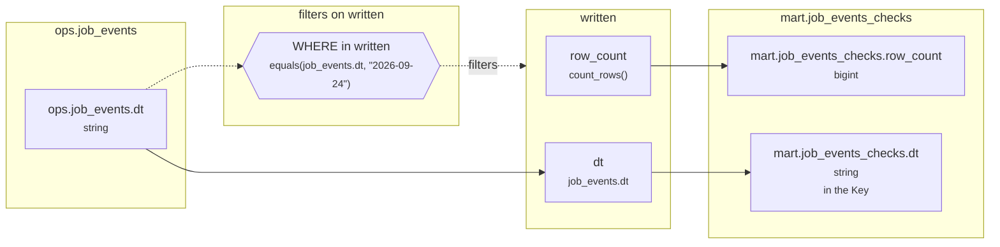

# Lineage: written

Made by `export_lineage`. The chart is written in Mermaid, which JupyterLab draws. Arrows run from where a value comes from to where it goes. A solid arrow carries a value. A dotted arrow carries a column into a condition, or runs from a condition to the step whose rows it decides (labelled "filters").

## Graph



## written

It writes the Saved table mart.job_events_checks, replacing each partition its rows fill.

### Calculated columns

Every column that is calculated rather than copied, in the order it is calculated.

#### `row_count`

Calculated in **written** as `count_rows()`, which is `COUNT(*)`.

```text
written.row_count = count_rows()
└─ (no columns: it counts rows)
```

Rows that count:
- WHERE in written: `equals(job_events.dt, "2026-09-24")`, which is `job_events.dt = '2026-09-24'` (reads ops.job_events.dt)

One value for each different `job_events.dt`.

### Copied columns

| Output | Comes from |
| --- | --- |
| `dt` | ops.job_events.dt |

### Keys

The columns that tell each step's rows apart, as the Toolbox works them out. A column in one is marked "in the Key" in the chart.

- written: one row, so it needs no Key: GROUP_BY makes one row for each dt, with dt held to one value.
- mart.job_events_checks' Key (dt) holds: each row written has its own.

### Hive as submitted

```sql
INSERT OVERWRITE TABLE mart.job_events_checks PARTITION(dt)
SELECT
  COUNT(*) AS row_count,
  job_events.dt
FROM ops.job_events AS job_events
WHERE
  job_events.dt = '2026-09-24'
GROUP BY
  job_events.dt
```

---

Made by export_lineage on 2026-09-25 06:00, from your scripts at commit nogit, with sqlglot Composer 7.0.
