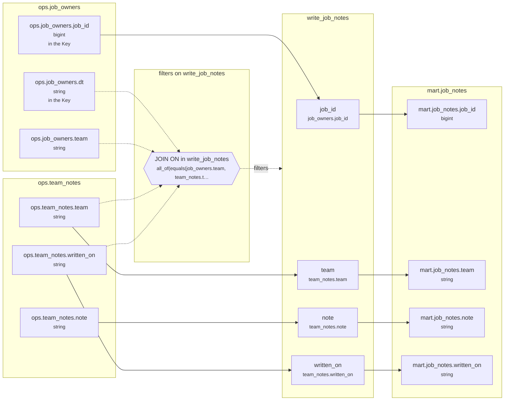

<!-- sqlglot Composer 7.1, exported 2026-10-22 13:22 - copy it, then edit your copy -->
# Lineage: write_job_notes

Made by `export_lineage`. The chart is written in Mermaid, which JupyterLab draws. Arrows run from where a value comes from to where it goes. A solid arrow carries a value. A dotted arrow carries a column into a condition, or runs from a condition to the step whose rows it decides (labelled "filters").

## Graph



## write_job_notes

It writes the whole Saved table mart.job_notes.

### Calculated columns

Every column that is calculated rather than copied, in the order it is calculated.

None: every column is copied.

### Copied columns

| Output | Comes from |
| --- | --- |
| `job_id` | ops.job_owners.job_id |
| `team` | ops.team_notes.team |
| `note` | ops.team_notes.note |
| `written_on` | ops.team_notes.written_on |

### Keys

The columns that tell each step's rows apart, as the Toolbox works them out. A column in one is marked "in the Key" in the chart.

- write_job_notes: no Key the Toolbox can see, since team_notes declares no Key.
- mart.job_notes declares no Key, so its rows aren't checked.

### Hive as submitted

```sql
INSERT OVERWRITE TABLE mart.job_notes
SELECT
  job_owners.job_id,
  team_notes.team,
  team_notes.note,
  team_notes.written_on
FROM ops.team_notes AS team_notes
JOIN ops.job_owners AS job_owners
  ON job_owners.team = team_notes.team
  AND job_owners.dt = team_notes.written_on
  AND job_owners.dt BETWEEN '2026-09-11' AND '2026-09-24'
```

---

Made by export_lineage on 2026-09-25 06:00, from your scripts at commit nogit, with sqlglot Composer 7.1.
