<!-- sqlglot Composer 6.0, exported 2026-10-21 07:24 - copy it, then edit your copy -->
# Lineage: statement_1, statement_2, statement_3, statement_4, statement_5, statement_6, statement_7, statement_8, statement_9

Made by `export_lineage`. The chart is written in Mermaid, which JupyterLab draws. Arrows run from where a value comes from to where it goes. A solid arrow carries a value. A dotted arrow carries a column into a condition, or runs from a condition to the step whose rows it decides (labelled "filters"). A dotted arrow labelled "day written" runs from a write's date bound to the day of the Saved table it writes.

## Graph

```mermaid
flowchart LR
  subgraph g0["ops.region_costs"]
    n0["ops.region_costs.job_id<br/><small>bigint</small><br/><small>in the Key</small>"]
    n2["ops.region_costs.dt<br/><small>string</small><br/><small>in the Key</small>"]
    n3["ops.region_costs.cost_cents<br/><small>bigint</small>"]
  end
  subgraph g1["costs_per_job_day in statement_1"]
    n1["costs_per_job_day in statement_1.job_id<br/><small>region_costs.job_id</small><br/><small>in the Key</small>"]
    n4["costs_per_job_day in statement_1.cost_cents<br/><small>sum_of(region_costs.cost_cents)</small>"]
  end
  subgraph g2["filters on costs_per_job_day in statement_1"]
    n5{{"WHERE in costs_per_job_day in statement_1<br/><small>equals(region_costs.dt, datetime.date(2026,…</small>"}}
  end
  subgraph g3["statement_1"]
    n6["job_id<br/><small>costs_per_job_day.job_id</small><br/><small>in the Key</small>"]
    n7["cost_cents<br/><small>costs_per_job_day.cost_cents</small>"]
  end
  subgraph g4["mart.job_day_costs"]
    n8["mart.job_day_costs.job_id<br/><small>bigint</small><br/><small>in the Key</small>"]
    n9["mart.job_day_costs.cost_cents<br/><small>bigint</small>"]
    n10["mart.job_day_costs.dt<br/><small>string</small><br/><small>in the Key</small>"]
  end
  subgraph g5["costs_per_job_day in statement_2"]
    n11["costs_per_job_day in statement_2.job_id<br/><small>region_costs.job_id</small><br/><small>in the Key</small>"]
    n12["costs_per_job_day in statement_2.cost_cents<br/><small>sum_of(region_costs.cost_cents)</small>"]
  end
  subgraph g6["filters on costs_per_job_day in statement_2"]
    n13{{"WHERE in costs_per_job_day in statement_2<br/><small>equals(region_costs.dt, datetime.date(2026,…</small>"}}
  end
  subgraph g7["statement_2"]
    n14["job_id<br/><small>costs_per_job_day.job_id</small><br/><small>in the Key</small>"]
    n15["cost_cents<br/><small>costs_per_job_day.cost_cents</small>"]
  end
  subgraph g8["costs_per_job_day in statement_3"]
    n16["costs_per_job_day in statement_3.job_id<br/><small>region_costs.job_id</small><br/><small>in the Key</small>"]
    n17["costs_per_job_day in statement_3.cost_cents<br/><small>sum_of(region_costs.cost_cents)</small>"]
  end
  subgraph g9["filters on costs_per_job_day in statement_3"]
    n18{{"WHERE in costs_per_job_day in statement_3<br/><small>equals(region_costs.dt, datetime.date(2026,…</small>"}}
  end
  subgraph g10["statement_3"]
    n19["job_id<br/><small>costs_per_job_day.job_id</small><br/><small>in the Key</small>"]
    n20["cost_cents<br/><small>costs_per_job_day.cost_cents</small>"]
  end
  subgraph g11["ops.job_events"]
    n21["ops.job_events.job_id<br/><small>bigint</small>"]
    n23["ops.job_events.dt<br/><small>string</small>"]
    n26["ops.job_events.event_type<br/><small>string</small>"]
    n28["ops.job_events.minutes<br/><small>int</small>"]
  end
  subgraph g12["events_per_job_day in statement_4"]
    n22["events_per_job_day in statement_4.job_id<br/><small>job_events.job_id</small><br/><small>in the Key</small>"]
    n24["events_per_job_day in statement_4.dt<br/><small>job_events.dt</small>"]
    n25["events_per_job_day in statement_4.events<br/><small>count_rows()</small>"]
    n27["events_per_job_day in statement_4.runs<br/><small>count_rows(where=equals(job_events.event_ty…</small>"]
    n29["events_per_job_day in statement_4.minutes<br/><small>fill_null(sum_of(job_events.minutes, where=…</small>"]
  end
  subgraph g13["filters on events_per_job_day in statement_4"]
    n30{{"WHERE in events_per_job_day in statement_4<br/><small>equals(job_events.dt, datetime.date(2026, 9…</small>"}}
  end
  subgraph g14["statement_4"]
    n31["job_id<br/><small>events_per_job_day.job_id</small><br/><small>in the Key</small>"]
    n33["team<br/><small>job_owners.team</small>"]
    n34["events<br/><small>events_per_job_day.events</small>"]
    n35["runs<br/><small>events_per_job_day.runs</small>"]
    n36["minutes<br/><small>events_per_job_day.minutes</small>"]
  end
  subgraph g15["ops.job_owners"]
    n32["ops.job_owners.team<br/><small>string</small>"]
    n38["ops.job_owners.dt<br/><small>string</small><br/><small>in the Key</small>"]
    n39["ops.job_owners.job_id<br/><small>bigint</small><br/><small>in the Key</small>"]
  end
  subgraph g16["filters on statement_4"]
    n37{{"LEFT JOIN ON in statement_4<br/><small>all_of(equals(job_owners.job_id, events_per…</small>"}}
  end
  subgraph g17["mart.job_day_facts"]
    n40["mart.job_day_facts.job_id<br/><small>bigint</small><br/><small>in the Key</small>"]
    n41["mart.job_day_facts.team<br/><small>string</small>"]
    n42["mart.job_day_facts.events<br/><small>bigint</small>"]
    n43["mart.job_day_facts.runs<br/><small>bigint</small>"]
    n44["mart.job_day_facts.minutes<br/><small>bigint</small>"]
    n45["mart.job_day_facts.dt<br/><small>string</small><br/><small>in the Key</small>"]
  end
  subgraph g18["events_per_job_day in statement_5"]
    n46["events_per_job_day in statement_5.job_id<br/><small>job_events.job_id</small><br/><small>in the Key</small>"]
    n47["events_per_job_day in statement_5.dt<br/><small>job_events.dt</small>"]
    n48["events_per_job_day in statement_5.events<br/><small>count_rows()</small>"]
    n49["events_per_job_day in statement_5.runs<br/><small>count_rows(where=equals(job_events.event_ty…</small>"]
    n50["events_per_job_day in statement_5.minutes<br/><small>fill_null(sum_of(job_events.minutes, where=…</small>"]
  end
  subgraph g19["filters on events_per_job_day in statement_5"]
    n51{{"WHERE in events_per_job_day in statement_5<br/><small>equals(job_events.dt, datetime.date(2026, 9…</small>"}}
  end
  subgraph g20["statement_5"]
    n52["job_id<br/><small>events_per_job_day.job_id</small><br/><small>in the Key</small>"]
    n53["team<br/><small>job_owners.team</small>"]
    n54["events<br/><small>events_per_job_day.events</small>"]
    n55["runs<br/><small>events_per_job_day.runs</small>"]
    n56["minutes<br/><small>events_per_job_day.minutes</small>"]
  end
  subgraph g21["filters on statement_5"]
    n57{{"LEFT JOIN ON in statement_5<br/><small>all_of(equals(job_owners.job_id, events_per…</small>"}}
  end
  subgraph g22["events_per_job_day in statement_6"]
    n58["events_per_job_day in statement_6.job_id<br/><small>job_events.job_id</small><br/><small>in the Key</small>"]
    n59["events_per_job_day in statement_6.dt<br/><small>job_events.dt</small>"]
    n60["events_per_job_day in statement_6.events<br/><small>count_rows()</small>"]
    n61["events_per_job_day in statement_6.runs<br/><small>count_rows(where=equals(job_events.event_ty…</small>"]
    n62["events_per_job_day in statement_6.minutes<br/><small>fill_null(sum_of(job_events.minutes, where=…</small>"]
  end
  subgraph g23["filters on events_per_job_day in statement_6"]
    n63{{"WHERE in events_per_job_day in statement_6<br/><small>equals(job_events.dt, datetime.date(2026, 9…</small>"}}
  end
  subgraph g24["statement_6"]
    n64["job_id<br/><small>events_per_job_day.job_id</small><br/><small>in the Key</small>"]
    n65["team<br/><small>job_owners.team</small>"]
    n66["events<br/><small>events_per_job_day.events</small>"]
    n67["runs<br/><small>events_per_job_day.runs</small>"]
    n68["minutes<br/><small>events_per_job_day.minutes</small>"]
  end
  subgraph g25["filters on statement_6"]
    n69{{"LEFT JOIN ON in statement_6<br/><small>all_of(equals(job_owners.job_id, events_per…</small>"}}
  end
  subgraph g26["statement_7"]
    n70["team<br/><small>job_day_facts.team</small><br/><small>in the Key</small>"]
    n71["events<br/><small>sum_of(job_day_facts.events)</small>"]
    n72["runs<br/><small>sum_of(job_day_facts.runs)</small>"]
    n73["minutes<br/><small>sum_of(job_day_facts.minutes)</small>"]
    n74["cost_cents<br/><small>sum_of(job_day_costs.cost_cents)</small>"]
  end
  subgraph g27["filters on statement_7"]
    n75{{"WHERE in statement_7<br/><small>equals(job_day_facts.dt, datetime.date(2026…</small>"}}
    n76{{"LEFT JOIN ON in statement_7<br/><small>all_of(equals(job_day_costs.job_id, job_day…</small>"}}
  end
  subgraph g28["mart.team_days"]
    n77["mart.team_days.team<br/><small>string</small><br/><small>in the Key</small>"]
    n78["mart.team_days.events<br/><small>bigint</small>"]
    n79["mart.team_days.runs<br/><small>bigint</small>"]
    n80["mart.team_days.minutes<br/><small>bigint</small>"]
    n81["mart.team_days.cost_cents<br/><small>bigint</small>"]
    n82["mart.team_days.dt<br/><small>string</small><br/><small>in the Key</small>"]
  end
  subgraph g29["statement_8"]
    n83["team<br/><small>job_day_facts.team</small><br/><small>in the Key</small>"]
    n84["events<br/><small>sum_of(job_day_facts.events)</small>"]
    n85["runs<br/><small>sum_of(job_day_facts.runs)</small>"]
    n86["minutes<br/><small>sum_of(job_day_facts.minutes)</small>"]
    n87["cost_cents<br/><small>sum_of(job_day_costs.cost_cents)</small>"]
  end
  subgraph g30["filters on statement_8"]
    n88{{"WHERE in statement_8<br/><small>equals(job_day_facts.dt, datetime.date(2026…</small>"}}
    n89{{"LEFT JOIN ON in statement_8<br/><small>all_of(equals(job_day_costs.job_id, job_day…</small>"}}
  end
  subgraph g31["statement_9"]
    n90["team<br/><small>job_day_facts.team</small><br/><small>in the Key</small>"]
    n91["events<br/><small>sum_of(job_day_facts.events)</small>"]
    n92["runs<br/><small>sum_of(job_day_facts.runs)</small>"]
    n93["minutes<br/><small>sum_of(job_day_facts.minutes)</small>"]
    n94["cost_cents<br/><small>sum_of(job_day_costs.cost_cents)</small>"]
  end
  subgraph g32["filters on statement_9"]
    n95{{"WHERE in statement_9<br/><small>equals(job_day_facts.dt, datetime.date(2026…</small>"}}
    n96{{"LEFT JOIN ON in statement_9<br/><small>all_of(equals(job_day_costs.job_id, job_day…</small>"}}
  end
  n0 --> n1
  n3 --> n4
  n2 -.-> n5
  n1 --> n6
  n4 --> n7
  n6 --> n8
  n7 --> n9
  n5 -.->|day written| n10
  n0 --> n11
  n3 --> n12
  n2 -.-> n13
  n11 --> n14
  n12 --> n15
  n14 --> n8
  n15 --> n9
  n13 -.->|day written| n10
  n0 --> n16
  n3 --> n17
  n2 -.-> n18
  n16 --> n19
  n17 --> n20
  n19 --> n8
  n20 --> n9
  n18 -.->|day written| n10
  n21 --> n22
  n23 --> n24
  n26 --> n27
  n28 --> n29
  n26 --> n29
  n23 -.-> n30
  n22 --> n31
  n32 --> n33
  n25 --> n34
  n27 --> n35
  n29 --> n36
  n38 -.-> n37
  n39 -.-> n37
  n22 -.-> n37
  n24 -.-> n37
  n31 --> n40
  n33 --> n41
  n34 --> n42
  n35 --> n43
  n36 --> n44
  n30 -.->|day written| n45
  n21 --> n46
  n23 --> n47
  n26 --> n49
  n28 --> n50
  n26 --> n50
  n23 -.-> n51
  n46 --> n52
  n32 --> n53
  n48 --> n54
  n49 --> n55
  n50 --> n56
  n38 -.-> n57
  n39 -.-> n57
  n46 -.-> n57
  n47 -.-> n57
  n52 --> n40
  n53 --> n41
  n54 --> n42
  n55 --> n43
  n56 --> n44
  n51 -.->|day written| n45
  n21 --> n58
  n23 --> n59
  n26 --> n61
  n28 --> n62
  n26 --> n62
  n23 -.-> n63
  n58 --> n64
  n32 --> n65
  n60 --> n66
  n61 --> n67
  n62 --> n68
  n38 -.-> n69
  n39 -.-> n69
  n58 -.-> n69
  n59 -.-> n69
  n64 --> n40
  n65 --> n41
  n66 --> n42
  n67 --> n43
  n68 --> n44
  n63 -.->|day written| n45
  n41 --> n70
  n42 --> n71
  n43 --> n72
  n44 --> n73
  n9 --> n74
  n45 -.-> n75
  n10 -.-> n76
  n8 -.-> n76
  n40 -.-> n76
  n45 -.-> n76
  n70 --> n77
  n71 --> n78
  n72 --> n79
  n73 --> n80
  n74 --> n81
  n75 -.->|day written| n82
  n41 --> n83
  n42 --> n84
  n43 --> n85
  n44 --> n86
  n9 --> n87
  n45 -.-> n88
  n10 -.-> n89
  n8 -.-> n89
  n40 -.-> n89
  n45 -.-> n89
  n83 --> n77
  n84 --> n78
  n85 --> n79
  n86 --> n80
  n87 --> n81
  n88 -.->|day written| n82
  n41 --> n90
  n42 --> n91
  n43 --> n92
  n44 --> n93
  n9 --> n94
  n45 -.-> n95
  n10 -.-> n96
  n8 -.-> n96
  n40 -.-> n96
  n45 -.-> n96
  n90 --> n77
  n91 --> n78
  n92 --> n79
  n93 --> n80
  n94 --> n81
  n95 -.->|day written| n82
  n5 -.->|filters| g1
  n13 -.->|filters| g5
  n18 -.->|filters| g8
  n30 -.->|filters| g12
  n37 -.->|filters| g14
  n51 -.->|filters| g18
  n57 -.->|filters| g20
  n63 -.->|filters| g22
  n69 -.->|filters| g24
  n75 -.->|filters| g26
  n76 -.->|filters| g26
  n88 -.->|filters| g29
  n89 -.->|filters| g29
  n95 -.->|filters| g31
  n96 -.->|filters| g31
```



## statement_1

It writes the Saved table mart.job_day_costs, one day at a time.

### Calculated columns

Every column that is calculated rather than copied, in the order it is calculated.

#### `costs_per_job_day in statement_1.cost_cents`

Calculated in **costs_per_job_day in statement_1** as `sum_of(region_costs.cost_cents)`, which is `SUM(region_costs.cost_cents)`.

```text
costs_per_job_day in statement_1.cost_cents = sum_of(region_costs.cost_cents)
└─ ops.region_costs.cost_cents  (bigint)
```

Rows that count:
- WHERE in costs_per_job_day in statement_1: `equals(region_costs.dt, datetime.date(2026, 9, 22))`, which is `region_costs.dt = '20260922'` (reads ops.region_costs.dt)

One value for each different `region_costs.job_id` and `region_costs.dt`.

### Copied columns

| Output | Comes from |
| --- | --- |
| `job_id` | costs_per_job_day in statement_1.job_id ← ops.region_costs.job_id |
| `cost_cents` | costs_per_job_day in statement_1.cost_cents (calculated) ← ops.region_costs.cost_cents |

### Keys

The columns that tell each step's rows apart, as the Toolbox works them out. A column in one is marked "in the Key" in the chart.

- derived('costs_per_job_day', ...): Key (job_id), since GROUP_BY makes one row for each job_id, dt, with dt held to one value.
- statement_1: Key (job_id), since costs_per_job_day's rows are told apart by job_id.
- mart.job_day_costs' Key (job_id, dt) holds: each row written has its own.

### Hive as submitted

```sql
WITH costs_per_job_day AS (
  SELECT
    region_costs.job_id,
    region_costs.dt,
    SUM(region_costs.cost_cents) AS cost_cents
  FROM ops.region_costs AS region_costs
  WHERE
    region_costs.dt = '20260922'
  GROUP BY
    region_costs.job_id,
    region_costs.dt
)
INSERT OVERWRITE TABLE mart.job_day_costs PARTITION(dt = '2026-09-22')
SELECT
  costs_per_job_day.job_id,
  costs_per_job_day.cost_cents
FROM costs_per_job_day
```

## statement_2

It writes the Saved table mart.job_day_costs, one day at a time.

### Calculated columns

Every column that is calculated rather than copied, in the order it is calculated.

#### `costs_per_job_day in statement_2.cost_cents`

Calculated in **costs_per_job_day in statement_2** as `sum_of(region_costs.cost_cents)`, which is `SUM(region_costs.cost_cents)`.

```text
costs_per_job_day in statement_2.cost_cents = sum_of(region_costs.cost_cents)
└─ ops.region_costs.cost_cents  (bigint)
```

Rows that count:
- WHERE in costs_per_job_day in statement_2: `equals(region_costs.dt, datetime.date(2026, 9, 23))`, which is `region_costs.dt = '20260923'` (reads ops.region_costs.dt)

One value for each different `region_costs.job_id` and `region_costs.dt`.

### Copied columns

| Output | Comes from |
| --- | --- |
| `job_id` | costs_per_job_day in statement_2.job_id ← ops.region_costs.job_id |
| `cost_cents` | costs_per_job_day in statement_2.cost_cents (calculated) ← ops.region_costs.cost_cents |

### Keys

The columns that tell each step's rows apart, as the Toolbox works them out. A column in one is marked "in the Key" in the chart.

- derived('costs_per_job_day', ...): Key (job_id), since GROUP_BY makes one row for each job_id, dt, with dt held to one value.
- statement_2: Key (job_id), since costs_per_job_day's rows are told apart by job_id.
- mart.job_day_costs' Key (job_id, dt) holds: each row written has its own.

### Hive as submitted

```sql
WITH costs_per_job_day AS (
  SELECT
    region_costs.job_id,
    region_costs.dt,
    SUM(region_costs.cost_cents) AS cost_cents
  FROM ops.region_costs AS region_costs
  WHERE
    region_costs.dt = '20260923'
  GROUP BY
    region_costs.job_id,
    region_costs.dt
)
INSERT OVERWRITE TABLE mart.job_day_costs PARTITION(dt = '2026-09-23')
SELECT
  costs_per_job_day.job_id,
  costs_per_job_day.cost_cents
FROM costs_per_job_day
```

## statement_3

It writes the Saved table mart.job_day_costs, one day at a time.

### Calculated columns

Every column that is calculated rather than copied, in the order it is calculated.

#### `costs_per_job_day in statement_3.cost_cents`

Calculated in **costs_per_job_day in statement_3** as `sum_of(region_costs.cost_cents)`, which is `SUM(region_costs.cost_cents)`.

```text
costs_per_job_day in statement_3.cost_cents = sum_of(region_costs.cost_cents)
└─ ops.region_costs.cost_cents  (bigint)
```

Rows that count:
- WHERE in costs_per_job_day in statement_3: `equals(region_costs.dt, datetime.date(2026, 9, 24))`, which is `region_costs.dt = '20260924'` (reads ops.region_costs.dt)

One value for each different `region_costs.job_id` and `region_costs.dt`.

### Copied columns

| Output | Comes from |
| --- | --- |
| `job_id` | costs_per_job_day in statement_3.job_id ← ops.region_costs.job_id |
| `cost_cents` | costs_per_job_day in statement_3.cost_cents (calculated) ← ops.region_costs.cost_cents |

### Keys

The columns that tell each step's rows apart, as the Toolbox works them out. A column in one is marked "in the Key" in the chart.

- derived('costs_per_job_day', ...): Key (job_id), since GROUP_BY makes one row for each job_id, dt, with dt held to one value.
- statement_3: Key (job_id), since costs_per_job_day's rows are told apart by job_id.
- mart.job_day_costs' Key (job_id, dt) holds: each row written has its own.

### Hive as submitted

```sql
WITH costs_per_job_day AS (
  SELECT
    region_costs.job_id,
    region_costs.dt,
    SUM(region_costs.cost_cents) AS cost_cents
  FROM ops.region_costs AS region_costs
  WHERE
    region_costs.dt = '20260924'
  GROUP BY
    region_costs.job_id,
    region_costs.dt
)
INSERT OVERWRITE TABLE mart.job_day_costs PARTITION(dt = '2026-09-24')
SELECT
  costs_per_job_day.job_id,
  costs_per_job_day.cost_cents
FROM costs_per_job_day
```

## statement_4

It writes the Saved table mart.job_day_facts, one day at a time.

### Calculated columns

Every column that is calculated rather than copied, in the order it is calculated.

#### `events_per_job_day in statement_4.events`

Calculated in **events_per_job_day in statement_4** as `count_rows()`, which is `COUNT(*)`.

```text
events_per_job_day in statement_4.events = count_rows()
└─ (no columns: it counts rows)
```

Rows that count:
- WHERE in events_per_job_day in statement_4: `equals(job_events.dt, datetime.date(2026, 9, 22))`, which is `job_events.dt = '2026-09-22'` (reads ops.job_events.dt)

One value for each different `job_events.job_id` and `job_events.dt`.

#### `events_per_job_day in statement_4.runs`

Calculated in **events_per_job_day in statement_4** as `count_rows(where=equals(job_events.event_type, "start"))`, which is `COUNT(CASE WHEN job_events.event_type = 'start' THEN 1 END)`.

```text
events_per_job_day in statement_4.runs = count_rows(where=equals(job_events.event_type, "start"))
└─ ops.job_events.event_type  (string)
```

Rows that count:
- WHERE in events_per_job_day in statement_4: `equals(job_events.dt, datetime.date(2026, 9, 22))`, which is `job_events.dt = '2026-09-22'` (reads ops.job_events.dt)

One value for each different `job_events.job_id` and `job_events.dt`.

#### `events_per_job_day in statement_4.minutes`

Calculated in **events_per_job_day in statement_4** as `fill_null(sum_of(job_events.minutes, where=is_in(job_events.event_type, ["finish", "fail"])), 0)`, which is `COALESCE(SUM(CASE WHEN job_events.event_type IN ('finish', 'fail') THEN job_events.minutes END), 0)`.

```text
events_per_job_day in statement_4.minutes = fill_null(sum_of(job_events.minutes, where=is_in(job_events.event_type, ["finish", "fail"])), 0)
├─ ops.job_events.minutes  (int)
└─ ops.job_events.event_type  (string)
```

Rows that count:
- WHERE in events_per_job_day in statement_4: `equals(job_events.dt, datetime.date(2026, 9, 22))`, which is `job_events.dt = '2026-09-22'` (reads ops.job_events.dt)

One value for each different `job_events.job_id` and `job_events.dt`.

### Copied columns

| Output | Comes from |
| --- | --- |
| `job_id` | events_per_job_day in statement_4.job_id ← ops.job_events.job_id |
| `team` | ops.job_owners.team |
| `events` | events_per_job_day in statement_4.events (calculated) |
| `runs` | events_per_job_day in statement_4.runs (calculated) ← ops.job_events.event_type |
| `minutes` | events_per_job_day in statement_4.minutes (calculated) ← ops.job_events.minutes |

### Keys

The columns that tell each step's rows apart, as the Toolbox works them out. A column in one is marked "in the Key" in the chart.

- derived('events_per_job_day', ...): Key (job_id), since GROUP_BY makes one row for each job_id, dt, with dt held to one value.
- statement_4: Key (job_id), since events_per_job_day's rows are told apart by job_id.
- mart.job_day_facts' Key (job_id, dt) holds: each row written has its own.

### Hive as submitted

```sql
WITH events_per_job_day AS (
  SELECT
    job_events.job_id,
    job_events.dt,
    COUNT(*) AS events,
    COUNT(CASE WHEN job_events.event_type = 'start' THEN 1 END) AS runs,
    COALESCE(
      SUM(
        CASE WHEN job_events.event_type IN ('finish', 'fail') THEN job_events.minutes END
      ),
      0
    ) AS minutes
  FROM ops.job_events AS job_events
  WHERE
    job_events.dt = '2026-09-22'
  GROUP BY
    job_events.job_id,
    job_events.dt
)
INSERT OVERWRITE TABLE mart.job_day_facts PARTITION(dt = '2026-09-22')
SELECT
  events_per_job_day.job_id,
  job_owners.team,
  events_per_job_day.events,
  events_per_job_day.runs,
  events_per_job_day.minutes
FROM events_per_job_day
LEFT JOIN ops.job_owners AS job_owners
  ON job_owners.job_id = events_per_job_day.job_id
  AND job_owners.dt = events_per_job_day.dt
  AND job_owners.dt BETWEEN '2026-09-22' AND '2026-09-24'
```

## statement_5

It writes the Saved table mart.job_day_facts, one day at a time.

### Calculated columns

Every column that is calculated rather than copied, in the order it is calculated.

#### `events_per_job_day in statement_5.events`

Calculated in **events_per_job_day in statement_5** as `count_rows()`, which is `COUNT(*)`.

```text
events_per_job_day in statement_5.events = count_rows()
└─ (no columns: it counts rows)
```

Rows that count:
- WHERE in events_per_job_day in statement_5: `equals(job_events.dt, datetime.date(2026, 9, 23))`, which is `job_events.dt = '2026-09-23'` (reads ops.job_events.dt)

One value for each different `job_events.job_id` and `job_events.dt`.

#### `events_per_job_day in statement_5.runs`

Calculated in **events_per_job_day in statement_5** as `count_rows(where=equals(job_events.event_type, "start"))`, which is `COUNT(CASE WHEN job_events.event_type = 'start' THEN 1 END)`.

```text
events_per_job_day in statement_5.runs = count_rows(where=equals(job_events.event_type, "start"))
└─ ops.job_events.event_type  (string)
```

Rows that count:
- WHERE in events_per_job_day in statement_5: `equals(job_events.dt, datetime.date(2026, 9, 23))`, which is `job_events.dt = '2026-09-23'` (reads ops.job_events.dt)

One value for each different `job_events.job_id` and `job_events.dt`.

#### `events_per_job_day in statement_5.minutes`

Calculated in **events_per_job_day in statement_5** as `fill_null(sum_of(job_events.minutes, where=is_in(job_events.event_type, ["finish", "fail"])), 0)`, which is `COALESCE(SUM(CASE WHEN job_events.event_type IN ('finish', 'fail') THEN job_events.minutes END), 0)`.

```text
events_per_job_day in statement_5.minutes = fill_null(sum_of(job_events.minutes, where=is_in(job_events.event_type, ["finish", "fail"])), 0)
├─ ops.job_events.minutes  (int)
└─ ops.job_events.event_type  (string)
```

Rows that count:
- WHERE in events_per_job_day in statement_5: `equals(job_events.dt, datetime.date(2026, 9, 23))`, which is `job_events.dt = '2026-09-23'` (reads ops.job_events.dt)

One value for each different `job_events.job_id` and `job_events.dt`.

### Copied columns

| Output | Comes from |
| --- | --- |
| `job_id` | events_per_job_day in statement_5.job_id ← ops.job_events.job_id |
| `team` | ops.job_owners.team |
| `events` | events_per_job_day in statement_5.events (calculated) |
| `runs` | events_per_job_day in statement_5.runs (calculated) ← ops.job_events.event_type |
| `minutes` | events_per_job_day in statement_5.minutes (calculated) ← ops.job_events.minutes |

### Keys

The columns that tell each step's rows apart, as the Toolbox works them out. A column in one is marked "in the Key" in the chart.

- derived('events_per_job_day', ...): Key (job_id), since GROUP_BY makes one row for each job_id, dt, with dt held to one value.
- statement_5: Key (job_id), since events_per_job_day's rows are told apart by job_id.
- mart.job_day_facts' Key (job_id, dt) holds: each row written has its own.

### Hive as submitted

```sql
WITH events_per_job_day AS (
  SELECT
    job_events.job_id,
    job_events.dt,
    COUNT(*) AS events,
    COUNT(CASE WHEN job_events.event_type = 'start' THEN 1 END) AS runs,
    COALESCE(
      SUM(
        CASE WHEN job_events.event_type IN ('finish', 'fail') THEN job_events.minutes END
      ),
      0
    ) AS minutes
  FROM ops.job_events AS job_events
  WHERE
    job_events.dt = '2026-09-23'
  GROUP BY
    job_events.job_id,
    job_events.dt
)
INSERT OVERWRITE TABLE mart.job_day_facts PARTITION(dt = '2026-09-23')
SELECT
  events_per_job_day.job_id,
  job_owners.team,
  events_per_job_day.events,
  events_per_job_day.runs,
  events_per_job_day.minutes
FROM events_per_job_day
LEFT JOIN ops.job_owners AS job_owners
  ON job_owners.job_id = events_per_job_day.job_id
  AND job_owners.dt = events_per_job_day.dt
  AND job_owners.dt BETWEEN '2026-09-22' AND '2026-09-24'
```

## statement_6

It writes the Saved table mart.job_day_facts, one day at a time.

### Calculated columns

Every column that is calculated rather than copied, in the order it is calculated.

#### `events_per_job_day in statement_6.events`

Calculated in **events_per_job_day in statement_6** as `count_rows()`, which is `COUNT(*)`.

```text
events_per_job_day in statement_6.events = count_rows()
└─ (no columns: it counts rows)
```

Rows that count:
- WHERE in events_per_job_day in statement_6: `equals(job_events.dt, datetime.date(2026, 9, 24))`, which is `job_events.dt = '2026-09-24'` (reads ops.job_events.dt)

One value for each different `job_events.job_id` and `job_events.dt`.

#### `events_per_job_day in statement_6.runs`

Calculated in **events_per_job_day in statement_6** as `count_rows(where=equals(job_events.event_type, "start"))`, which is `COUNT(CASE WHEN job_events.event_type = 'start' THEN 1 END)`.

```text
events_per_job_day in statement_6.runs = count_rows(where=equals(job_events.event_type, "start"))
└─ ops.job_events.event_type  (string)
```

Rows that count:
- WHERE in events_per_job_day in statement_6: `equals(job_events.dt, datetime.date(2026, 9, 24))`, which is `job_events.dt = '2026-09-24'` (reads ops.job_events.dt)

One value for each different `job_events.job_id` and `job_events.dt`.

#### `events_per_job_day in statement_6.minutes`

Calculated in **events_per_job_day in statement_6** as `fill_null(sum_of(job_events.minutes, where=is_in(job_events.event_type, ["finish", "fail"])), 0)`, which is `COALESCE(SUM(CASE WHEN job_events.event_type IN ('finish', 'fail') THEN job_events.minutes END), 0)`.

```text
events_per_job_day in statement_6.minutes = fill_null(sum_of(job_events.minutes, where=is_in(job_events.event_type, ["finish", "fail"])), 0)
├─ ops.job_events.minutes  (int)
└─ ops.job_events.event_type  (string)
```

Rows that count:
- WHERE in events_per_job_day in statement_6: `equals(job_events.dt, datetime.date(2026, 9, 24))`, which is `job_events.dt = '2026-09-24'` (reads ops.job_events.dt)

One value for each different `job_events.job_id` and `job_events.dt`.

### Copied columns

| Output | Comes from |
| --- | --- |
| `job_id` | events_per_job_day in statement_6.job_id ← ops.job_events.job_id |
| `team` | ops.job_owners.team |
| `events` | events_per_job_day in statement_6.events (calculated) |
| `runs` | events_per_job_day in statement_6.runs (calculated) ← ops.job_events.event_type |
| `minutes` | events_per_job_day in statement_6.minutes (calculated) ← ops.job_events.minutes |

### Keys

The columns that tell each step's rows apart, as the Toolbox works them out. A column in one is marked "in the Key" in the chart.

- derived('events_per_job_day', ...): Key (job_id), since GROUP_BY makes one row for each job_id, dt, with dt held to one value.
- statement_6: Key (job_id), since events_per_job_day's rows are told apart by job_id.
- mart.job_day_facts' Key (job_id, dt) holds: each row written has its own.

### Hive as submitted

```sql
WITH events_per_job_day AS (
  SELECT
    job_events.job_id,
    job_events.dt,
    COUNT(*) AS events,
    COUNT(CASE WHEN job_events.event_type = 'start' THEN 1 END) AS runs,
    COALESCE(
      SUM(
        CASE WHEN job_events.event_type IN ('finish', 'fail') THEN job_events.minutes END
      ),
      0
    ) AS minutes
  FROM ops.job_events AS job_events
  WHERE
    job_events.dt = '2026-09-24'
  GROUP BY
    job_events.job_id,
    job_events.dt
)
INSERT OVERWRITE TABLE mart.job_day_facts PARTITION(dt = '2026-09-24')
SELECT
  events_per_job_day.job_id,
  job_owners.team,
  events_per_job_day.events,
  events_per_job_day.runs,
  events_per_job_day.minutes
FROM events_per_job_day
LEFT JOIN ops.job_owners AS job_owners
  ON job_owners.job_id = events_per_job_day.job_id
  AND job_owners.dt = events_per_job_day.dt
  AND job_owners.dt BETWEEN '2026-09-22' AND '2026-09-24'
```

## statement_7

It reads the Saved table mart.job_day_costs, written by statement_1 and statement_2 and statement_3 above. It reads the Saved table mart.job_day_facts, written by statement_4 and statement_5 and statement_6 above. It writes the Saved table mart.team_days, one day at a time.

### Calculated columns

Every column that is calculated rather than copied, in the order it is calculated.

#### `events`

Calculated in **statement_7** as `sum_of(job_day_facts.events)`, which is `SUM(job_day_facts.events)`.

```text
statement_7.events = sum_of(job_day_facts.events)
└─ mart.job_day_facts.events  (bigint)
   ├─ statement_4.events
   │  └─ events_per_job_day in statement_4.events = count_rows()
   ├─ statement_5.events
   │  └─ events_per_job_day in statement_5.events = count_rows()
   └─ statement_6.events
      └─ events_per_job_day in statement_6.events = count_rows()
```

Rows that count:
- WHERE in statement_7: `equals(job_day_facts.dt, datetime.date(2026, 9, 22))`, which is `job_day_facts.dt = '2026-09-22'` (reads mart.job_day_facts.dt)

One value for each different `job_day_facts.dt` and `job_day_facts.team`.

#### `runs`

Calculated in **statement_7** as `sum_of(job_day_facts.runs)`, which is `SUM(job_day_facts.runs)`.

```text
statement_7.runs = sum_of(job_day_facts.runs)
└─ mart.job_day_facts.runs  (bigint)
   ├─ statement_4.runs
   │  └─ events_per_job_day in statement_4.runs = count_rows(where=equals(job_events.event_type, "start"))
   │     └─ ops.job_events.event_type  (string)
   ├─ statement_5.runs
   │  └─ events_per_job_day in statement_5.runs = count_rows(where=equals(job_events.event_type, "start"))
   │     └─ ops.job_events.event_type  (string)
   └─ statement_6.runs
      └─ events_per_job_day in statement_6.runs = count_rows(where=equals(job_events.event_type, "start"))
         └─ ops.job_events.event_type  (string)
```

Rows that count:
- WHERE in statement_7: `equals(job_day_facts.dt, datetime.date(2026, 9, 22))`, which is `job_day_facts.dt = '2026-09-22'` (reads mart.job_day_facts.dt)

One value for each different `job_day_facts.dt` and `job_day_facts.team`.

#### `minutes`

Calculated in **statement_7** as `sum_of(job_day_facts.minutes)`, which is `SUM(job_day_facts.minutes)`.

```text
statement_7.minutes = sum_of(job_day_facts.minutes)
└─ mart.job_day_facts.minutes  (bigint)
   ├─ statement_4.minutes
   │  └─ events_per_job_day in statement_4.minutes = fill_null(sum_of(job_events.minutes, where=is_in(job_events.event_type, ["finish", "fail"])), 0)
   │     ├─ ops.job_events.minutes  (int)
   │     └─ ops.job_events.event_type  (string)
   ├─ statement_5.minutes
   │  └─ events_per_job_day in statement_5.minutes = fill_null(sum_of(job_events.minutes, where=is_in(job_events.event_type, ["finish", "fail"])), 0)
   │     ├─ ops.job_events.minutes  (int)
   │     └─ ops.job_events.event_type  (string)
   └─ statement_6.minutes
      └─ events_per_job_day in statement_6.minutes = fill_null(sum_of(job_events.minutes, where=is_in(job_events.event_type, ["finish", "fail"])), 0)
         ├─ ops.job_events.minutes  (int)
         └─ ops.job_events.event_type  (string)
```

Rows that count:
- WHERE in statement_7: `equals(job_day_facts.dt, datetime.date(2026, 9, 22))`, which is `job_day_facts.dt = '2026-09-22'` (reads mart.job_day_facts.dt)

One value for each different `job_day_facts.dt` and `job_day_facts.team`.

#### `cost_cents`

Calculated in **statement_7** as `sum_of(job_day_costs.cost_cents)`, which is `SUM(job_day_costs.cost_cents)`.

```text
statement_7.cost_cents = sum_of(job_day_costs.cost_cents)
└─ mart.job_day_costs.cost_cents  (bigint)
   ├─ statement_1.cost_cents
   │  └─ costs_per_job_day in statement_1.cost_cents = sum_of(region_costs.cost_cents)
   │     └─ ops.region_costs.cost_cents  (bigint)
   ├─ statement_2.cost_cents
   │  └─ costs_per_job_day in statement_2.cost_cents = sum_of(region_costs.cost_cents)
   │     └─ ops.region_costs.cost_cents  (bigint)
   └─ statement_3.cost_cents
      └─ costs_per_job_day in statement_3.cost_cents = sum_of(region_costs.cost_cents)
         └─ ops.region_costs.cost_cents  (bigint)
```

Rows that count:
- WHERE in statement_7: `equals(job_day_facts.dt, datetime.date(2026, 9, 22))`, which is `job_day_facts.dt = '2026-09-22'` (reads mart.job_day_facts.dt)
- LEFT JOIN ON in statement_7: `all_of(equals(job_day_costs.job_id, job_day_facts.job_id), equals(job_day_costs.dt, job_day_facts.dt), between(job_day_costs.dt, "2026-09-22", "2026-09-24"))`, which is `job_day_costs.job_id = job_day_facts.job_id AND job_day_costs.dt = job_day_facts.dt AND job_day_costs.dt BETWEEN '2026-09-22' AND '2026-09-24'` (reads mart.job_day_costs.dt, mart.job_day_costs.job_id, mart.job_day_facts.dt, mart.job_day_facts.job_id)

One value for each different `job_day_facts.dt` and `job_day_facts.team`.

### Copied columns

| Output | Comes from |
| --- | --- |
| `team` | mart.job_day_facts.team ← statement_4.team ← ops.job_owners.team |

### Keys

The columns that tell each step's rows apart, as the Toolbox works them out. A column in one is marked "in the Key" in the chart.

- statement_7: Key (team), since GROUP_BY makes one row for each team, dt, with dt held to one value.
- mart.team_days' Key (team, dt) holds: each row written has its own.

### Hive as submitted

```sql
INSERT OVERWRITE TABLE mart.team_days PARTITION(dt = '2026-09-22')
SELECT
  job_day_facts.team,
  SUM(job_day_facts.events) AS events,
  SUM(job_day_facts.runs) AS runs,
  SUM(job_day_facts.minutes) AS minutes,
  SUM(job_day_costs.cost_cents) AS cost_cents
FROM mart.job_day_facts AS job_day_facts
LEFT JOIN mart.job_day_costs AS job_day_costs
  ON job_day_costs.job_id = job_day_facts.job_id
  AND job_day_costs.dt = job_day_facts.dt
  AND job_day_costs.dt BETWEEN '2026-09-22' AND '2026-09-24'
WHERE
  job_day_facts.dt = '2026-09-22'
GROUP BY
  job_day_facts.dt,
  job_day_facts.team
```

## statement_8

It reads the Saved table mart.job_day_costs, written by statement_1 and statement_2 and statement_3 above. It reads the Saved table mart.job_day_facts, written by statement_4 and statement_5 and statement_6 above. It writes the Saved table mart.team_days, one day at a time.

### Calculated columns

Every column that is calculated rather than copied, in the order it is calculated.

#### `events`

Calculated in **statement_8** as `sum_of(job_day_facts.events)`, which is `SUM(job_day_facts.events)`.

```text
statement_8.events = sum_of(job_day_facts.events)
└─ mart.job_day_facts.events  (bigint)
   ├─ statement_4.events
   │  └─ events_per_job_day in statement_4.events = count_rows()
   ├─ statement_5.events
   │  └─ events_per_job_day in statement_5.events = count_rows()
   └─ statement_6.events
      └─ events_per_job_day in statement_6.events = count_rows()
```

Rows that count:
- WHERE in statement_8: `equals(job_day_facts.dt, datetime.date(2026, 9, 23))`, which is `job_day_facts.dt = '2026-09-23'` (reads mart.job_day_facts.dt)

One value for each different `job_day_facts.dt` and `job_day_facts.team`.

#### `runs`

Calculated in **statement_8** as `sum_of(job_day_facts.runs)`, which is `SUM(job_day_facts.runs)`.

```text
statement_8.runs = sum_of(job_day_facts.runs)
└─ mart.job_day_facts.runs  (bigint)
   ├─ statement_4.runs
   │  └─ events_per_job_day in statement_4.runs = count_rows(where=equals(job_events.event_type, "start"))
   │     └─ ops.job_events.event_type  (string)
   ├─ statement_5.runs
   │  └─ events_per_job_day in statement_5.runs = count_rows(where=equals(job_events.event_type, "start"))
   │     └─ ops.job_events.event_type  (string)
   └─ statement_6.runs
      └─ events_per_job_day in statement_6.runs = count_rows(where=equals(job_events.event_type, "start"))
         └─ ops.job_events.event_type  (string)
```

Rows that count:
- WHERE in statement_8: `equals(job_day_facts.dt, datetime.date(2026, 9, 23))`, which is `job_day_facts.dt = '2026-09-23'` (reads mart.job_day_facts.dt)

One value for each different `job_day_facts.dt` and `job_day_facts.team`.

#### `minutes`

Calculated in **statement_8** as `sum_of(job_day_facts.minutes)`, which is `SUM(job_day_facts.minutes)`.

```text
statement_8.minutes = sum_of(job_day_facts.minutes)
└─ mart.job_day_facts.minutes  (bigint)
   ├─ statement_4.minutes
   │  └─ events_per_job_day in statement_4.minutes = fill_null(sum_of(job_events.minutes, where=is_in(job_events.event_type, ["finish", "fail"])), 0)
   │     ├─ ops.job_events.minutes  (int)
   │     └─ ops.job_events.event_type  (string)
   ├─ statement_5.minutes
   │  └─ events_per_job_day in statement_5.minutes = fill_null(sum_of(job_events.minutes, where=is_in(job_events.event_type, ["finish", "fail"])), 0)
   │     ├─ ops.job_events.minutes  (int)
   │     └─ ops.job_events.event_type  (string)
   └─ statement_6.minutes
      └─ events_per_job_day in statement_6.minutes = fill_null(sum_of(job_events.minutes, where=is_in(job_events.event_type, ["finish", "fail"])), 0)
         ├─ ops.job_events.minutes  (int)
         └─ ops.job_events.event_type  (string)
```

Rows that count:
- WHERE in statement_8: `equals(job_day_facts.dt, datetime.date(2026, 9, 23))`, which is `job_day_facts.dt = '2026-09-23'` (reads mart.job_day_facts.dt)

One value for each different `job_day_facts.dt` and `job_day_facts.team`.

#### `cost_cents`

Calculated in **statement_8** as `sum_of(job_day_costs.cost_cents)`, which is `SUM(job_day_costs.cost_cents)`.

```text
statement_8.cost_cents = sum_of(job_day_costs.cost_cents)
└─ mart.job_day_costs.cost_cents  (bigint)
   ├─ statement_1.cost_cents
   │  └─ costs_per_job_day in statement_1.cost_cents = sum_of(region_costs.cost_cents)
   │     └─ ops.region_costs.cost_cents  (bigint)
   ├─ statement_2.cost_cents
   │  └─ costs_per_job_day in statement_2.cost_cents = sum_of(region_costs.cost_cents)
   │     └─ ops.region_costs.cost_cents  (bigint)
   └─ statement_3.cost_cents
      └─ costs_per_job_day in statement_3.cost_cents = sum_of(region_costs.cost_cents)
         └─ ops.region_costs.cost_cents  (bigint)
```

Rows that count:
- WHERE in statement_8: `equals(job_day_facts.dt, datetime.date(2026, 9, 23))`, which is `job_day_facts.dt = '2026-09-23'` (reads mart.job_day_facts.dt)
- LEFT JOIN ON in statement_8: `all_of(equals(job_day_costs.job_id, job_day_facts.job_id), equals(job_day_costs.dt, job_day_facts.dt), between(job_day_costs.dt, "2026-09-22", "2026-09-24"))`, which is `job_day_costs.job_id = job_day_facts.job_id AND job_day_costs.dt = job_day_facts.dt AND job_day_costs.dt BETWEEN '2026-09-22' AND '2026-09-24'` (reads mart.job_day_costs.dt, mart.job_day_costs.job_id, mart.job_day_facts.dt, mart.job_day_facts.job_id)

One value for each different `job_day_facts.dt` and `job_day_facts.team`.

### Copied columns

| Output | Comes from |
| --- | --- |
| `team` | mart.job_day_facts.team ← statement_4.team ← ops.job_owners.team |

### Keys

The columns that tell each step's rows apart, as the Toolbox works them out. A column in one is marked "in the Key" in the chart.

- statement_8: Key (team), since GROUP_BY makes one row for each team, dt, with dt held to one value.
- mart.team_days' Key (team, dt) holds: each row written has its own.

### Hive as submitted

```sql
INSERT OVERWRITE TABLE mart.team_days PARTITION(dt = '2026-09-23')
SELECT
  job_day_facts.team,
  SUM(job_day_facts.events) AS events,
  SUM(job_day_facts.runs) AS runs,
  SUM(job_day_facts.minutes) AS minutes,
  SUM(job_day_costs.cost_cents) AS cost_cents
FROM mart.job_day_facts AS job_day_facts
LEFT JOIN mart.job_day_costs AS job_day_costs
  ON job_day_costs.job_id = job_day_facts.job_id
  AND job_day_costs.dt = job_day_facts.dt
  AND job_day_costs.dt BETWEEN '2026-09-22' AND '2026-09-24'
WHERE
  job_day_facts.dt = '2026-09-23'
GROUP BY
  job_day_facts.dt,
  job_day_facts.team
```

## statement_9

It reads the Saved table mart.job_day_costs, written by statement_1 and statement_2 and statement_3 above. It reads the Saved table mart.job_day_facts, written by statement_4 and statement_5 and statement_6 above. It writes the Saved table mart.team_days, one day at a time.

### Calculated columns

Every column that is calculated rather than copied, in the order it is calculated.

#### `events`

Calculated in **statement_9** as `sum_of(job_day_facts.events)`, which is `SUM(job_day_facts.events)`.

```text
statement_9.events = sum_of(job_day_facts.events)
└─ mart.job_day_facts.events  (bigint)
   ├─ statement_4.events
   │  └─ events_per_job_day in statement_4.events = count_rows()
   ├─ statement_5.events
   │  └─ events_per_job_day in statement_5.events = count_rows()
   └─ statement_6.events
      └─ events_per_job_day in statement_6.events = count_rows()
```

Rows that count:
- WHERE in statement_9: `equals(job_day_facts.dt, datetime.date(2026, 9, 24))`, which is `job_day_facts.dt = '2026-09-24'` (reads mart.job_day_facts.dt)

One value for each different `job_day_facts.dt` and `job_day_facts.team`.

#### `runs`

Calculated in **statement_9** as `sum_of(job_day_facts.runs)`, which is `SUM(job_day_facts.runs)`.

```text
statement_9.runs = sum_of(job_day_facts.runs)
└─ mart.job_day_facts.runs  (bigint)
   ├─ statement_4.runs
   │  └─ events_per_job_day in statement_4.runs = count_rows(where=equals(job_events.event_type, "start"))
   │     └─ ops.job_events.event_type  (string)
   ├─ statement_5.runs
   │  └─ events_per_job_day in statement_5.runs = count_rows(where=equals(job_events.event_type, "start"))
   │     └─ ops.job_events.event_type  (string)
   └─ statement_6.runs
      └─ events_per_job_day in statement_6.runs = count_rows(where=equals(job_events.event_type, "start"))
         └─ ops.job_events.event_type  (string)
```

Rows that count:
- WHERE in statement_9: `equals(job_day_facts.dt, datetime.date(2026, 9, 24))`, which is `job_day_facts.dt = '2026-09-24'` (reads mart.job_day_facts.dt)

One value for each different `job_day_facts.dt` and `job_day_facts.team`.

#### `minutes`

Calculated in **statement_9** as `sum_of(job_day_facts.minutes)`, which is `SUM(job_day_facts.minutes)`.

```text
statement_9.minutes = sum_of(job_day_facts.minutes)
└─ mart.job_day_facts.minutes  (bigint)
   ├─ statement_4.minutes
   │  └─ events_per_job_day in statement_4.minutes = fill_null(sum_of(job_events.minutes, where=is_in(job_events.event_type, ["finish", "fail"])), 0)
   │     ├─ ops.job_events.minutes  (int)
   │     └─ ops.job_events.event_type  (string)
   ├─ statement_5.minutes
   │  └─ events_per_job_day in statement_5.minutes = fill_null(sum_of(job_events.minutes, where=is_in(job_events.event_type, ["finish", "fail"])), 0)
   │     ├─ ops.job_events.minutes  (int)
   │     └─ ops.job_events.event_type  (string)
   └─ statement_6.minutes
      └─ events_per_job_day in statement_6.minutes = fill_null(sum_of(job_events.minutes, where=is_in(job_events.event_type, ["finish", "fail"])), 0)
         ├─ ops.job_events.minutes  (int)
         └─ ops.job_events.event_type  (string)
```

Rows that count:
- WHERE in statement_9: `equals(job_day_facts.dt, datetime.date(2026, 9, 24))`, which is `job_day_facts.dt = '2026-09-24'` (reads mart.job_day_facts.dt)

One value for each different `job_day_facts.dt` and `job_day_facts.team`.

#### `cost_cents`

Calculated in **statement_9** as `sum_of(job_day_costs.cost_cents)`, which is `SUM(job_day_costs.cost_cents)`.

```text
statement_9.cost_cents = sum_of(job_day_costs.cost_cents)
└─ mart.job_day_costs.cost_cents  (bigint)
   ├─ statement_1.cost_cents
   │  └─ costs_per_job_day in statement_1.cost_cents = sum_of(region_costs.cost_cents)
   │     └─ ops.region_costs.cost_cents  (bigint)
   ├─ statement_2.cost_cents
   │  └─ costs_per_job_day in statement_2.cost_cents = sum_of(region_costs.cost_cents)
   │     └─ ops.region_costs.cost_cents  (bigint)
   └─ statement_3.cost_cents
      └─ costs_per_job_day in statement_3.cost_cents = sum_of(region_costs.cost_cents)
         └─ ops.region_costs.cost_cents  (bigint)
```

Rows that count:
- WHERE in statement_9: `equals(job_day_facts.dt, datetime.date(2026, 9, 24))`, which is `job_day_facts.dt = '2026-09-24'` (reads mart.job_day_facts.dt)
- LEFT JOIN ON in statement_9: `all_of(equals(job_day_costs.job_id, job_day_facts.job_id), equals(job_day_costs.dt, job_day_facts.dt), between(job_day_costs.dt, "2026-09-22", "2026-09-24"))`, which is `job_day_costs.job_id = job_day_facts.job_id AND job_day_costs.dt = job_day_facts.dt AND job_day_costs.dt BETWEEN '2026-09-22' AND '2026-09-24'` (reads mart.job_day_costs.dt, mart.job_day_costs.job_id, mart.job_day_facts.dt, mart.job_day_facts.job_id)

One value for each different `job_day_facts.dt` and `job_day_facts.team`.

### Copied columns

| Output | Comes from |
| --- | --- |
| `team` | mart.job_day_facts.team ← statement_4.team ← ops.job_owners.team |

### Keys

The columns that tell each step's rows apart, as the Toolbox works them out. A column in one is marked "in the Key" in the chart.

- statement_9: Key (team), since GROUP_BY makes one row for each team, dt, with dt held to one value.
- mart.team_days' Key (team, dt) holds: each row written has its own.

### Hive as submitted

```sql
INSERT OVERWRITE TABLE mart.team_days PARTITION(dt = '2026-09-24')
SELECT
  job_day_facts.team,
  SUM(job_day_facts.events) AS events,
  SUM(job_day_facts.runs) AS runs,
  SUM(job_day_facts.minutes) AS minutes,
  SUM(job_day_costs.cost_cents) AS cost_cents
FROM mart.job_day_facts AS job_day_facts
LEFT JOIN mart.job_day_costs AS job_day_costs
  ON job_day_costs.job_id = job_day_facts.job_id
  AND job_day_costs.dt = job_day_facts.dt
  AND job_day_costs.dt BETWEEN '2026-09-22' AND '2026-09-24'
WHERE
  job_day_facts.dt = '2026-09-24'
GROUP BY
  job_day_facts.dt,
  job_day_facts.team
```

---

Made by export_lineage on 2026-09-25 06:00, from your scripts at commit nogit, with sqlglot Composer 6.0.
