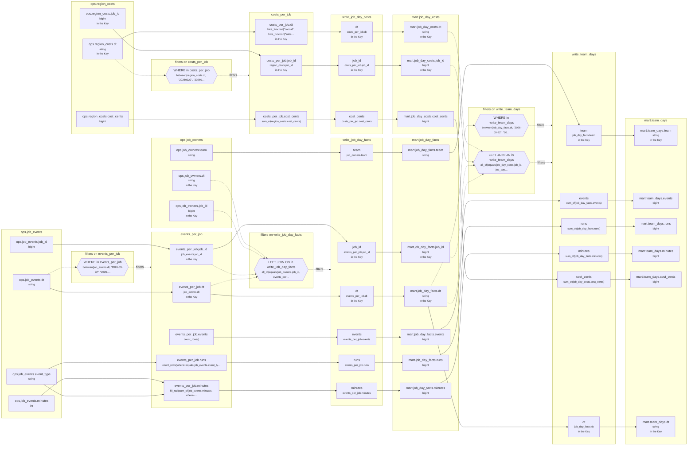

# Lineage: write_job_day_costs, write_job_day_facts, write_team_days

Made by `export_lineage`. The chart is written in Mermaid, which JupyterLab draws. Arrows run from where a value comes from to where it goes. A solid arrow carries a value. A dotted arrow carries a column into a condition, or runs from a condition to the step whose rows it decides (labelled "filters").

## Graph



## write_job_day_costs

It writes the Saved table mart.job_day_costs, replacing each partition its rows fill.

### Calculated columns

Every column that is calculated rather than copied, in the order it is calculated.

#### `costs_per_job.cost_cents`

Calculated in **costs_per_job** as `sum_of(region_costs.cost_cents)`, which is `SUM(region_costs.cost_cents)`.

```text
costs_per_job.cost_cents = sum_of(region_costs.cost_cents)
└─ ops.region_costs.cost_cents  (bigint)
```

Rows that count:
- WHERE in costs_per_job: `between(region_costs.dt, "20260922", "20260924")`, which is `region_costs.dt BETWEEN '20260922' AND '20260924'` (reads ops.region_costs.dt)

One value for each different `region_costs.job_id` and `hive_function("concat", hive_function("substr", region_costs.dt, 1, 4), "-", hive_function("substr", region_costs.dt, 5, 2), "-", hive_function("substr", region_costs.dt, 7, 2))`.

#### `costs_per_job.dt`

Calculated in **costs_per_job** as `hive_function("concat", hive_function("substr", region_costs.dt, 1, 4), "-", hive_function("substr", region_costs.dt, 5, 2), "-", hive_function("substr", region_costs.dt, 7, 2))`, which is `CONCAT(SUBSTRING(region_costs.dt, 1, 4), '-', SUBSTRING(region_costs.dt, 5, 2), '-', SUBSTRING(region_costs.dt, 7, 2))`.

```text
costs_per_job.dt = hive_function("concat", hive_function("substr", region_costs.dt, 1, 4), "-", hive_function("substr", region_costs.dt, 5, 2), "-", hive_function("substr", region_costs.dt, 7, 2))
└─ ops.region_costs.dt  (string)
```

Rows that count:
- WHERE in costs_per_job: `between(region_costs.dt, "20260922", "20260924")`, which is `region_costs.dt BETWEEN '20260922' AND '20260924'` (reads ops.region_costs.dt)

### Copied columns

| Output | Comes from |
| --- | --- |
| `job_id` | costs_per_job.job_id ← ops.region_costs.job_id |
| `cost_cents` | costs_per_job.cost_cents (calculated) ← ops.region_costs.cost_cents |
| `dt` | costs_per_job.dt (calculated) ← ops.region_costs.dt |

### Keys

The columns that tell each step's rows apart, as the Toolbox works them out. A column in one is marked "in the Key" in the chart.

- derived('costs_per_job', ...): Key (job_id, dt), since GROUP_BY makes one row for each job_id, dt.
- write_job_day_costs: Key (job_id, dt), since costs_per_job's rows are told apart by job_id, dt.
- mart.job_day_costs' Key (job_id, dt) holds: each row written has its own.

### Hive as submitted

```sql
WITH costs_per_job AS (
  SELECT
    region_costs.job_id,
    SUM(region_costs.cost_cents) AS cost_cents,
    CONCAT(
      SUBSTRING(region_costs.dt, 1, 4),
      '-',
      SUBSTRING(region_costs.dt, 5, 2),
      '-',
      SUBSTRING(region_costs.dt, 7, 2)
    ) AS dt
  FROM ops.region_costs AS region_costs
  WHERE
    region_costs.dt BETWEEN '20260922' AND '20260924'
  GROUP BY
    region_costs.job_id,
    CONCAT(
      SUBSTRING(region_costs.dt, 1, 4),
      '-',
      SUBSTRING(region_costs.dt, 5, 2),
      '-',
      SUBSTRING(region_costs.dt, 7, 2)
    )
)
INSERT OVERWRITE TABLE mart.job_day_costs PARTITION(dt)
SELECT
  costs_per_job.job_id,
  costs_per_job.cost_cents,
  costs_per_job.dt
FROM costs_per_job
```

## write_job_day_facts

It writes the Saved table mart.job_day_facts, replacing each partition its rows fill.

### Calculated columns

Every column that is calculated rather than copied, in the order it is calculated.

#### `events_per_job.events`

Calculated in **events_per_job** as `count_rows()`, which is `COUNT(*)`.

```text
events_per_job.events = count_rows()
└─ (no columns: it counts rows)
```

Rows that count:
- WHERE in events_per_job: `between(job_events.dt, "2026-09-22", "2026-09-24")`, which is `job_events.dt BETWEEN '2026-09-22' AND '2026-09-24'` (reads ops.job_events.dt)

One value for each different `job_events.job_id` and `job_events.dt`.

#### `events_per_job.runs`

Calculated in **events_per_job** as `count_rows(where=equals(job_events.event_type, "start"))`, which is `COUNT(CASE WHEN job_events.event_type = 'start' THEN 1 END)`.

```text
events_per_job.runs = count_rows(where=equals(job_events.event_type, "start"))
└─ ops.job_events.event_type  (string)
```

Rows that count:
- WHERE in events_per_job: `between(job_events.dt, "2026-09-22", "2026-09-24")`, which is `job_events.dt BETWEEN '2026-09-22' AND '2026-09-24'` (reads ops.job_events.dt)

One value for each different `job_events.job_id` and `job_events.dt`.

#### `events_per_job.minutes`

Calculated in **events_per_job** as `fill_null(sum_of(job_events.minutes, where=is_in(job_events.event_type, ["finish", "fail"])), 0)`, which is `COALESCE(SUM(CASE WHEN job_events.event_type IN ('finish', 'fail') THEN job_events.minutes END), 0)`.

```text
events_per_job.minutes = fill_null(sum_of(job_events.minutes, where=is_in(job_events.event_type, ["finish", "fail"])), 0)
├─ ops.job_events.minutes  (int)
└─ ops.job_events.event_type  (string)
```

Rows that count:
- WHERE in events_per_job: `between(job_events.dt, "2026-09-22", "2026-09-24")`, which is `job_events.dt BETWEEN '2026-09-22' AND '2026-09-24'` (reads ops.job_events.dt)

One value for each different `job_events.job_id` and `job_events.dt`.

### Copied columns

| Output | Comes from |
| --- | --- |
| `job_id` | events_per_job.job_id ← ops.job_events.job_id |
| `team` | ops.job_owners.team |
| `events` | events_per_job.events (calculated) |
| `runs` | events_per_job.runs (calculated) ← ops.job_events.event_type |
| `minutes` | events_per_job.minutes (calculated) ← ops.job_events.minutes |
| `dt` | events_per_job.dt ← ops.job_events.dt |

### Keys

The columns that tell each step's rows apart, as the Toolbox works them out. A column in one is marked "in the Key" in the chart.

- derived('events_per_job', ...): Key (job_id, dt), since GROUP_BY makes one row for each job_id, dt.
- write_job_day_facts: Key (job_id, dt), since events_per_job's rows are told apart by job_id, dt.
- mart.job_day_facts' Key (job_id, dt) holds: each row written has its own.

### Hive as submitted

```sql
WITH events_per_job AS (
  SELECT
    job_events.job_id,
    job_events.dt,
    COUNT(*) AS events,
    COUNT(CASE WHEN job_events.event_type = 'start' THEN 1 END) AS runs,
    COALESCE(
      SUM(
        CASE WHEN job_events.event_type IN ('finish', 'fail') THEN job_events.minutes END
      ),
      0
    ) AS minutes
  FROM ops.job_events AS job_events
  WHERE
    job_events.dt BETWEEN '2026-09-22' AND '2026-09-24'
  GROUP BY
    job_events.job_id,
    job_events.dt
)
INSERT OVERWRITE TABLE mart.job_day_facts PARTITION(dt)
SELECT
  events_per_job.job_id,
  job_owners.team,
  events_per_job.events,
  events_per_job.runs,
  events_per_job.minutes,
  events_per_job.dt
FROM events_per_job
LEFT JOIN ops.job_owners AS job_owners
  ON job_owners.job_id = events_per_job.job_id
  AND job_owners.dt = events_per_job.dt
  AND job_owners.dt BETWEEN '2026-09-22' AND '2026-09-24'
```

## write_team_days

It reads the Saved table mart.job_day_costs, written by write_job_day_costs above. It reads the Saved table mart.job_day_facts, written by write_job_day_facts above. It writes the Saved table mart.team_days, replacing each partition its rows fill.

### Calculated columns

Every column that is calculated rather than copied, in the order it is calculated.

#### `events`

Calculated in **write_team_days** as `sum_of(job_day_facts.events)`, which is `SUM(job_day_facts.events)`.

```text
write_team_days.events = sum_of(job_day_facts.events)
└─ mart.job_day_facts.events  (bigint)
   └─ write_job_day_facts.events
      └─ events_per_job.events = count_rows()
```

Rows that count:
- WHERE in events_per_job: `between(job_events.dt, "2026-09-22", "2026-09-24")`, which is `job_events.dt BETWEEN '2026-09-22' AND '2026-09-24'` (reads ops.job_events.dt)
- WHERE in write_team_days: `between(job_day_facts.dt, "2026-09-22", "2026-09-24")`, which is `job_day_facts.dt BETWEEN '2026-09-22' AND '2026-09-24'` (reads mart.job_day_facts.dt)

One value for each different `job_day_facts.dt` and `job_day_facts.team`.

#### `runs`

Calculated in **write_team_days** as `sum_of(job_day_facts.runs)`, which is `SUM(job_day_facts.runs)`.

```text
write_team_days.runs = sum_of(job_day_facts.runs)
└─ mart.job_day_facts.runs  (bigint)
   └─ write_job_day_facts.runs
      └─ events_per_job.runs = count_rows(where=equals(job_events.event_type, "start"))
         └─ ops.job_events.event_type  (string)
```

Rows that count:
- WHERE in events_per_job: `between(job_events.dt, "2026-09-22", "2026-09-24")`, which is `job_events.dt BETWEEN '2026-09-22' AND '2026-09-24'` (reads ops.job_events.dt)
- WHERE in write_team_days: `between(job_day_facts.dt, "2026-09-22", "2026-09-24")`, which is `job_day_facts.dt BETWEEN '2026-09-22' AND '2026-09-24'` (reads mart.job_day_facts.dt)

One value for each different `job_day_facts.dt` and `job_day_facts.team`.

#### `minutes`

Calculated in **write_team_days** as `sum_of(job_day_facts.minutes)`, which is `SUM(job_day_facts.minutes)`.

```text
write_team_days.minutes = sum_of(job_day_facts.minutes)
└─ mart.job_day_facts.minutes  (bigint)
   └─ write_job_day_facts.minutes
      └─ events_per_job.minutes = fill_null(sum_of(job_events.minutes, where=is_in(job_events.event_type, ["finish", "fail"])), 0)
         ├─ ops.job_events.minutes  (int)
         └─ ops.job_events.event_type  (string)
```

Rows that count:
- WHERE in events_per_job: `between(job_events.dt, "2026-09-22", "2026-09-24")`, which is `job_events.dt BETWEEN '2026-09-22' AND '2026-09-24'` (reads ops.job_events.dt)
- WHERE in write_team_days: `between(job_day_facts.dt, "2026-09-22", "2026-09-24")`, which is `job_day_facts.dt BETWEEN '2026-09-22' AND '2026-09-24'` (reads mart.job_day_facts.dt)

One value for each different `job_day_facts.dt` and `job_day_facts.team`.

#### `cost_cents`

Calculated in **write_team_days** as `sum_of(job_day_costs.cost_cents)`, which is `SUM(job_day_costs.cost_cents)`.

```text
write_team_days.cost_cents = sum_of(job_day_costs.cost_cents)
└─ mart.job_day_costs.cost_cents  (bigint)
   └─ write_job_day_costs.cost_cents
      └─ costs_per_job.cost_cents = sum_of(region_costs.cost_cents)
         └─ ops.region_costs.cost_cents  (bigint)
```

Rows that count:
- WHERE in costs_per_job: `between(region_costs.dt, "20260922", "20260924")`, which is `region_costs.dt BETWEEN '20260922' AND '20260924'` (reads ops.region_costs.dt)
- WHERE in events_per_job: `between(job_events.dt, "2026-09-22", "2026-09-24")`, which is `job_events.dt BETWEEN '2026-09-22' AND '2026-09-24'` (reads ops.job_events.dt)
- WHERE in write_team_days: `between(job_day_facts.dt, "2026-09-22", "2026-09-24")`, which is `job_day_facts.dt BETWEEN '2026-09-22' AND '2026-09-24'` (reads mart.job_day_facts.dt)
- LEFT JOIN ON in write_team_days: `all_of(equals(job_day_costs.job_id, job_day_facts.job_id), equals(job_day_costs.dt, job_day_facts.dt), between(job_day_costs.dt, "2026-09-22", "2026-09-24"))`, which is `job_day_costs.job_id = job_day_facts.job_id AND job_day_costs.dt = job_day_facts.dt AND job_day_costs.dt BETWEEN '2026-09-22' AND '2026-09-24'` (reads mart.job_day_costs.dt, mart.job_day_costs.job_id, mart.job_day_facts.dt, mart.job_day_facts.job_id)

One value for each different `job_day_facts.dt` and `job_day_facts.team`.

### Copied columns

| Output | Comes from |
| --- | --- |
| `team` | mart.job_day_facts.team ← write_job_day_facts.team ← ops.job_owners.team |
| `dt` | mart.job_day_facts.dt ← write_job_day_facts.dt ← events_per_job.dt ← ops.job_events.dt |

### Keys

The columns that tell each step's rows apart, as the Toolbox works them out. A column in one is marked "in the Key" in the chart.

- write_team_days: Key (dt, team), since GROUP_BY makes one row for each dt, team.
- mart.team_days' Key (team, dt) holds: each row written has its own.

### Hive as submitted

```sql
INSERT OVERWRITE TABLE mart.team_days PARTITION(dt)
SELECT
  job_day_facts.team,
  SUM(job_day_facts.events) AS events,
  SUM(job_day_facts.runs) AS runs,
  SUM(job_day_facts.minutes) AS minutes,
  SUM(job_day_costs.cost_cents) AS cost_cents,
  job_day_facts.dt
FROM mart.job_day_facts AS job_day_facts
LEFT JOIN mart.job_day_costs AS job_day_costs
  ON job_day_costs.job_id = job_day_facts.job_id
  AND job_day_costs.dt = job_day_facts.dt
  AND job_day_costs.dt BETWEEN '2026-09-22' AND '2026-09-24'
WHERE
  job_day_facts.dt BETWEEN '2026-09-22' AND '2026-09-24'
GROUP BY
  job_day_facts.dt,
  job_day_facts.team
```

---

Made by export_lineage on 2026-09-25 06:00, from your scripts at commit nogit, with sqlglot Composer 8.0.
