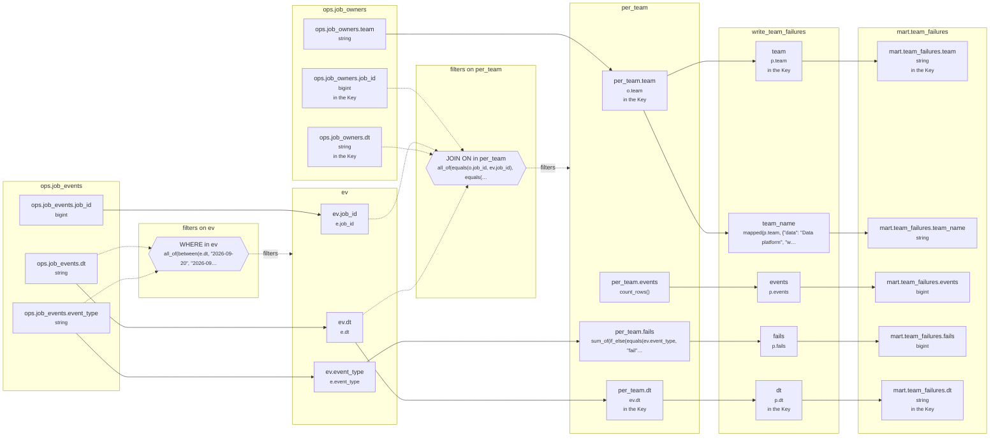

<!-- sqlglot Composer 7.2 - copy it, then edit your copy -->
# Lineage: write_team_failures

Made by `export_lineage`. The chart is written in Mermaid, which JupyterLab draws. Arrows run from where a value comes from to where it goes. A solid arrow carries a value. A dotted arrow carries a column into a condition, or runs from a condition to the step whose rows it decides (labelled "filters").

## Graph



## write_team_failures

It writes the Saved table mart.team_failures, replacing each partition its rows fill.

### Calculated columns

Every column that is calculated rather than copied, in the order it is calculated.

#### `per_team.events`

Calculated in **per_team** as `count_rows()`, which is `COUNT(*)`.

```text
per_team.events = count_rows()
└─ (no columns: it counts rows)
```

Rows that count:
- WHERE in ev: `all_of(between(e.dt, "2026-09-20", "2026-09-24"), is_in(e.event_type, ["start", "retry", "fail", "finish"]))`, which is `e.dt BETWEEN '2026-09-20' AND '2026-09-24' AND e.event_type IN ('start', 'retry', 'fail', 'finish')` (reads ops.job_events.dt, ops.job_events.event_type)
- JOIN ON in per_team: `all_of(equals(o.job_id, ev.job_id), equals(o.dt, ev.dt))`, which is `o.job_id = ev.job_id AND o.dt = ev.dt` (reads ops.job_events.dt, ops.job_events.job_id, ops.job_owners.dt, ops.job_owners.job_id)

One value for each different `o.team` and `ev.dt`.

#### `per_team.fails`

Calculated in **per_team** as `sum_of(if_else(equals(ev.event_type, "fail"), 1, 0))`, which is `SUM(CASE WHEN ev.event_type = 'fail' THEN 1 ELSE 0 END)`.

```text
per_team.fails = sum_of(if_else(equals(ev.event_type, "fail"), 1, 0))
└─ ev.event_type
   └─ ops.job_events.event_type  (string)
```

Rows that count:
- WHERE in ev: `all_of(between(e.dt, "2026-09-20", "2026-09-24"), is_in(e.event_type, ["start", "retry", "fail", "finish"]))`, which is `e.dt BETWEEN '2026-09-20' AND '2026-09-24' AND e.event_type IN ('start', 'retry', 'fail', 'finish')` (reads ops.job_events.dt, ops.job_events.event_type)
- JOIN ON in per_team: `all_of(equals(o.job_id, ev.job_id), equals(o.dt, ev.dt))`, which is `o.job_id = ev.job_id AND o.dt = ev.dt` (reads ops.job_events.dt, ops.job_events.job_id, ops.job_owners.dt, ops.job_owners.job_id)

One value for each different `o.team` and `ev.dt`.

#### `team_name`

Calculated in **write_team_failures** as `mapped(p.team, {"data": "Data platform", "web": "Web"}, otherwise="Other")`, which is `CASE p.team WHEN 'data' THEN 'Data platform' WHEN 'web' THEN 'Web' ELSE 'Other' END`.

```text
write_team_failures.team_name = mapped(p.team, {"data": "Data platform", "web": "Web"}, otherwise="Other")
└─ per_team.team
   └─ ops.job_owners.team  (string)
```

Rows that count:
- WHERE in ev: `all_of(between(e.dt, "2026-09-20", "2026-09-24"), is_in(e.event_type, ["start", "retry", "fail", "finish"]))`, which is `e.dt BETWEEN '2026-09-20' AND '2026-09-24' AND e.event_type IN ('start', 'retry', 'fail', 'finish')` (reads ops.job_events.dt, ops.job_events.event_type)
- JOIN ON in per_team: `all_of(equals(o.job_id, ev.job_id), equals(o.dt, ev.dt))`, which is `o.job_id = ev.job_id AND o.dt = ev.dt` (reads ops.job_events.dt, ops.job_events.job_id, ops.job_owners.dt, ops.job_owners.job_id)

### Copied columns

| Output | Comes from |
| --- | --- |
| `team` | per_team.team ← ops.job_owners.team |
| `events` | per_team.events (calculated) |
| `fails` | per_team.fails (calculated) ← ev.event_type ← ops.job_events.event_type |
| `dt` | per_team.dt ← ev.dt ← ops.job_events.dt |

### Keys

The columns that tell each step's rows apart, as the Toolbox works them out. A column in one is marked "in the Key" in the chart.

- derived('ev', ...): no Key the Toolbox can see, since e's rows are told apart by event_id, and SELECT leaves out e.event_id.
- derived('per_team', ...): Key (team, dt), since GROUP_BY makes one row for each team, dt.
- write_team_failures: Key (team, dt), since p's rows are told apart by team, dt.
- mart.team_failures' Key (team, dt) holds: each row written has its own.

### Hive as submitted

```sql
WITH ev AS (
  SELECT
    e.job_id,
    e.dt,
    e.event_type
  FROM ops.job_events AS e
  WHERE
    e.dt BETWEEN '2026-09-20' AND '2026-09-24'
    AND e.event_type IN ('start', 'retry', 'fail', 'finish')
), per_team AS (
  SELECT
    o.team,
    ev.dt,
    COUNT(*) AS events,
    SUM(CASE WHEN ev.event_type = 'fail' THEN 1 ELSE 0 END) AS fails
  FROM ev
  JOIN ops.job_owners AS o
    ON o.job_id = ev.job_id AND o.dt = ev.dt
  GROUP BY
    o.team,
    ev.dt
)
INSERT OVERWRITE TABLE mart.team_failures PARTITION(dt)
SELECT
  p.team,
  CASE p.team WHEN 'data' THEN 'Data platform' WHEN 'web' THEN 'Web' ELSE 'Other' END AS team_name,
  p.events,
  p.fails,
  p.dt
FROM per_team AS p
```

---

Made by export_lineage on 2026-09-25 06:00, from your scripts at commit nogit, with sqlglot Composer 7.2.
