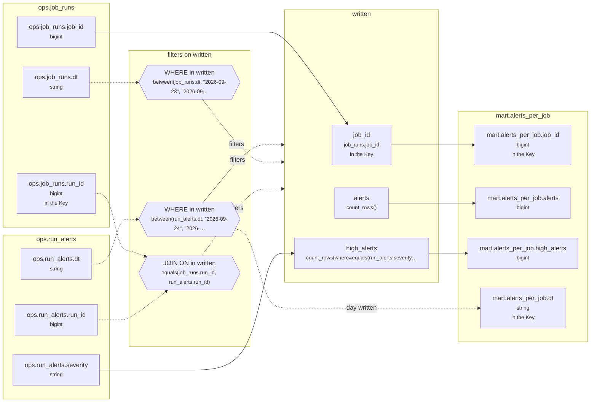

# Lineage: written

Made by `export_lineage`. The chart is written in Mermaid, which JupyterLab draws. Arrows run from where a value comes from to where it goes. A solid arrow carries a value. A dotted arrow carries a column into a condition, or runs from a condition to the step whose rows it decides (labelled "filters"). A dotted arrow labelled "day written" runs from a write's date bound to the day of the Saved table it writes.

## Graph



## written

It writes the Saved table mart.alerts_per_job, one day at a time.

### Calculated columns

Every column that is calculated rather than copied, in the order it is calculated.

#### `alerts`

Calculated in **written** as `count_rows()`, which is `COUNT(*)`.

```text
written.alerts = count_rows()
└─ (no columns: it counts rows)
```

Rows that count:
- WHERE in written: `between(run_alerts.dt, "2026-09-24", "2026-09-24")`, which is `run_alerts.dt BETWEEN '2026-09-24' AND '2026-09-24'` (reads ops.run_alerts.dt)
- WHERE in written: `between(job_runs.dt, "2026-09-23", "2026-09-24")`, which is `job_runs.dt BETWEEN '2026-09-23' AND '2026-09-24'` (reads ops.job_runs.dt)
- JOIN ON in written: `equals(job_runs.run_id, run_alerts.run_id)`, which is `job_runs.run_id = run_alerts.run_id` (reads ops.job_runs.run_id, ops.run_alerts.run_id)

One value for each different `run_alerts.dt` and `job_runs.job_id`.

#### `high_alerts`

Calculated in **written** as `count_rows(where=equals(run_alerts.severity, "high"))`, which is `COUNT(CASE WHEN run_alerts.severity = 'high' THEN 1 END)`.

```text
written.high_alerts = count_rows(where=equals(run_alerts.severity, "high"))
└─ ops.run_alerts.severity  (string)
```

Rows that count:
- WHERE in written: `between(run_alerts.dt, "2026-09-24", "2026-09-24")`, which is `run_alerts.dt BETWEEN '2026-09-24' AND '2026-09-24'` (reads ops.run_alerts.dt)
- WHERE in written: `between(job_runs.dt, "2026-09-23", "2026-09-24")`, which is `job_runs.dt BETWEEN '2026-09-23' AND '2026-09-24'` (reads ops.job_runs.dt)
- JOIN ON in written: `equals(job_runs.run_id, run_alerts.run_id)`, which is `job_runs.run_id = run_alerts.run_id` (reads ops.job_runs.run_id, ops.run_alerts.run_id)

One value for each different `run_alerts.dt` and `job_runs.job_id`.

### Copied columns

| Output | Comes from |
| --- | --- |
| `job_id` | ops.job_runs.job_id |

### Keys

The columns that tell each step's rows apart, as the Toolbox works them out. A column in one is marked "in the Key" in the chart.

- written: Key (job_id), since GROUP_BY makes one row for each job_id, dt, with dt held to one value.
- mart.alerts_per_job's Key (job_id, dt) holds: each row written has its own.

### Hive as submitted

```sql
INSERT OVERWRITE TABLE mart.alerts_per_job PARTITION(dt = '2026-09-24')
SELECT
  job_runs.job_id,
  COUNT(*) AS alerts,
  COUNT(CASE WHEN run_alerts.severity = 'high' THEN 1 END) AS high_alerts
FROM ops.run_alerts AS run_alerts
JOIN ops.job_runs AS job_runs
  ON job_runs.run_id = run_alerts.run_id
WHERE
  run_alerts.dt BETWEEN '2026-09-24' AND '2026-09-24'
  AND job_runs.dt BETWEEN '2026-09-23' AND '2026-09-24'
GROUP BY
  run_alerts.dt,
  job_runs.job_id
```

---

Made by export_lineage on 2026-09-25 06:00, from your scripts at commit pinned, with sqlglot Composer 6.0.
