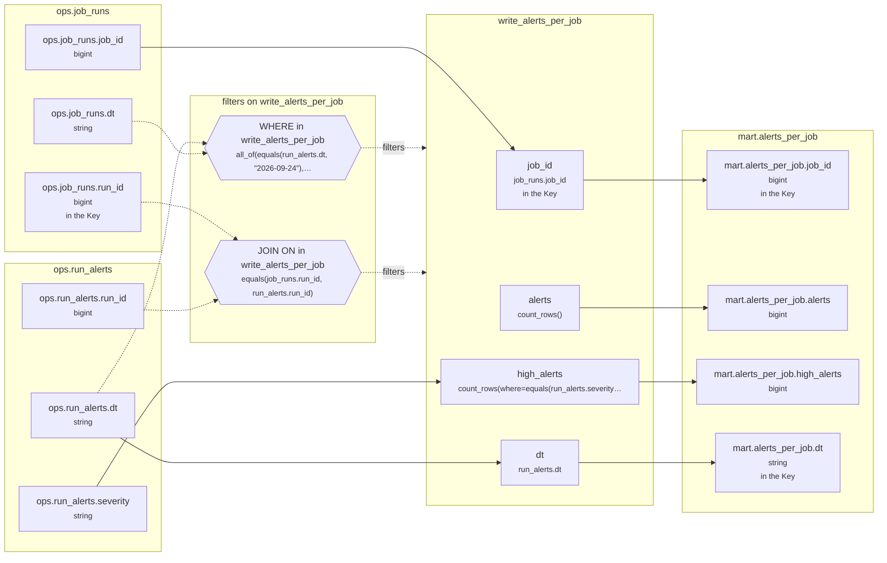

# Lineage: write_alerts_per_job

Made by `export_lineage`. The chart is written in Mermaid, which JupyterLab draws. Arrows run from where a value comes from to where it goes. A solid arrow carries a value. A dotted arrow carries a column into a condition, or runs from a condition to the step whose rows it decides (labelled "filters").

## Graph



## write_alerts_per_job

It writes the Saved table mart.alerts_per_job, replacing each partition its rows fill.

### Calculated columns

Every column that is calculated rather than copied, in the order it is calculated.

#### `alerts`

Calculated in **write_alerts_per_job** as `count_rows()`, which is `COUNT(*)`.

```text
write_alerts_per_job.alerts = count_rows()
└─ (no columns: it counts rows)
```

Rows that count:
- WHERE in write_alerts_per_job: `all_of(equals(run_alerts.dt, "2026-09-24"), between(job_runs.dt, "2026-09-23", "2026-09-24"))`, which is `run_alerts.dt = '2026-09-24' AND job_runs.dt BETWEEN '2026-09-23' AND '2026-09-24'` (reads ops.job_runs.dt, ops.run_alerts.dt)
- JOIN ON in write_alerts_per_job: `equals(job_runs.run_id, run_alerts.run_id)`, which is `job_runs.run_id = run_alerts.run_id` (reads ops.job_runs.run_id, ops.run_alerts.run_id)

One value for each different `job_runs.job_id` and `run_alerts.dt`.

#### `high_alerts`

Calculated in **write_alerts_per_job** as `count_rows(where=equals(run_alerts.severity, "high"))`, which is `COUNT(CASE WHEN run_alerts.severity = 'high' THEN 1 END)`.

```text
write_alerts_per_job.high_alerts = count_rows(where=equals(run_alerts.severity, "high"))
└─ ops.run_alerts.severity  (string)
```

Rows that count:
- WHERE in write_alerts_per_job: `all_of(equals(run_alerts.dt, "2026-09-24"), between(job_runs.dt, "2026-09-23", "2026-09-24"))`, which is `run_alerts.dt = '2026-09-24' AND job_runs.dt BETWEEN '2026-09-23' AND '2026-09-24'` (reads ops.job_runs.dt, ops.run_alerts.dt)
- JOIN ON in write_alerts_per_job: `equals(job_runs.run_id, run_alerts.run_id)`, which is `job_runs.run_id = run_alerts.run_id` (reads ops.job_runs.run_id, ops.run_alerts.run_id)

One value for each different `job_runs.job_id` and `run_alerts.dt`.

### Copied columns

| Output | Comes from |
| --- | --- |
| `job_id` | ops.job_runs.job_id |
| `dt` | ops.run_alerts.dt |

### Keys

The columns that tell each step's rows apart, as the Toolbox works them out. A column in one is marked "in the Key" in the chart.

- write_alerts_per_job: Key (job_id), since GROUP_BY makes one row for each job_id, dt, with dt held to one value.
- mart.alerts_per_job's Key (job_id, dt) holds: each row written has its own.

### Hive as submitted

```sql
INSERT OVERWRITE TABLE mart.alerts_per_job PARTITION(dt)
SELECT
  job_runs.job_id,
  COUNT(*) AS alerts,
  COUNT(CASE WHEN run_alerts.severity = 'high' THEN 1 END) AS high_alerts,
  run_alerts.dt
FROM ops.run_alerts AS run_alerts
JOIN ops.job_runs AS job_runs
  ON job_runs.run_id = run_alerts.run_id
WHERE
  run_alerts.dt = '2026-09-24'
  AND job_runs.dt BETWEEN '2026-09-23' AND '2026-09-24'
GROUP BY
  job_runs.job_id,
  run_alerts.dt
```

---

Made by export_lineage on 2026-09-25 06:00, from your scripts at commit nogit, with sqlglot Composer 7.2.
