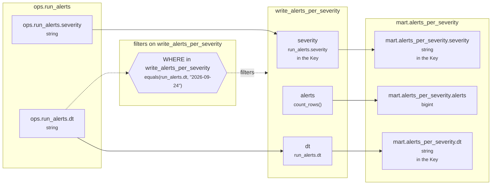

<!-- sqlglot Composer 7.1, exported 2026-10-22 13:22 - copy it, then edit your copy -->
# Lineage: write_alerts_per_severity

Made by `export_lineage`. The chart is written in Mermaid, which JupyterLab draws. Arrows run from where a value comes from to where it goes. A solid arrow carries a value. A dotted arrow carries a column into a condition, or runs from a condition to the step whose rows it decides (labelled "filters").

## Graph



## write_alerts_per_severity

It writes the Saved table mart.alerts_per_severity, replacing each partition its rows fill.

### Calculated columns

Every column that is calculated rather than copied, in the order it is calculated.

#### `alerts`

Calculated in **write_alerts_per_severity** as `count_rows()`, which is `COUNT(*)`.

```text
write_alerts_per_severity.alerts = count_rows()
└─ (no columns: it counts rows)
```

Rows that count:
- WHERE in write_alerts_per_severity: `equals(run_alerts.dt, "2026-09-24")`, which is `run_alerts.dt = '2026-09-24'` (reads ops.run_alerts.dt)

One value for each different `run_alerts.severity` and `run_alerts.dt`.

### Copied columns

| Output | Comes from |
| --- | --- |
| `severity` | ops.run_alerts.severity |
| `dt` | ops.run_alerts.dt |

### Keys

The columns that tell each step's rows apart, as the Toolbox works them out. A column in one is marked "in the Key" in the chart.

- write_alerts_per_severity: Key (severity), since GROUP_BY makes one row for each severity, dt, with dt held to one value.
- mart.alerts_per_severity's Key (severity, dt) holds: each row written has its own.

### Hive as submitted

```sql
INSERT OVERWRITE TABLE mart.alerts_per_severity PARTITION(dt)
SELECT
  run_alerts.severity,
  COUNT(*) AS alerts,
  run_alerts.dt
FROM ops.run_alerts AS run_alerts
WHERE
  run_alerts.dt = '2026-09-24'
GROUP BY
  run_alerts.severity,
  run_alerts.dt
```

---

Made by export_lineage on 2026-09-25 06:00, from your scripts at commit nogit, with sqlglot Composer 7.1.
