# Lineage: statement_1, statement_2, written

Made by `export_lineage`. The chart is written in Mermaid, which JupyterLab draws. Arrows run from where a value comes from to where it goes. A solid arrow carries a value. A dotted arrow carries a column into a condition, or runs from a condition to the step whose rows it decides (labelled "filters").

## Graph

```mermaid
flowchart LR
  subgraph g0["ops.job_runs"]
    n0["ops.job_runs.job_id<br/><small>bigint</small>"]
    n2["ops.job_runs.dt<br/><small>string</small>"]
    n5["ops.job_runs.status<br/><small>string</small>"]
    n7["ops.job_runs.duration_mins<br/><small>int</small>"]
    n29["ops.job_runs.run_id<br/><small>bigint</small><br/><small>in the Key</small>"]
  end
  subgraph g1["runs_per_job"]
    n1["runs_per_job.job_id<br/><small>job_runs.job_id</small><br/><small>in the Key</small>"]
    n3["runs_per_job.dt<br/><small>job_runs.dt</small>"]
    n4["runs_per_job.runs<br/><small>count_rows()</small>"]
    n6["runs_per_job.failed_runs<br/><small>count_rows(where=equals(job_runs.status, #quot;F…</small>"]
    n8["runs_per_job.minutes<br/><small>sum_of(job_runs.duration_mins)</small>"]
  end
  subgraph g2["filters on runs_per_job"]
    n9{{"WHERE in runs_per_job<br/><small>equals(job_runs.dt, #quot;2026-09-24#quot;)</small>"}}
  end
  subgraph g3["statement_1"]
    n10["job_id<br/><small>runs_per_job.job_id</small><br/><small>in the Key</small>"]
    n11["runs<br/><small>runs_per_job.runs</small>"]
    n12["failed_runs<br/><small>runs_per_job.failed_runs</small>"]
    n13["minutes<br/><small>runs_per_job.minutes</small>"]
    n14["dt<br/><small>runs_per_job.dt</small>"]
  end
  subgraph g4["mart.daily_job_runs"]
    n15["mart.daily_job_runs.job_id<br/><small>bigint</small><br/><small>in the Key</small>"]
    n16["mart.daily_job_runs.runs<br/><small>bigint</small>"]
    n17["mart.daily_job_runs.failed_runs<br/><small>bigint</small>"]
    n18["mart.daily_job_runs.minutes<br/><small>bigint</small>"]
    n19["mart.daily_job_runs.dt<br/><small>string</small><br/><small>in the Key</small>"]
  end
  subgraph g5["statement_2"]
    n20["job_id<br/><small>job_runs.job_id</small><br/><small>in the Key</small>"]
    n21["alerts<br/><small>count_rows()</small>"]
    n23["high_alerts<br/><small>count_rows(where=equals(run_alerts.severity…</small>"]
    n25["dt<br/><small>run_alerts.dt</small>"]
  end
  subgraph g6["ops.run_alerts"]
    n22["ops.run_alerts.severity<br/><small>string</small>"]
    n24["ops.run_alerts.dt<br/><small>string</small>"]
    n30["ops.run_alerts.run_id<br/><small>bigint</small>"]
  end
  subgraph g7["filters on statement_2"]
    n26{{"WHERE in statement_2<br/><small>equals(run_alerts.dt, #quot;2026-09-24#quot;)</small>"}}
    n27{{"WHERE in statement_2<br/><small>is_in(job_runs.dt, [#quot;2026-09-23#quot;, #quot;2026-09-…</small>"}}
    n28{{"JOIN ON in statement_2<br/><small>equals(job_runs.run_id, run_alerts.run_id)</small>"}}
  end
  subgraph g8["mart.alerts_per_job"]
    n31["mart.alerts_per_job.job_id<br/><small>bigint</small><br/><small>in the Key</small>"]
    n32["mart.alerts_per_job.alerts<br/><small>bigint</small>"]
    n33["mart.alerts_per_job.high_alerts<br/><small>bigint</small>"]
    n34["mart.alerts_per_job.dt<br/><small>string</small><br/><small>in the Key</small>"]
  end
  subgraph g9["ops.jobs"]
    n35["ops.jobs.team<br/><small>string</small>"]
    n45["ops.jobs.job_id<br/><small>bigint</small><br/><small>in the Key</small>"]
  end
  subgraph g10["written"]
    n36["team<br/><small>jobs.team</small><br/><small>in the Key</small>"]
    n37["runs<br/><small>sum_of(daily_job_runs.runs)</small>"]
    n38["failed_runs<br/><small>sum_of(daily_job_runs.failed_runs)</small>"]
    n39["minutes<br/><small>sum_of(daily_job_runs.minutes)</small>"]
    n40["alerts<br/><small>fill_null(sum_of(alerts_per_job.alerts), 0)</small>"]
    n41["high_alerts<br/><small>fill_null(sum_of(alerts_per_job.high_alerts…</small>"]
    n42["dt<br/><small>daily_job_runs.dt</small>"]
  end
  subgraph g11["filters on written"]
    n43{{"WHERE in written<br/><small>equals(daily_job_runs.dt, #quot;2026-09-24#quot;)</small>"}}
    n44{{"JOIN ON in written<br/><small>equals(jobs.job_id, daily_job_runs.job_id)</small>"}}
    n46{{"LEFT JOIN ON in written<br/><small>all_of(equals(alerts_per_job.job_id, daily_…</small>"}}
  end
  subgraph g12["mart.team_day"]
    n47["mart.team_day.team<br/><small>string</small><br/><small>in the Key</small>"]
    n48["mart.team_day.runs<br/><small>bigint</small>"]
    n49["mart.team_day.failed_runs<br/><small>bigint</small>"]
    n50["mart.team_day.minutes<br/><small>bigint</small>"]
    n51["mart.team_day.alerts<br/><small>bigint</small>"]
    n52["mart.team_day.high_alerts<br/><small>bigint</small>"]
    n53["mart.team_day.dt<br/><small>string</small><br/><small>in the Key</small>"]
  end
  n0 --> n1
  n2 --> n3
  n5 --> n6
  n7 --> n8
  n2 -.-> n9
  n1 --> n10
  n4 --> n11
  n6 --> n12
  n8 --> n13
  n3 --> n14
  n10 --> n15
  n11 --> n16
  n12 --> n17
  n13 --> n18
  n14 --> n19
  n0 --> n20
  n22 --> n23
  n24 --> n25
  n24 -.-> n26
  n2 -.-> n27
  n29 -.-> n28
  n30 -.-> n28
  n20 --> n31
  n21 --> n32
  n23 --> n33
  n25 --> n34
  n35 --> n36
  n16 --> n37
  n17 --> n38
  n18 --> n39
  n32 --> n40
  n33 --> n41
  n19 --> n42
  n19 -.-> n43
  n45 -.-> n44
  n15 -.-> n44
  n34 -.-> n46
  n31 -.-> n46
  n15 -.-> n46
  n19 -.-> n46
  n36 --> n47
  n37 --> n48
  n38 --> n49
  n39 --> n50
  n40 --> n51
  n41 --> n52
  n42 --> n53
  n9 -.->|filters| g1
  n26 -.->|filters| g5
  n27 -.->|filters| g5
  n28 -.->|filters| g5
  n43 -.->|filters| g10
  n44 -.->|filters| g10
  n46 -.->|filters| g10
```



## statement_1

It writes the Saved table mart.daily_job_runs, replacing each partition its rows fill.

### Calculated columns

Every column that is calculated rather than copied, in the order it is calculated.

#### `runs_per_job.runs`

Calculated in **runs_per_job** as `count_rows()`, which is `COUNT(*)`.

```text
runs_per_job.runs = count_rows()
└─ (no columns: it counts rows)
```

Rows that count:
- WHERE in runs_per_job: `equals(job_runs.dt, "2026-09-24")`, which is `job_runs.dt = '2026-09-24'` (reads ops.job_runs.dt)

One value for each different `job_runs.job_id` and `job_runs.dt`.

#### `runs_per_job.failed_runs`

Calculated in **runs_per_job** as `count_rows(where=equals(job_runs.status, "FAILED"))`, which is `COUNT(CASE WHEN job_runs.status = 'FAILED' THEN 1 END)`.

```text
runs_per_job.failed_runs = count_rows(where=equals(job_runs.status, "FAILED"))
└─ ops.job_runs.status  (string)
```

Rows that count:
- WHERE in runs_per_job: `equals(job_runs.dt, "2026-09-24")`, which is `job_runs.dt = '2026-09-24'` (reads ops.job_runs.dt)

One value for each different `job_runs.job_id` and `job_runs.dt`.

#### `runs_per_job.minutes`

Calculated in **runs_per_job** as `sum_of(job_runs.duration_mins)`, which is `SUM(job_runs.duration_mins)`.

```text
runs_per_job.minutes = sum_of(job_runs.duration_mins)
└─ ops.job_runs.duration_mins  (int)
```

Rows that count:
- WHERE in runs_per_job: `equals(job_runs.dt, "2026-09-24")`, which is `job_runs.dt = '2026-09-24'` (reads ops.job_runs.dt)

One value for each different `job_runs.job_id` and `job_runs.dt`.

### Copied columns

| Output | Comes from |
| --- | --- |
| `job_id` | runs_per_job.job_id ← ops.job_runs.job_id |
| `runs` | runs_per_job.runs (calculated) |
| `failed_runs` | runs_per_job.failed_runs (calculated) ← ops.job_runs.status |
| `minutes` | runs_per_job.minutes (calculated) ← ops.job_runs.duration_mins |
| `dt` | runs_per_job.dt ← ops.job_runs.dt |

### Keys

The columns that tell each step's rows apart, as the Toolbox works them out. A column in one is marked "in the Key" in the chart.

- derived('runs_per_job', ...): Key (job_id), since GROUP_BY makes one row for each job_id, dt, with dt held to one value.
- statement_1: Key (job_id), since runs_per_job's rows are told apart by job_id.
- mart.daily_job_runs' Key (job_id, dt) holds: each row written has its own.

### Hive as submitted

```sql
WITH runs_per_job AS (
  SELECT
    job_runs.job_id,
    job_runs.dt,
    COUNT(*) AS runs,
    COUNT(CASE WHEN job_runs.status = 'FAILED' THEN 1 END) AS failed_runs,
    SUM(job_runs.duration_mins) AS minutes
  FROM ops.job_runs AS job_runs
  WHERE
    job_runs.dt = '2026-09-24'
  GROUP BY
    job_runs.job_id,
    job_runs.dt
)
INSERT OVERWRITE TABLE mart.daily_job_runs PARTITION(dt)
SELECT
  runs_per_job.job_id,
  runs_per_job.runs,
  runs_per_job.failed_runs,
  runs_per_job.minutes,
  runs_per_job.dt
FROM runs_per_job
```

## statement_2

It writes the Saved table mart.alerts_per_job, replacing each partition its rows fill.

### Calculated columns

Every column that is calculated rather than copied, in the order it is calculated.

#### `alerts`

Calculated in **statement_2** as `count_rows()`, which is `COUNT(*)`.

```text
statement_2.alerts = count_rows()
└─ (no columns: it counts rows)
```

Rows that count:
- WHERE in statement_2: `equals(run_alerts.dt, "2026-09-24")`, which is `run_alerts.dt = '2026-09-24'` (reads ops.run_alerts.dt)
- WHERE in statement_2: `is_in(job_runs.dt, ["2026-09-23", "2026-09-24"])`, which is `job_runs.dt IN ('2026-09-23', '2026-09-24')` (reads ops.job_runs.dt)
- JOIN ON in statement_2: `equals(job_runs.run_id, run_alerts.run_id)`, which is `job_runs.run_id = run_alerts.run_id` (reads ops.job_runs.run_id, ops.run_alerts.run_id)

One value for each different `run_alerts.dt` and `job_runs.job_id`.

#### `high_alerts`

Calculated in **statement_2** as `count_rows(where=equals(run_alerts.severity, "high"))`, which is `COUNT(CASE WHEN run_alerts.severity = 'high' THEN 1 END)`.

```text
statement_2.high_alerts = count_rows(where=equals(run_alerts.severity, "high"))
└─ ops.run_alerts.severity  (string)
```

Rows that count:
- WHERE in statement_2: `equals(run_alerts.dt, "2026-09-24")`, which is `run_alerts.dt = '2026-09-24'` (reads ops.run_alerts.dt)
- WHERE in statement_2: `is_in(job_runs.dt, ["2026-09-23", "2026-09-24"])`, which is `job_runs.dt IN ('2026-09-23', '2026-09-24')` (reads ops.job_runs.dt)
- JOIN ON in statement_2: `equals(job_runs.run_id, run_alerts.run_id)`, which is `job_runs.run_id = run_alerts.run_id` (reads ops.job_runs.run_id, ops.run_alerts.run_id)

One value for each different `run_alerts.dt` and `job_runs.job_id`.

### Copied columns

| Output | Comes from |
| --- | --- |
| `job_id` | ops.job_runs.job_id |
| `dt` | ops.run_alerts.dt |

### Keys

The columns that tell each step's rows apart, as the Toolbox works them out. A column in one is marked "in the Key" in the chart.

- statement_2: Key (job_id), since GROUP_BY makes one row for each job_id, dt, with dt held to one value.
- mart.alerts_per_job's Key (job_id, dt) holds: each row written has its own.

### Hive as submitted

```sql
INSERT OVERWRITE TABLE mart.alerts_per_job PARTITION(dt)
SELECT
  job_runs.job_id,
  COUNT(*) AS alerts,
  COUNT(CASE WHEN run_alerts.severity = 'high' THEN 1 END) AS high_alerts,
  run_alerts.dt
FROM ops.run_alerts AS run_alerts
JOIN ops.job_runs AS job_runs
  ON job_runs.run_id = run_alerts.run_id
WHERE
  run_alerts.dt = '2026-09-24' AND job_runs.dt IN ('2026-09-23', '2026-09-24')
GROUP BY
  run_alerts.dt,
  job_runs.job_id
```

## written

It reads the Saved table mart.alerts_per_job, written by statement_2 above. It reads the Saved table mart.daily_job_runs, written by statement_1 above. It writes the Saved table mart.team_day, replacing each partition its rows fill.

### Calculated columns

Every column that is calculated rather than copied, in the order it is calculated.

#### `runs`

Calculated in **written** as `sum_of(daily_job_runs.runs)`, which is `SUM(daily_job_runs.runs)`.

```text
written.runs = sum_of(daily_job_runs.runs)
└─ mart.daily_job_runs.runs  (bigint)
   └─ statement_1.runs
      └─ runs_per_job.runs = count_rows()
```

Rows that count:
- WHERE in runs_per_job: `equals(job_runs.dt, "2026-09-24")`, which is `job_runs.dt = '2026-09-24'` (reads ops.job_runs.dt)
- WHERE in written: `equals(daily_job_runs.dt, "2026-09-24")`, which is `daily_job_runs.dt = '2026-09-24'` (reads mart.daily_job_runs.dt)
- JOIN ON in written: `equals(jobs.job_id, daily_job_runs.job_id)`, which is `jobs.job_id = daily_job_runs.job_id` (reads mart.daily_job_runs.job_id, ops.jobs.job_id)

One value for each different `daily_job_runs.dt` and `jobs.team`.

#### `failed_runs`

Calculated in **written** as `sum_of(daily_job_runs.failed_runs)`, which is `SUM(daily_job_runs.failed_runs)`.

```text
written.failed_runs = sum_of(daily_job_runs.failed_runs)
└─ mart.daily_job_runs.failed_runs  (bigint)
   └─ statement_1.failed_runs
      └─ runs_per_job.failed_runs = count_rows(where=equals(job_runs.status, "FAILED"))
         └─ ops.job_runs.status  (string)
```

Rows that count:
- WHERE in runs_per_job: `equals(job_runs.dt, "2026-09-24")`, which is `job_runs.dt = '2026-09-24'` (reads ops.job_runs.dt)
- WHERE in written: `equals(daily_job_runs.dt, "2026-09-24")`, which is `daily_job_runs.dt = '2026-09-24'` (reads mart.daily_job_runs.dt)
- JOIN ON in written: `equals(jobs.job_id, daily_job_runs.job_id)`, which is `jobs.job_id = daily_job_runs.job_id` (reads mart.daily_job_runs.job_id, ops.jobs.job_id)

One value for each different `daily_job_runs.dt` and `jobs.team`.

#### `minutes`

Calculated in **written** as `sum_of(daily_job_runs.minutes)`, which is `SUM(daily_job_runs.minutes)`.

```text
written.minutes = sum_of(daily_job_runs.minutes)
└─ mart.daily_job_runs.minutes  (bigint)
   └─ statement_1.minutes
      └─ runs_per_job.minutes = sum_of(job_runs.duration_mins)
         └─ ops.job_runs.duration_mins  (int)
```

Rows that count:
- WHERE in runs_per_job: `equals(job_runs.dt, "2026-09-24")`, which is `job_runs.dt = '2026-09-24'` (reads ops.job_runs.dt)
- WHERE in written: `equals(daily_job_runs.dt, "2026-09-24")`, which is `daily_job_runs.dt = '2026-09-24'` (reads mart.daily_job_runs.dt)
- JOIN ON in written: `equals(jobs.job_id, daily_job_runs.job_id)`, which is `jobs.job_id = daily_job_runs.job_id` (reads mart.daily_job_runs.job_id, ops.jobs.job_id)

One value for each different `daily_job_runs.dt` and `jobs.team`.

#### `alerts`

Calculated in **written** as `fill_null(sum_of(alerts_per_job.alerts), 0)`, which is `COALESCE(SUM(alerts_per_job.alerts), 0)`.

```text
written.alerts = fill_null(sum_of(alerts_per_job.alerts), 0)
└─ mart.alerts_per_job.alerts  (bigint)
   └─ statement_2.alerts = count_rows()
```

Rows that count:
- WHERE in runs_per_job: `equals(job_runs.dt, "2026-09-24")`, which is `job_runs.dt = '2026-09-24'` (reads ops.job_runs.dt)
- WHERE in statement_2: `equals(run_alerts.dt, "2026-09-24")`, which is `run_alerts.dt = '2026-09-24'` (reads ops.run_alerts.dt)
- WHERE in statement_2: `is_in(job_runs.dt, ["2026-09-23", "2026-09-24"])`, which is `job_runs.dt IN ('2026-09-23', '2026-09-24')` (reads ops.job_runs.dt)
- JOIN ON in statement_2: `equals(job_runs.run_id, run_alerts.run_id)`, which is `job_runs.run_id = run_alerts.run_id` (reads ops.job_runs.run_id, ops.run_alerts.run_id)
- WHERE in written: `equals(daily_job_runs.dt, "2026-09-24")`, which is `daily_job_runs.dt = '2026-09-24'` (reads mart.daily_job_runs.dt)
- JOIN ON in written: `equals(jobs.job_id, daily_job_runs.job_id)`, which is `jobs.job_id = daily_job_runs.job_id` (reads mart.daily_job_runs.job_id, ops.jobs.job_id)
- LEFT JOIN ON in written: `all_of(equals(alerts_per_job.job_id, daily_job_runs.job_id), equals(alerts_per_job.dt, daily_job_runs.dt), equals(alerts_per_job.dt, "2026-09-24"))`, which is `alerts_per_job.job_id = daily_job_runs.job_id AND alerts_per_job.dt = daily_job_runs.dt AND alerts_per_job.dt = '2026-09-24'` (reads mart.alerts_per_job.dt, mart.alerts_per_job.job_id, mart.daily_job_runs.dt, mart.daily_job_runs.job_id)

One value for each different `daily_job_runs.dt` and `jobs.team`.

#### `high_alerts`

Calculated in **written** as `fill_null(sum_of(alerts_per_job.high_alerts), 0)`, which is `COALESCE(SUM(alerts_per_job.high_alerts), 0)`.

```text
written.high_alerts = fill_null(sum_of(alerts_per_job.high_alerts), 0)
└─ mart.alerts_per_job.high_alerts  (bigint)
   └─ statement_2.high_alerts = count_rows(where=equals(run_alerts.severity, "high"))
      └─ ops.run_alerts.severity  (string)
```

Rows that count:
- WHERE in runs_per_job: `equals(job_runs.dt, "2026-09-24")`, which is `job_runs.dt = '2026-09-24'` (reads ops.job_runs.dt)
- WHERE in statement_2: `equals(run_alerts.dt, "2026-09-24")`, which is `run_alerts.dt = '2026-09-24'` (reads ops.run_alerts.dt)
- WHERE in statement_2: `is_in(job_runs.dt, ["2026-09-23", "2026-09-24"])`, which is `job_runs.dt IN ('2026-09-23', '2026-09-24')` (reads ops.job_runs.dt)
- JOIN ON in statement_2: `equals(job_runs.run_id, run_alerts.run_id)`, which is `job_runs.run_id = run_alerts.run_id` (reads ops.job_runs.run_id, ops.run_alerts.run_id)
- WHERE in written: `equals(daily_job_runs.dt, "2026-09-24")`, which is `daily_job_runs.dt = '2026-09-24'` (reads mart.daily_job_runs.dt)
- JOIN ON in written: `equals(jobs.job_id, daily_job_runs.job_id)`, which is `jobs.job_id = daily_job_runs.job_id` (reads mart.daily_job_runs.job_id, ops.jobs.job_id)
- LEFT JOIN ON in written: `all_of(equals(alerts_per_job.job_id, daily_job_runs.job_id), equals(alerts_per_job.dt, daily_job_runs.dt), equals(alerts_per_job.dt, "2026-09-24"))`, which is `alerts_per_job.job_id = daily_job_runs.job_id AND alerts_per_job.dt = daily_job_runs.dt AND alerts_per_job.dt = '2026-09-24'` (reads mart.alerts_per_job.dt, mart.alerts_per_job.job_id, mart.daily_job_runs.dt, mart.daily_job_runs.job_id)

One value for each different `daily_job_runs.dt` and `jobs.team`.

### Copied columns

| Output | Comes from |
| --- | --- |
| `team` | ops.jobs.team |
| `dt` | mart.daily_job_runs.dt ← statement_1.dt ← runs_per_job.dt ← ops.job_runs.dt |

### Keys

The columns that tell each step's rows apart, as the Toolbox works them out. A column in one is marked "in the Key" in the chart.

- written: Key (team), since GROUP_BY makes one row for each team, dt, with dt held to one value.
- mart.team_day's Key (team, dt) holds: each row written has its own.

### Hive as submitted

```sql
INSERT OVERWRITE TABLE mart.team_day PARTITION(dt)
SELECT
  jobs.team,
  SUM(daily_job_runs.runs) AS runs,
  SUM(daily_job_runs.failed_runs) AS failed_runs,
  SUM(daily_job_runs.minutes) AS minutes,
  COALESCE(SUM(alerts_per_job.alerts), 0) AS alerts,
  COALESCE(SUM(alerts_per_job.high_alerts), 0) AS high_alerts,
  daily_job_runs.dt
FROM mart.daily_job_runs AS daily_job_runs
JOIN ops.jobs AS jobs
  ON jobs.job_id = daily_job_runs.job_id
LEFT JOIN mart.alerts_per_job AS alerts_per_job
  ON alerts_per_job.job_id = daily_job_runs.job_id
  AND alerts_per_job.dt = daily_job_runs.dt
  AND alerts_per_job.dt = '2026-09-24'
WHERE
  daily_job_runs.dt = '2026-09-24'
GROUP BY
  daily_job_runs.dt,
  jobs.team
```

---

Made by export_lineage on 2026-09-25 06:00, from your scripts at commit nogit, with sqlglot Composer 7.0.
